# 目录  
1.感知机  
2.神经网络  
3.神经网络的学习  
4.误差反向传播法  
5.与学习相关的技巧  
6.卷积神经网络(CNN)  
7.深度学习(DNN)  

# 1.感知机  
**目录:**  
1.1 感知机概述  
1.2 感知机的实现  
1.3 感知机的局限性  
1.5 多层感知机  

## 1.1 感知机概述  
1.感知机是什么  
感知机<font color="#00FF00">接收多个输入信号,输出一个信号</font>,下图是接收两个输入信号的感知机的例子,x1和x2是输入信号,y是输出信号,w1和w2是权重,图中的○称为<font color="#FF00FF">神经元</font>,输入信号被送往神经元时,会被分别乘以固定的权重(w1x1、w2x2)  
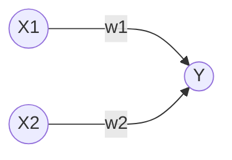
神经元会计算传送过来的信号总和,只有当这个总和超过某个界限值时(<font color="#FF00FF">阈值</font>),才会输出1,这也称为神经元被激活,用符号θ表示  

2.感知机的运行公式  
上述感知机的运行原理可以用下述公式来表示,感知机的多个输入信号都有各自固有的权重,这些权重控制着各个信号的重要性的作用,即<font color="#00FF00">权重越大对应权重的信号的重要性就越高</font>  
$$Y = \begin{cases} 
0, & w_1 x_1 + w_2 x_2 \le \theta \\ 
1, & w_1 x_1 + w_2 x_2 > \theta 
\end{cases}$$

## 1.2 感知机的实现
**目录:**  
1.2.1 简单实现  
1.2.2 导入权重和偏移量  

### 1.2.1 简单实现  
1.函数代码  
```python
import numpy as np

def AND(x1, x2):
    x = np.array([x1, x2])
    w = np.array([0.5, 0.5])
    b = -0.7
    tmp = np.sum(w*x) + b
    if tmp <= 0:
        return 0
    else:
        return 1

if __name__ == '__main__':
    for xs in [(0, 0), (1, 0), (0, 1), (1, 1)]:
        y = AND(xs[0], xs[1])
        print(str(xs) + " -> " + str(y))

# 输出结果
# (0, 0) -> 0
# (1, 0) -> 0
# (0, 1) -> 0
# (1, 1) -> 1
```
*提示:上述代码用于实现<font color="#00FF00">与门</font>的逻辑*

2.代码解释  
在函数内初始化参数w1、w2、theta,当输入的加权和超过阈值时返回1否则返回0

### 1.2.2 导入权重和偏移量  
1.修改公式  
将[[DeepLearing#11-感知机概述]]的公式变换,将其中的θ换成-b,于是就可以用下述公式来表示感知机的行为,*注意下面的公式进行了移相操作,把-b移到左边了*  
此公式中b称为偏移量,w1和w2称为权重,感知机会计算输入信号和权重的乘积,然后加上偏移量,如果值
$$Y = \begin{cases} 
0, & b + w_1 x_1 + w_2 x_2 \le 0 \\ 
1, & b + w_1 x_1 + w_2 x_2 > 0 
\end{cases}$$

2.代码示例  
```python
import numpy as np

def NAND(x1, x2):
    x = np.array([x1, x2]) #输入
    w = np.array([-0.5, -0.5]) #权重
    b = 0.7 #偏移量
    tmp = np.sum(w*x) + b
    if tmp <= 0:
        return 0
    else:
        return 1

if __name__ == '__main__':
    for xs in [(0, 0), (1, 0), (0, 1), (1, 1)]:
        y = NAND(xs[0], xs[1])
        print(str(xs) + " -> " + str(y))

# 输出结果
# (0, 0) -> 0
# (1, 0) -> 0
# (0, 1) -> 0
# (1, 1) -> 1
```
上述乘法运算,当两个数组的元素个数相同时,各个元素分别相乘即[0,1] * [0.5,0.5] = [0,0.5]  
np.sum(w*x)的意思是计算相乘后的各个元素的总和,最后再把偏移量加到这个结果之上就是上述1的公式

3.参数解释  
权重和偏移量的作用是不一样的,具体来说w1和w2是<font color="#00FF00">控制输入信号重要性的参数</font>,而<font color="#00FF00">偏移量是调整神经元被激活的容易程度的参数</font>(输出信号为1的容易度的参数)  
*举例:比如b取-0.1,则只要输入信号的加权总和超过0.1时,神经元就会被激活,但如果b为-20,则输入信号的加权总和必须超过20时,神经元才会被激活*  

4.或门的实现  
```python
import numpy as np

def OR(x1, x2):
    x = np.array([x1, x2])
    w = np.array([0.5, 0.5]) #仅权重和偏移量与AND算法不同
    b = -0.2
    tmp = np.sum(w*x) + b
    if tmp <= 0:
        return 0
    else:
        return 1

if __name__ == '__main__':
    for xs in [(0, 0), (1, 0), (0, 1), (1, 1)]:
        y = OR(xs[0], xs[1])
        print(str(xs) + " -> " + str(y))
```
*提示:与门、与非门、或门是具有相同构造的感知机,区别只在于权重参数的值*  

## 1.3 感知机的局限性  
**目录:**  
1.3.1 异或门  
1.3.2 线性和非线性  

### 1.3.1 异或门  
1.概述  
实际上用上述的感知机是无法实现异或门的,用感知机可以实现与门、或门却无法实现异或门  

2.或门公式和参数  
当权重参数(b,w1,w2)=(-0.5,1.0,1.0)时,可以满足或门的逻辑,此时感知机可以用下面公式表示,该公式表示的感知机会生成由直线-0.5+x1+x2=0分割开的两个空间,其中一个空间输出1,另一个空间输出0,公式对应的图也在下面,图中灰色区域是感知机输出0的区域  
$$Y = \begin{cases} 
0, & -0.5 + x_1 + x_2 \le 0 \\ 
1, & -0.5 + x_1 + x_2 > 0 
\end{cases}$$

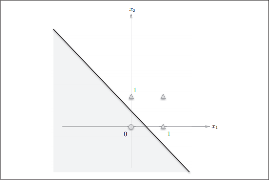  

*提示:图中只有当x1和x2在(0,0)时输出0,其余的三种情况都是输出1,如果想用感知机实现或门就需要用一条直线将图中的○和△分开,○代表0,△代表1*  

3.为什么感知机无法实现异或门  
看下图,要想用感知机实现异或门,就需要用一条直线作出分割图中○和△,但事实上无法用一条直线将○和△分开,所以感知机无法实现异或门  
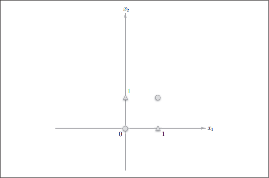  

### 1.3.2 线性和非线性  
  
上图中的○和△无法用一条直线分开,但如果将"直线"的限制去除,就可以实现了,如下图所示  
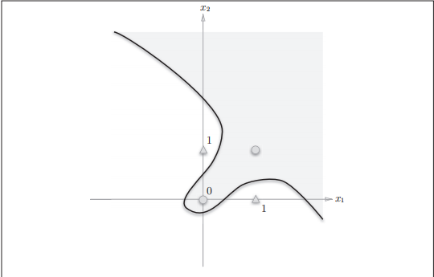  
<font color="#00FF00">感知机的局限于在于它只能表示由一条直线分割的空间</font>,而上图这种弯曲的曲线是无法用感知机表示的  
所以由曲线分割而成的空间称为<font color="#FFC800">非线性空间</font>,由直线分割而成的空间称为<font color="#FFC800">线性空间</font>

## 1.5 多层感知机  
**目录:**  
1.5.1 已有门电路的组合  
1.5.2 异或门的实现  

### 1.5.1 已有门电路的组合  
1.概述  
实际上在[[DeepLearing#13-感知机的局限性]]所提到的感知机的局限性,是单层感知机无法表示异或门  
但感知机可以相互组合,于是乎就可以通过组合感知机实现异或门(也即通过已有的或门、与门、与非门的组合来实现异或门),如下图所示  
  

### 1.5.2 异或门的实现  
1.Python代码实现异或门  
*提示:使用之前定义的AND函数、NAND函数、OR函数就可以实现*  
```python
from and_gate import AND
from or_gate import OR
from nand_gate import NAND


def XOR(x1, x2):
    s1 = NAND(x1, x2)
    s2 = OR(x1, x2)
    y = AND(s1, s2)
    return y

if __name__ == '__main__':
    for xs in [(0, 0), (1, 0), (0, 1), (1, 1)]:
        y = XOR(xs[0], xs[1])
        print(str(xs) + " -> " + str(y))
```

2.感知机表示  
现在使用感知机来表示异或门,如下图所示异或门是一种<font color="#00FF00">多层结构的神经网络</font>,此处将最左边的第一列称为第0层、中间的第一列称为第1层、最右边的第一列称为第2层  
与门、或门是单层感知机,异或门是2层感知机,叠加了多层的感知机也称为<font color="#00FF00">多层感知机</font>  
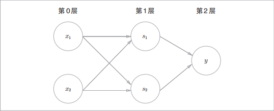  
*提示:这里称为2层感知机而不是三层的原因是,实质上拥有权重的层只有第0层和第1层,所以称为2层感知机*  
在上述的2层感知机中,先在第0层和第1层的神经元之间信号的传送和接收,然后在第1层和第2层之间进行信号的传送和接收  
<font color="#00FF00">即通过叠加层感知机能进行更加灵活的表示</font>  

# 2.神经网络  
**目录:**  
2.1 从感知机到神经网络  
2.2 激活函数  
2.3 多维数组的运算  
2.4 3层神经网络的实现(前向)  
2.5 输出层的设计  
2.6 手写数字识别  

## 2.1 从感知机到神经网络  
**目录:**  
2.1.1 神经网络的例子  
2.1.2 感知机复习  
2.1.3 激活函数  


### 2.1.1 神经网络的例子  
1.感知机的问题  
在介绍神经网络之前,先简单说明感知机存在的问题,对于感知机而言,即便是复杂的函数也可以通过感知机的叠加来实现它,但问题在于,设置感知机权重的工作(即确定合适的、能符合预期输入与输出的权重)还得依靠人工进行,在之前的章节中就是结合与门、或门的真值表人工决定了合适的权重  
<font color="#00FF00">神经网络</font>的出现就是为了解决刚才的问题,神经网络的重要性质就是它可以<font color="#00FF00">自动地从数据中学习到合适的权重参数</font>  

2.神经网络概述  
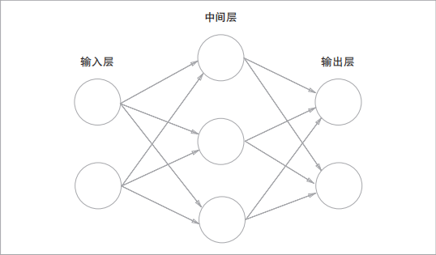  
以上图来表示神经网络,最左边的一列称为<font color="#FFC800">输入层</font>,最右边的一列称为<font color="#FFC800">输出层</font>,中间的一列称为<font color="#FFC800">中间层</font>,中间层有时也称为<font color="#FFC800">隐藏层</font>  
隐藏层的意思是,相较于输入层和输出层而言,隐藏层的神经元是不可见的,本笔记依次把输入层到输出层称为第0层、第1层、第2层  
*提示:本笔记会把图中的神经网络称为2层网络,因为其本质只有2层的神经元有权重,有些地方会把上图的网络称为三层网络*  

### 2.1.2 感知机复习  
1.感知机  
$$Y = \begin{cases} 
0, & b + w_1 x_1 + w_2 x_2 \le 0 \\ 
1, & b + w_1 x_1 + w_2 x_2 > 0 
\end{cases}$$
以之前提到的上述感知机公式为例,我们可以画出其对应的网络结构,但现在也要把偏移量b一并画在图中,这个感知机将x1、x2、1三个信号作为神经元的输入,将其各自的权重相乘并相加后得到结果,由于偏移量b的值一直是1,所以为了区分别的神经元,将其整个涂成灰色  
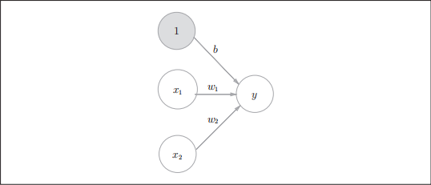  
*提示:所以偏移量b也可以算是权重,只不过它反映神经元被激活的容易程度*

2.改写公式  
将上述感知机公式简化,用一个函数来表示这种分情况的动作(超过0则输出1,否则输出0),引入新函数h(x)  
$$Y = h(b + w_1x_1 + w_2x_2)$$
$$h(x) = \begin{cases} 
0, & x \le 0 \\ 
1, & x > 0 
\end{cases}$$

式1中,输入信号的总和会被函数h(x)转换,转换后的值就是y的值  
式2中,h(x)函数,在输入超过0时输出0,否则返回1(该函数只输出0或1)

### 2.1.3 激活函数  
1.h(x)函数  
上述的h(x)函数会将输入信号的总和转为输出信号,这种函数一般称为<font color="#00FF00">激活函数</font>,激活函数的作用在于决定如何来激活输入信号的总和  

2.改写公式  
如果将Y=h(x)进一步改写,先计算输入信号的加权总和,然后用激活函数转换这一总和,此时可将该式子分解为下述的两个公式  
式1计算加权输入信号和偏移量的总和记为a,式2用h()函数将a转换为输出y  
$$a = b + w_1x_1 + w_2x_2$$  
$$y = h(a)$$  

3.激活函数的计算过程  
下图表示了上述改写后公式的样貌,图中的○明确显示了激活函数的计算过程,即信号的加权总和为节点a,然后节点a被激活函数h(x)转换为节点y  
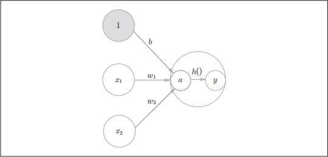  

## 2.2 激活函数  
**目录:** 
2.2.1 sigmoid函数  
2.2.2 阶跃函数的实现  
2.2.3 阶跃函数的图形  
2.2.4 sigmoid函数的实现  
2.2.5 阶跃函数和sigmoid函数  
2.2.6 非线性函数  
2.2.7 ReLU函数  

### 2.2.1 sigmoid函数  
1.概述  
$$h(x) = \begin{cases} 
0, & x \le 0 \\ 
1, & x > 0 
\end{cases}$$
上述激活函数以阈值为界,一旦输入超过阈值,就切换输出,这样的函数称为<font color="#FFC800">阶跃函数</font>,因此可以说感知机使用阶跃函数作为激活函数,那么当感知机使用别的函数作为激活函数时,此时就进入了神经网络激活函数,可以说感知机和神经网络的主要区别就是<font color="#00FF00">激活函数</font>  
本节的sigmoid函数就是要介绍的第一个神经网络激活函数  

2.sigmoid函数  
sigmoid函数表达式如下,所谓函数就是单值对应(一个输入一个输出),比如向sigmoid函数执行,h(1)=0.731、h(2)=0.880  
$$h(x) = \frac{1}{1 + e^{-x}}$$  


### 2.2.2 阶跃函数的实现  
1.阶跃函数的简单代码实现  
$$h(x) = \begin{cases} 
0, & x \le 0 \\ 
1, & x > 0 
\end{cases}$$

```python
def step_function(x):
    if x > 0:
        return 1
    else:
        return 0
```
上述阶跃函数可以被上述代码简单地实现,但是该函数的输入参数只能接受实数(浮点数),但它不允许参数取NumPy数组,所以将其修改为支持NumPy数组的实现  
```python
import numpy as np

def step_function(x):
    y = x > 0
    return y.astype(np.int)
```
*解释:x>0会返回一个布尔数组并保存在y中,显示在数组x中有多少元素的值大于0,y是一个布尔数组,但是目前要求输出的值为0或1分别表示False和True,所以再用astype转换其类型为0/1*  
*模拟:例如x = np.array([-1.0,1.0,2.0])最后输出的结果为array([0,1,1])*  

### 2.2.3 阶跃函数的图形  
1.图像代码
用图来表示[[DeepLearing#222-阶跃函数的实现]]的阶跃函数,代码如下  
```python
import numpy as np
import matplotlib.pylab as plt


def sigmoid(x):
    return 1 / (1 + np.exp(-x))    


def step_function(x):
    return np.array(x > 0, dtype=int)

# 在-5.0到5.0之间以0.1为单位,生成NumPy数组
x = np.arange(-5.0, 5.0, 0.1)
# step_function以该数组为参数,对数组的各个元素执行阶跃函数运算,并以数组形式返回运算结果,对数组x、y进行绘图
y2 = step_function(x)

plt.plot(x, y2, 'k--')
plt.ylim(-0.1, 1.1) #指定图中绘制的y轴的范围
plt.savefig("sig_step_compare.png")
```

2.图像结果  
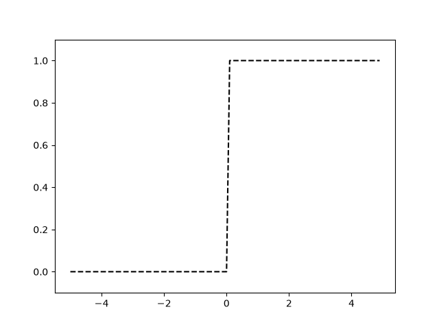  
阶跃函数以0为界限,输出从0切换到1(或者反过来),<font color="#00FF00">它的值呈阶梯式变化,所以称为阶跃函数</font>  

### 2.2.4 sigmoid函数的实现  
1.Python实现代码  
$$h(x) = \frac{1}{1 + e^{-x}}$$  
```python
def sigmoid(x):
    return 1 / (1 + np.exp(-x))    
```

2.广播
上述函数也可用于NumPy数组的计算,它的结果如下  
```python
x = np.array[(-1.0,1.0,2.0)]; # 定义数组
sigmoid(x)
# 输出结果为[(0.26894142,0.73105858,0.88079708)]
```
之所以sigmoid函数能够支持NumPy数组,原因就在于NumPy的广播功能[[../Python/Python#6543-广播]],如果在标量(一个具体的数值)和NumPy数组之间进行运算,<font color="#00FF00">则标量会和数组的各个元素进行计算</font>  

### 2.2.5 阶跃函数和sigmoid函数  
1.函数代码
```python
import numpy as np
import matplotlib.pylab as plt

def sigmoid(x):
    return 1 / (1 + np.exp(-x))    


def step_function(x):
    return np.array(x > 0, dtype=int)

x = np.arange(-5.0, 5.0, 0.1)
# 主要区别就在这里,y1是sigmoid函数的图像
y1 = sigmoid(x)
# y2是阶跃函数的图像
y2 = step_function(x)

# plot函数需要的参数是NumPy数组
plt.plot(x, y1)
plt.plot(x, y2, 'k--')
plt.ylim(-0.1, 1.1)
plt.savefig("sig_step_compare.png")
```
*提示:本代码和之前阶跃函数那边的代码类似,就是加了一个sigmoid函数的图像*

2.阶跃函数和sigmoid函数区别 
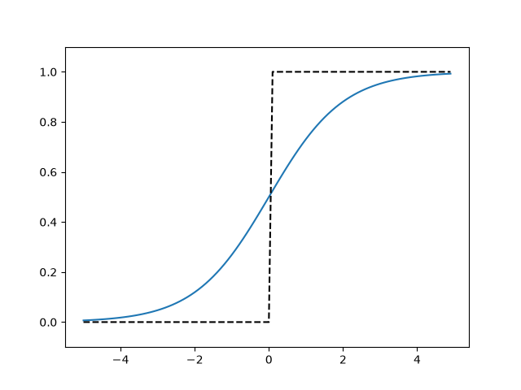   
(1) sigmoid函数是一条平滑的曲线,输出随着输入发生连续性变化,而阶跃函数以0为界,输出发生急剧性变化  
(2) 阶跃函数只能返回0和1,但是sigmoid可以返回一些列实数(0.26894142,0.73105858,0.88079708),即感知机中神经元之间流动的是二元信号,而神经网络中流动的是连续的实数信号  

3.阶跃函数和sigmoid函数共同点  
(1) 虽然两个函数在平滑性上有差异,但是如果从宏观视角看,两者的结构均为<font color="#00FF00">输入小时,输出接近0,随着输入增大,输出向1靠近</font>,换句话说,当输入信号为重要信号时,阶跃函数和sigmoid函数都会输出较大的值,当输入信号不重要时,两者都输出较小的值  
(2) 不管输入信号的大小,两者的输出信号均在0到1之间  

4.补充  
参考[[DeepLearing#326-为了要设定损失函数]]  

### 2.2.6 非线性函数  
1.非线性函数  
阶跃函数和sigmoid函数都是<font color="#00FF00">非线性函数</font>,所谓非线性函数对应的是线性函数,若函数的输出值是输入值的常数倍数就称为线性函数,所以线性函数就是一条笔直的直线,反之就是非线性函数  

2.神经网络必须使用非线性函数  
激活函数不能使用线性函数,因为使用线性函数的话,<font color="#00FF00">加深神经网络的层数就没有意义了</font>  
比如把$h(x)=cx$作为激活函数,把$y(x)=h(h(h(x)))$的运算对应三层神经网络,这个运算会进行$y(x)=c * c * c * x$的乘法运算,但是同样的处理可以用$y(x)=ax$其中$a=c^3$这一次乘法运算来表示,所以使用线性函数的时候,就无法发挥多层网络带来的优势,因此要想发挥叠加层所带来的优势,<font color="#00FF00">激活函数必须使用非线性函数</font>  


### 2.2.7 ReLU函数  
1.函数表达式
ReLU函数在输入大于0时,直接输出该值,在输入小于等于0时,输出0;函数表达式如下  
$$h(x) = \begin{cases} 
x \space (x > 0) \\ 
0 \space (x \le 0) \\ 
\end{cases}$$

2.ReLU函数的实现  
```python
def relu(x):
    # 选择输入中较大的那个值进行输出
    return np.maximum(0, x)
```
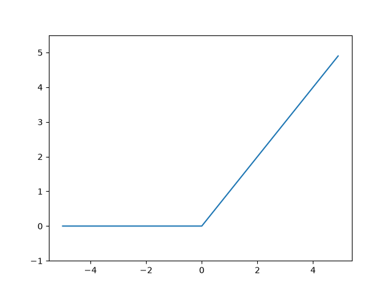  

## 2.3 多维数组的运算  
1.矩阵与神经网络  
其实用神经网络可以表示出矩阵乘法运算,如下图所示,该神经元省略了偏移量和激活函数,只有权重,例如这里的输入参数取[1,2],最终计算出的神经元就是[5,11,17]和矩阵乘法规则一模一样  
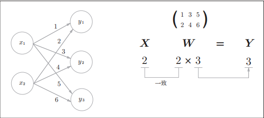  

## 2.4 3层神经网络的实现(前向)  
**目录:**  
2.4.1 概述  
2.4.2 符号确认  
2.4.3 各层间信号传递的实现  
2.4.4 代码实现小结  

### 2.4.1 概述  
本节进行神经网络的实现,以下图的三层神经网络为对象,实现从输入到输出的(前向)处理,使用NumPy数组就可以用很少的代码完成神经网络的前向处理  
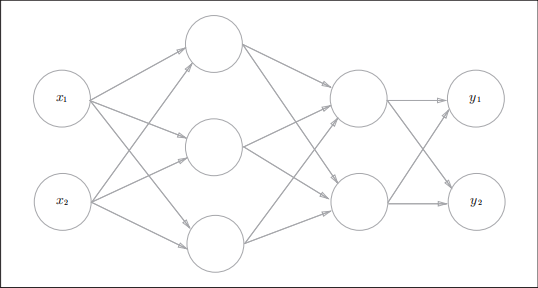  

### 2.4.2 符号确认  
1.神经元  
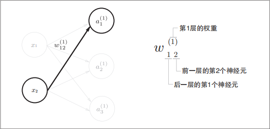  

2.解释  
上图只突出显示了从输入层神经元$x_2$到后一层的神经元$a_1^{(1)}$  
权重$w_{12}^{(1)}$和神经元$a_1^{(1)}$右上角的(1),表示权重和神经元的层号(注意这里不是2,从左往右依次是第0层、第1层)  
然后权重右下角的两个数字,指的是后一层的神经元和前一层的神经元的索引号,比如这里的12,表示前一层的第2个神经元x2和后一层的第1个神经元$a_1^{(1)}$的权重  

### 2.4.3 各层间信号传递的实现  
1.神经网络  
*提示:本节将以下述的神经网络为示例,另外图中的实心节点为偏移神经元"1",所以它右下角的索引号只有一个,表示前一层的神经元只有一个*  
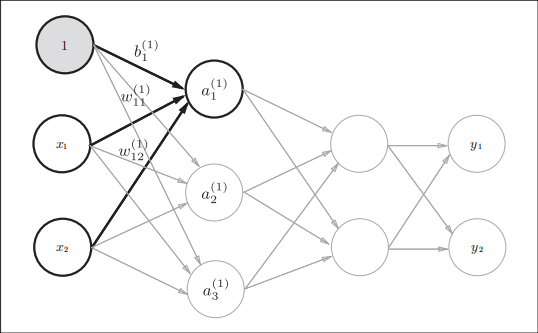  

2.输入层到第一层的信号传递  
根据[[DeepLearing#213-激活函数]]的相同计算方法,现在表示出$a_1^{(1)}$,它的计算方式为$a_1^{(1)}=w_{11}^{(1)}x_1 + w_{12}^{(1)}x_2 + b_{1}^{(1)}$  
如果使用矩阵运算的话,可以将第一层的加权和表示为$A^{(1)} = XW^{(1)} + B^{(1)}$,其中$A^{(1)}$、$X$、$B^{(1)}$、$W^{(1)}$如下所示  
$A^{(1)} = (a_1^{(1)} \quad a_2^{(1)} \quad a_3^{(1)})$,$X = (x_1 \quad x_2)$,$B^{(1)} = (b_1^{(1)} \quad b_2^{(1)} \quad b_3^{(1)})$,$W^{(1)} = \begin{pmatrix} w_{11}^{(1)} & w_{21}^{(1)} &w_{31}^{(1)} \\ w_{12}^{(1)} & w_{22}^{(1)} & w_{32}^{(1)} \end{pmatrix}$ 

接着使用NumPy数组来实现上述的式子,这里将输入信号、权重、偏移量设置为任意值  
```python
X = np.array([1.0, 0.5])
W1 = np.array([[0.1, 0.3, 0.5], [0.2, 0.4, 0.6]])
B1 = np.array([0.1, 0.2, 0.3])
print(W1.shape) # (2, 3)
print(X.shape) # (2,)
print(B1.shape) # (3,)
A1 = np.dot(X, W1) + B1
```
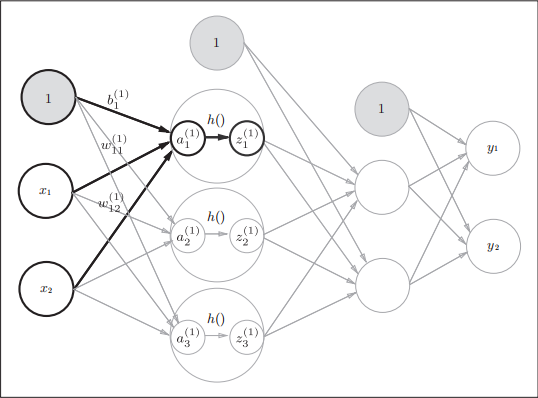  
该公式的计算过程,用上图表示,隐藏层的加权和(加权信号和偏移量的总和)用$a$表示,被激活函数转换后的信号用$z$表示,图中的$h()$表示激活函数,这里的激活函数使用的sigmoid,用Python代码实现第一层的输出  
```python
Z1 = sigmoid(A1)
print(A1) # [0.3, 0.7, 1.1]
print(Z1) # [0.57444252, 0.66818777, 0.75026011]
```

3.实现第1层到第2层信号的传递  
```python
W2 = np.array([[0.1, 0.4], [0.2, 0.5], [0.3, 0.6]])
B2 = np.array([0.1, 0.2])
print(Z1.shape) # (3,)
print(W2.shape) # (3, 2)
print(B2.shape) # (2,)
A2 = np.dot(Z1,W2) + B2
Z2 = sigmoid(A2)
```
*提示:除了第一层的输出(Z1)变成第二层的输入之外,这里的实现和刚才的代码完全相同*  

4.实现第2层到第3层信号的传递  
```python
def identity_function(x):
 return x
W3 = np.array([[0.1,0.3],[0.2,0.4]])
B3 = np.array([0.1,0.2])

A3 = np.dot(Z2,W3) + B3
Y = identity_function(A3)
```
这里定义的identity_function函数(也成为恒等函数),将其作为输出层的激活函数,输出层的激活函数会稍微不同  
*提示:输出层的激活函数要根据具体问题来确定,一般回归问题可以使用恒等函数,二元分类问题可以使用sigmoid函数,多元分类问题可以使用softmax函数*  


### 2.4.4 代码实现小结  
3层神经网络的实现原理已经理解了,现在把之前的代码规整一下,代码中的权重记作W1  
```python
def init_network():
    network = {}
    network['W1'] = np.array([[0.1, 0.3, 0.5], [0.2, 0.4, 0.6]])
    network['b1'] = np.array([0.1, 0.2, 0.3])
    network['W2'] = np.array([[0.1, 0.4], [0.2, 0.5], [0.3, 0.6]])
    network['b2'] = np.array([0.1, 0.2])
    network['W3'] = np.array([[0.1, 0.3], [0.2, 0.4]])
    network['b3'] = np.array([0.1, 0.2])

    return network
def forward(network, x):
    W1, W2, W3 = network['W1'], network['W2'], network['W3']
    b1, b2, b3 = network['b1'], network['b2'], network['b3']
    a1 = np.dot(x, W1) + b1
    z1 = sigmoid(a1)
    a2 = np.dot(z1, W2) + b2
    z2 = sigmoid(a2)
    a3 = np.dot(z2, W3) + b3
    y = identity_function(a3)

    return y
network = init_network()
x = np.array([1.0, 0.5])
y = forward(network, x)
print(y) # [ 0.31682708 0.69627909]
```
这里定义了init_network和forward函数,init_network函数进行权重和偏移量的初始化并将其保存在字典network中,network保存了每一层所需的参数(权重和偏移量),forward函数中则封装了将输入信号转换为输出信号的处理过程  
<font color="#00FF00">forward(前向)表示的是从输入到输出方向的传递处理</font>,后续进行神经网络训练时会介绍后向处理  

## 2.5 输出层的设计  
**目录:**  
2.5.1 分类问题和回归问题  
2.5.2 恒等函数和softmax函数  
2.5.3 softmax函数优化  
2.5.4 softmax函数的特征  
2.5.5 输出层的神经元数量  


### 2.5.1 分类问题和回归问题  
神经网络可以用于<font color="#00FF00">分类问题和回归问题</font>,一般而言回归问题用恒等函数,分类问题用softmax函数  
机器学习的问题大致分为分类问题和回归问题  
(1) 分类问题是数据属于哪一个类别的问题,比如区分图像是男人还是女人的问题  
(2) 回归问题是根据某个输入预测一个数值的问题(连续的数值),比如根据一个图像猜测这个人体重的问题  
*提示:本节讲的函数都只是服务于输出层的函数,和中间层不相关*  

### 2.5.2 恒等函数和softmax函数  
1.恒等函数  
恒等函数会将输入按原样输出,对于输入的信息,不加以任何改动地直接输出,因此在输出层使用恒等函数时,输入信号会原封不动地被输出  
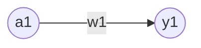

2.softmax函数  
分类问题中的softmax函数可用如下公式表示,假设输出层共有n个神经元,计算第k个神经元的输出yk,softmax函数的分子是输入信号ak的指数函数,分母是所有输入信号的指数函数的和  
$$yk = \frac{e^{a_k}}{\sum_{i=1}^{n} e^{a_i}}$$

下图可以表示softmax函数,softmax函数的输出通过箭头与所有输入信号相连,这是因为从上述式子可以看出,输出层的各个神经元都受到所有输入信号的影响  
  

3.Python代码实现  
```python
>>> a = np.array([0.3, 2.9, 4.0])
>>>
>>> exp_a = np.exp(a) # 指数函数
>>> print(exp_a)
[ 1.34985881 18.17414537 54.59815003]
>>>
>>> sum_exp_a = np.sum(exp_a) # 指数函数的和
>>> print(sum_exp_a)
74.1221542102
>>>
>>> y = exp_a / sum_exp_a
>>> print(y)
[ 0.01821127 0.24519181 0.73659691]
```
上述代码使用Python解释器来实现,这个Python实现完全是按照上节2.softmax函数的公式来的,下面把它定义为softmax函数  
```python
def softmax(a):
    exp_a = np.exp(a)
    sum_exp_a = np.sum(exp_a)
    y = exp_a / sum_exp_a
    
    return y
```

### 2.5.3 softmax函数优化  
1.数值溢出
上述的softmax函数虽然正确地描述公式,但会存在溢出缺陷,因为softmax函数的实现要进行指数函数的运算,但此时指数函数值会变得非常大,比如$e^10$值会超过20000,而$e^100$会有超过40个0的超大数值  

2.公式优化  
于是上述的经典公式可以按如下方法优化  
$$\begin{aligned}
    yk = \frac{e^{a_k}}{\sum_{i=1}^{n} e^{a_i}} &= \frac{Ce^{a_k}}{C\sum_{i=1}^{n} e^{a_i}} \\ &= \frac{e^{(a_k + logC)}}{\sum_{i=1}^{n} e^{(a_i + logC)}} \\ &= \frac{e^{(a_k + C')}}{\sum_{i=1}^{n} e^{(a_i + C')}}
\end{aligned}$$
首先在分子和分母都乘任意常数C,然后将C移动到指数函数中,记为$logC$,最后把$logC$替换为$C'$  
上述式子说明,在进行softmax的指数函数运算时,加上或减去某个常数并不会改变运算结果,这里的$C'$可以使用任何值,一般会使用输入信号中的最大值  

3.例子  
```python
>>> a = np.array([1010, 1000, 990])
>>> np.exp(a) / np.sum(np.exp(a)) # softmax 函数的运算
array([ nan, nan, nan])
# 没有被正确计算
>>> c = np.max(a) # 1010
>>> a - c
array([ 0, -10, -20])
>>>
>>> np.exp(a - c) / np.sum(np.exp(a - c))
array([9.99954600e-01, 4.53978686e-05, 2.06106005e-09])
```
正如上述例子所示,通过<font color="#00FF00">减去输入信号的最大值</font>,原本是nan的计算结果现在被正确计算了,于是乎可以像下面这样实现softmax函数  
```python
def softmax(a):
    c = np.max(a)
    exp_a = np.exp(a - c) # 溢出对策
    sum_exp_a = np.sum(exp_a)
    y = exp_a / sum_exp_a
    return y
```

### 2.5.4 softmax函数的特征  
1.softmax函数测试  
```python
>>> a = np.array([0.3, 2.9, 4.0])
>>> y = softmax(a)
>>> print(y)
[ 0.01821127 0.24519181 0.73659691]
>>> np.sum(y)
1.0
```
softmax函数的输出总是0.0到1.0之间的实数,并且softmax函数的输出值的总和是1,<font color="#FF00FF">输出总和为1是softmax函数的一个重要性质</font>,正因为有了这个性质才可以把softmax函数的输出解释为"概率"  

2.解释  
上述的例子还可以解释为y[0]的概率是0.018(1.8%),y[1]的概率是0.245(24.5%),y[2]的概率是0.737(73.3%),从概率的结果来看,可以说"因为第2个元素的概率最高,所以答案是第2个类别",还可以说"有74%的概率是第2个类别,有25%的概率是第1个类别,有1%的概率是第0个类别",即使用softmax函数,可以使用概率的方法处理问题  
另外,即便使用了softmax函数各个元素之间的大小关系也不会改变,这是因为指数函数$e^x$是单调递增函数,即数组a和数组y之间的大小关系没有改变(即数组a的值越大的元素,对应的y中的值也就越大)  

3.输出层函数  
一般而言,神经网络只把输出值最大的神经元所对应的类别作为识别结果,即使使用softmax函数,输出值最大的神经元的位置也不会改变,因此神经元在进行分类时,输出层的softmax函数可以省略,在实际问题中,由于指数函数的运算需要一定的计算机运算量,因此输出层的softmax函数一般会被省略  

4.学习和推理  
求解机器学习问题的步骤可以分为"学习"和"推理"两个阶段,在学习阶段进行模型的学习,在推理阶段用学到的模型对未知的数据进行推理(分类),推理阶段一般会省略输出层的softmax函数  


### 2.5.5 输出层的神经元数量  
输出层神经元数量需要根据待解决的问题来决定,对于分类问题输出层神经元数量一般设定为类别的数量,比如对于某个输入图像,预测图中数字是0-9中的哪一个的问题(10类别分类问题),可以将神经元设定为10个,类似下图  
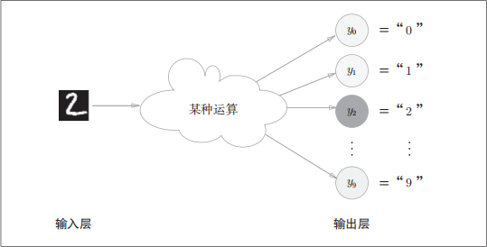  
在这个例子中,输出层的神经元从上到下依次对应数字0-9,图中输出层的神经元用不同的灰度表示,这个例子中神经元$y_2$颜色最深,输出的值最大,这表明这个神经网络预测的是$y_2$对应的类别,也就是2  

## 2.6 手写数字识别  
**目录:**  
2.6.1 MNIST数据集  
2.6.2 神经网络的推理处理  
2.6.3 批处理  


### 2.6.1 MNIST数据集  
1.概述  
MNIST数据集是知名数据集,在阅读图像或机器学习的论文时,MNIST数据集经常作为实验用的数据出现  
MNIST数据集由0到9的数字图像构成,如下图所示,训练图像有6万张,测试图像有1万张,这些图像可以用于学习和推理,MNIST数据集先用训练图像进行学习,再用学习到的模型度量能在多大程度上对测试图像进行正确分类  
  
MNIST的图像数据是28像素×28像素的灰度图像(1通道),各个像素的取值在0到255之间,每个图像数据都相应地标有7、2、1等标签  

2.文件结构  
现在的文件结构是,ch03含有mnist_show.py文件,但是该文件需要使用dataset文件夹中的mnist.py文件,所以为了在mnist_show.py文件中导入该文件,需要使用`sys.path.append(os.pardir)`代码,然后导入`dataset/mnist.py`中的`load_mnist`函数,调用该函数以读入MNIST数据集  

3.load_mnist函数  
load_mnist函数以(训练图像,训练标签),(测试图像,测试标签)的形式返回读入的MNIST数据,此外还可以像`load_mnist(normailize=True,flatten=True,one_hot_label=False)`设置三个参数  
第1个参数normalize设置是否将输入图像正规化为0.0～1.0的值,如果将该参数设置为 False,则输入图像的像素会保持原来的0～255  
第2个参数flatten设置是否展开输入图像(变成一维数组),如果将该参数设置为False,则输入图像为1×28×28的三维数组;若设置为True,则输入图像会保存为由784个元素构成的一维数组  
第3个参数one_hot_label设置是否将标签保存为one-hot表示(one-hot representation),one-hot表示是仅正确解标签为1,其余皆为0的数组,就像[0,0,1,0,0,0,0,0,0,0]这样(这是一种表示方式,数组一共10个元素,为1的是当前对应的正确解,其它的自然就为0),当one_hot_label为False时,只是像7、2这样简单保存正确解标签,当one_hot_label为True时,标签则保存为one-hot表示  
*提示:每一个图像它要对应一个标签,这个标签就是表明这个图像对应哪个数字,知识说one_hot_label这个参数的设置为影响这个<font color="#00FF00">标签的表示方式</font>*  

4.显示MNIST图像  
现在试着显示MNIST图像,同时确认一下数据,图像的显示使用PIL模块,执行下述代码后,训练图像的第一张就会显示出来  
这里需要注意的是,flatten=True时读入的图像是以一列(一维)NumPy数组的形式保存的,因此显示图像时,需要把它变为原来的28像素x28像素的形状,可以通过`reshapde()`方法的参数指定期望的形状,更改NumPy数组的形状,此外还需要把保存为NumPy数组的图像数据转换为PIL用的数据对象,这个转换处理由`Image.fromarray()`来完成  
```python
# coding: utf-8
import sys, os
sys.path.append(os.pardir)  # 为了导入父目录的文件而进行的设定
import numpy as np
from dataset.mnist import load_mnist
from PIL import Image


def img_show(img):
    pil_img = Image.fromarray(np.uint8(img))
    pil_img.show()

# (训练图像,训练标签),(测试图像,测试标签)
(x_train, t_train), (x_test, t_test) = load_mnist(flatten=True, normalize=False)

img = x_train[0]
label = t_train[0]
print(label)  # 5

print(img.shape)  # (784,)
img = img.reshape(28, 28)  # 把图像的形状变为原来的尺寸
print(img.shape)  # (28, 28)

img_show(img)
```
最终的显示效果如下  


### 2.6.2 神经网络的推理处理  
*提示:这里看不懂一定要回到[[DeepLearing#243-各层间信号传递的实现]]*  
1.神经元个数  
本节实现对MNIST数据集的神经网络<font color="#FF00FF">推理</font>处理,神经网络的输入层有784个神经元,输出层有10个神经元  
输入层的784个神经元对应图片的28*28=784个像素点,所以计算的时候实际上是把每个像素点的灰度值(0-255)传给神经元网络,输出层的10个神经元自然指代的就是0-9这10个数字  
此外神经网络有两个隐藏层,第一个隐藏层有50个神经元,第二个隐藏层有100个神经元,这个50和100可以设置为任何值

2.三个函数  
下面定义`get_data()`、`init_network()`、`predict()`三个函数  
```python
# 获取数据集,这里只返回测试集和测试集对应的标签
def get_data():
    (x_train, t_train), (x_test, t_test) = load_mnist(normalize=True, flatten=True, one_hot_label=False)
    return x_test, t_test

def init_network():
    # 读取神经网络的权重参数
    with open("sample_weight.pkl", 'rb') as f:
        network = pickle.load(f)
    return network

# 神经网络计算过程
def predict(network, x):
    W1, W2, W3 = network['W1'], network['W2'], network['W3']
    b1, b2, b3 = network['b1'], network['b2'], network['b3']

    a1 = np.dot(x, W1) + b1
    z1 = sigmoid(a1)
    a2 = np.dot(z1, W2) + b2
    z2 = sigmoid(a2)
    a3 = np.dot(z2, W3) + b3
    y = softmax(a3)

    return y
```
`init_network`函数会读取保存在`sample_weight.pkl`文件中学习到的权重参数(假设之前的学习阶段已经完成,所以学习到的参数被保存下来,在推理阶段直接使用这些参数即可)这个文件以字典变量的形式保存了权重和偏移量  
剩余的两个函数和前面介绍的代码实现基本相同,现在使用这三个函数来实现神经网络的推理处理并评价它的识别精度  

3.神经网络识别精度  
```python
x, t = get_data()
network = init_network()
accuracy_cnt = 0
for i in range(len(x)):
    y = predict(network, x[i])
    p= np.argmax(y) # 获取概率最高的元素的索引
    if p == t[i]:
        accuracy_cnt += 1

# 输出正确回答的概率
print("Accuracy:" + str(float(accuracy_cnt) / len(x)))
```
首先调用`get_data`获取MNIST数据集,再调用`init_network`生成神经网络,用`predict`进行分类,`predict`函数以NumPy数组的形式输出各个标签对应的概率,比如输出[0.1,0.3,0.2,...,0.04]的数组,该数组表示"0"的概率为0.1,"1"的概率为0.3等等,通过`argmax`函数取出概率列表中最大值的索引,作为预测结果,最后比较神经网络预测的答案和正确解的标签(t数组)将回答正确的概率作为识别精度  
执行上述代码后会输出"Accuracy:0.9352",这表示有93.5%的数据被正确分类了  

4.正规化  
在这个例子中设置`load_mnist`函数的`normalize`参数为True,设置为True之后函数内部会进行转换,将图像的各个像素点值(灰度值)除以255,使得数据的值在0.0~1.0之间浮动,想这样把数据限定到某个范围内的处理称为<font color="#FF00FF">正规化</font>  
此外对神经网络输入数据进行某种既定的转换称为<font color="#FF00FF">预处理</font>(对应的还有<font color="#00FF00">后处理</font>),这里作为对输入图像的一种预处理,我们进行了正规化  
*补充:除了像上述这种使数据整体以0为中心分布,或者进行正规化,把数据的延展控制在一定范围内的,还有将数据整体的分布形状均匀化的方法,即数据的<font color="#00FF00">白化</font>*  

### 2.6.3 批处理  
1.神经网络的形状  
使用Python的解释器,查看刚才的神经网络各层的权重形状  
```python
>>> x, _ = get_data()
>>> network = init_network()
>>> W1, W2, W3 = network['W1'], network['W2'], network['W3']
>>>
# 测试集一共10000张图片,每个图片对应784个像素
>>> x.shape
(10000, 784)
# 每个图片对应784个像素
>>> x[0].shape
(784,)
# 输入784个神经元,第一层输出50个神经元
>>> W1.shape
(784, 50)
# 输入50个神经元,第二层输出100个神经元
>>> W2.shape
(50, 100)
# 输入100个神经元,输出层输出10个神经元(对应数字0-9)
>>> W3.shape
(100, 10)
```
用图表示上述形状如下所示,多维数组对应维度的元素个数确实的一致的,从下面图像整体来看,输入一个由784个元素构成的一维数组后,输出一个由10个元素的一维数组,这是只输入一张图像的处理流程  
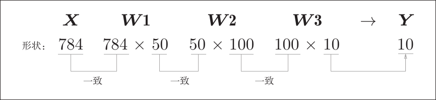  

2.输入多张图像  
现在考虑打包输入多张图像,比如用`predict`函数一次性打包100张图像,为此可以把x的形状改为100*784,将100张图像打包作为输入数据,用图表示如下  
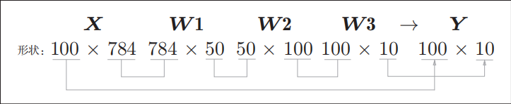  
如上图所示,输入数据的形状为100\*784,输出数据的形状为100\*10(看图中间相等取两边),这表示输入的100张图像被一次性输出了,数组x[0]和y[0]中保存了第0张图像和其推理结果,x[1]和y[1]保存的是第一张图像...  
这种打包的输入数据被称为<font color="#FF00FF">批</font>
*提示:批处理可以大幅缩短每张图片的处理时间,因为大多数都库都对大型数组运算进行了优化,总之批处理一次性计算大型数组要比分开逐步计算各个小型数组速度更快*  

3.批处理代码实现  
```python
x, t = get_data()
network = init_network()

batch_size = 100 # 批数量
accuracy_cnt = 0

# 步长为100从
for i in range(0, len(x), batch_size):
    # 每次从测试集中取100张图像,根据索引抽取
    x_batch = x[i:i+batch_size]
    # 得到对应的图像识别批处理结果
    y_batch = predict(network, x_batch)
    # 获取最大元素的索引值(批处理)
    p = np.argmax(y_batch, axis=1)
    # 比对并记录
    accuracy_cnt += np.sum(p == t[i:i+batch_size])

print("Accuracy:" + str(float(accuracy_cnt) / len(x)))
```

4.argmax()函数解释
上述argmax()函数的参数axis=1表明,在最终输出的100\*10的二维矩阵中,沿着第一维度方向找到值最大的元素索引值(第0维是按列方向,第1维是按行方向,也就是说如果是第1维就从一行上找出最大的元素的索引值,在100\*10的矩阵中一行正好10个元素)  
可以看下面这个例子  
```python
>>> x = np.array([[0.1, 0.8, 0.1], [0.3, 0.1, 0.6],
...
 [0.2, 0.5, 0.3], [0.8, 0.1, 0.1]])
>>> y = np.argmax(x, axis=1)
>>> print(y)
[1 2 1 0]
```

5.结果比较并统计  
最后比较以批为单位进行分类的结果和实际的答案,为此需要在NumPy数组之间使用`==`生成由True/False构成的布尔型数组,并计算True的个数  
```python
>>> y = np.array([1, 2, 1, 0])
>>> t = np.array([1, 2, 0, 0])
>>> print(y==t)
[True True False True]
>>> np.sum(y==t)
3
```

# 3.神经网络的学习  
**目录:**  
3.1 从数据中学习  
3.2 损失函数  
3.3 导数  
3.4 梯度  
3.5 学习算法的实现  

## 3.1 从数据中学习  
**目录:**  
3.1.1 概述  
3.1.2 数据驱动  
3.1.3 训练数据和测试数据  

### 3.1.1 概述  
1.概述  
本章所说的<font color="#00FF00">学习</font>是指从训练数据中<font color="#FF00FF">自动获取最优权重参数的过程</font>,为了使神经网络能够学习,将导入<font color="#00FF00">损失函数这一指标,而学习的目的就是以该损失函数为基准,找出能使它的值达到最小的权重参数</font>  

2.感知机  
在之前的感知机学习中,对照真值表人工设定了参数的值,但那个时候的参数只有3个,而在实际的神经网络中,参数的数量成千上万,在深度学习中参数的数量甚至可以上亿(现在的大模型亿级已经是入门了),所以这些参数是不可能人工确定的  

3.线性可分问题  
对于线性可分问题,感知机是可以利用数据自动学习的,根据"感知机收敛定理",通过有限次数的学习,线性可分问题是可解的;但是,非线性可分问题则无法通过(自动)学习来解决  

### 3.1.2 数据驱动  
1.人类学习和机器学习的区别  
人类给出某个问题的解决办法时,一般会以自已的经验和直觉为线索,通过反复试验推动工作,而机器学习的方法则避免人为介入,<font color="#00FF00">尝试从收集到的数据中发现答案</font>,神经网络或深度学习则比以往的机器学习更能避免人为介入  
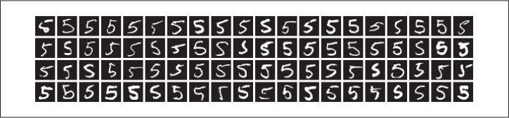  
比如识别数字5的算法,如果让我们自已来设计一个能将5正确分类的程序,就会意外发现这是一个很难的任务,人类可以简单地识别出5,但是却很难描述出这背后的算法,此外如上图所示每个人都有不同的书写习惯,要发现其中的规律也是很难的一件事  

2.特征量  
为此可以考虑通过有效利用数据来解决这个问题,一种方案是,先从图像中提取<font color="#FF00FF">特征量</font>,再用机器学习技术学习这些特征量的模式
特征量<font color="#00FF00">是指可以从输入数据(输入图像)中准确地提取本质数据(重要的数据)的转换器</font>  
图像的特征量通常表示为向量的形式,在计算机视觉领域,常用的特征量包括SIFT、SURF和HOG等,使用这些特征量将图像数据转换为向量,然后对转换后的向量使用机器学习中的SVM、KNN等分类器进行学习  

机器学习的方法中,由机器从收集到的数据中找出规律性,与从零开始想出算法相比,这种方法可以更高效地解决问题,也能减轻人的负担,但是需要注意的是,将图像转换为向量时使用的<font color="#00FF00">特征量仍是由人设计的</font>,对于不同的问题,必须使用合适的特征量(必须设计专门的特征量),才能得到好的结果  
*比如,为了区分狗的脸部,人们需要考虑与用于识别5的特征量不同的其他特征量,也就是说,即使使用特征量和机器学习的方法,也需要针对不同的问题人工考虑合适的特征量*  

3.机器学习的方法  
现在已经介绍了两种针对机器学习任务的方法,可以用下图来表示,此外图中还展示了深度学习的方法,在第二个方法中(利用特征向量和机器学习的方法),特征向量仍是由人工设计,而在神经网络中,<font color="#00FF00">连图像中包含的重要特征量也都是由机器来学习的</font>
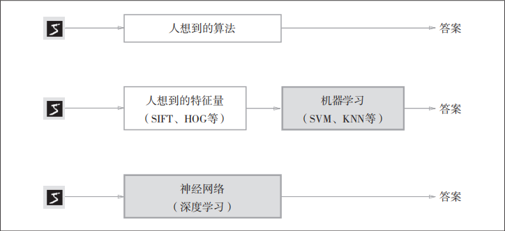  

4.深度学习  
深度学习有时也称为<font color="#FF00FF">端到端学习</font>,端到端的意思就是从一端到另一端的意思,即从原始数据(输入)中获得目标结果(输出)的意思  
神经网络的优点是对所有的问题都<font color="#00FF00">可以用同样的流程来解决</font>,不管要求解的问题是识别5,还是识别狗、人脸,神经网络都是通过不断地学习所提供的数据,尝试发现待求解的问题的模式,也就是说,<font color="#00FF00">与待处理的问题无关</font>,神经网络可以将数据直接作为原始数据,进行端对端的学  

### 3.1.3 训练数据和测试数据  
1.训练数据和测试数据  
机器学习中,一般将数据分为<font color="#00FF00">训练数据和测试数据</font>两部分来进行学习和实验等,首先使用训练数据进行学习,寻找最优的参数;然后,使用测试数据评价训练得到的模型的实际能力  
目的就是用来提升模型的<font color="#00FF00">泛化能力</font>,避免<font color="#FF00FF">过拟合</font>等问题,此外训练数据也可以称为<font color="#00FF00">监督数据</font>  

2.泛化能力  
泛化能力是指处理未被观察过的数据(不包含在训练数据中的数据)的能力,获得泛化能力是机器学习的最终目标,在识别手写数字的问题中,泛化能力可能会被用在自动读取明信片的邮政编码的系统上,此时手写数字识别就必须具备较高的识别"任意一个人写的任意文字"写的字的能力,如果系统只能正确识别已有的训练数据,那有可能是只学习到了训练数据中的个人的习惯写法  

## 3.2 损失函数  
**目录:**  
3.2.1 概述  
3.2.2 均方误差  
3.2.3 交叉熵误差  
3.2.4 mini-batch学习  
3.2.5 mini-batch交叉熵误差实现  
3.2.6 为了要设定损失函数  


### 3.2.1 概述  
神经网络以某个指标为线索寻找最优权重参数,神经网络的学习中所用的指标称为<font color="#FF00FF">损失函数</font>,这个损失函数可以用任意函数,但一般用均方误差和交叉熵误差等  
损失函数是表示神经网络性能的<font color="#00FF00">恶劣程度</font>的指标,即当前神经网络对监督数据(训练数据)在多大程度上<font color="#FF0000">不</font>拟合,在多大程度上<font color="#FF0000">不</font>一致  

### 3.2.2 均方误差  
1.均方误差公式
$$E = \frac{1}{2} \sum_{k} (y_k - t_k)^2$$
*这里$y_k$表示神经网络输出,$t_k$表示监督数据,$k$表示数据的维度*    
*提示:均方误差是最经典的损失函数*

2.手写识别的例子  
在[[DeepLearing#262-神经网络的推理处理]]的例子中$y_k$、$t_k$是由如下10个元素构成的数据  
```python
>>> y = [0.1, 0.05, 0.6, 0.0, 0.05, 0.1, 0.0, 0.1, 0.0, 0.0]
>>> t = [0, 0, 1, 0, 0, 0, 0, 0, 0, 0]
```
数组元素的索引从第一个开始依次对应数字0,1,...9,这里神经网络y的输出是softmax函数的输出,softmax(参考[[DeepLearing#25-输出层的设计]])函数的输出是以概率进行输出的
t是监督数据,将正确解标签设为1,其他均设为0,这里标签2为1表示正确解是2,将正确解标签表示为1,其他标签表示为0的表示方法称为one-hot表示(之前已经提到过[[DeepLearing#261-mnist数据集]])  

3.代码实现均方误差公式  
```python
def mean_squared_error(y, t):
    return 0.5 * np.sum((y-t)**2)
```
上述代码的y和t对应公式中的y和t,现在使用该函数实际进行计算  
```python
>>> # 设2为正确解
>>> t = [0, 0, 1, 0, 0, 0, 0, 0, 0, 0]
>>>
>>> # 例1 2的概率最高的情况(0.6)
>>> y = [0.1, 0.05, 0.6, 0.0, 0.05, 0.1, 0.0, 0.1, 0.0, 0.0]
>>> mean_squared_error(np.array(y), np.array(t))
0.097500000000000031
>>>
>>> # 例2 7的概率最高的情况(0.6)
>>> y = [0.1, 0.05, 0.1, 0.0, 0.05, 0.1, 0.0, 0.6, 0.0, 0.0]
>>> mean_squared_error(np.array(y), np.array(t))
0.59750000000000003
```
上述例子表明,正确解为2,第一个例子神经网络输出的最大值为2,第二个例子神经网络输出的最大值为7,也即第一个例子的损失函数值更小和监督数据之间的误差更小

### 3.2.3 交叉熵误差  
1.交叉熵公式  
$$E = -\sum_{k} t_k \log y_k$$  
*提示:上述式子$\log$表示的是以e为底的自然对数$\log_e$,$y_k$是神经网络的输出,$t_k$是正确解标签*  

2.例子  
因为$t_k$中只有正确解标签的索引为1,其他均为0(one-hot表示),所以上述式子<font color="#00FF00">只计算对应正确解标签的输出的自然对数</font>,交叉熵误差的值是由正确解标签所对应的输出结果决定的
*例子:比如正确解标签的索引为2,与之对应的神经网络输出是0.6则交叉熵误差为$-\log^{0.6} = 0.51$,若对应的神经网络输出为0.1,则则交叉熵误差为$-\log^{0.1} = 2.30$,*  
所以由这个例子就可以看出,如果正确解标签对应的输出越大,其值(交叉熵误差)就越接近0,反之正确解标签对应的输出越小,其值(交叉熵误差)就越接近1,<font color="#00FF00">实际上就是$\log_e$函数的图像曲线</font>  

3.代码实现交叉熵误差公式  
```python
def cross_entropy_error(y, t):
    delta = 1e-7
    return -np.sum(t * np.log(y + delta))
```
*注意:函数内部在计算np.log时,加上了一个微小值delta,因为当出现np.log(0)的时候会变为负无限大的-inf,这会导致后续计算无法进行,所以才添加一个微小值*  
下面使用`cross_entropy_error(y,t)`函数进行简单的计算,效果和之前的例子是一样的  
```python
>>> t = [0, 0, 1, 0, 0, 0, 0, 0, 0, 0]
>>> y = [0.1, 0.05, 0.6, 0.0, 0.05, 0.1, 0.0, 0.1, 0.0, 0.0]
>>> cross_entropy_error(np.array(y), np.array(t))
0.51082545709933802
>>>
>>> y = [0.1, 0.05, 0.1, 0.0, 0.05, 0.1, 0.0, 0.6, 0.0, 0.0]
>>> cross_entropy_error(np.array(y), np.array(t))
2.3025840929945458
```

### 3.2.4 mini-batch学习  
1.概述  
之前考虑的都是针对单个数据的损失函数,但严格来说损失函数就是针对训练数据计算值并找出使得该值尽可能小的参数,因此计算损失函数时必须将所有训练数据作为对象,若要求所有训练数据的损失函数总和,就要将式子写成下面这样(以交叉熵误差为例)  
$$E = -\frac{1}{N} \sum_{n} \sum_{k} t_{nk} \log y_{nk}$$  
*解释:假设有N个数据,$t_{nk}$表示第$n$个数据的第$k$个元素的值,$y_{nk}$是神经网络的输出,$t_{nk}$是训练数据,其实和之前是一样的*  

上述式子其实只是把求单个数据的损失函数的式子扩大到了N份数据,不过最后还要除以N进行正规化,通过除以N,可以求单个数据的<font color="#00FF00">平均损失函数</font>,通过这样的平均化,<font color="#FF00FF">可以获得和训练数据的数量无关的统一指标</font>  

2.mini-batch学习  
MINIST数据集的训练数据有60000个,如果以全部数据为对象求损失函数的和,则计算过程需要花费较长的时间,特别是遇到一些数据量达到几百万、几千万的,就很难计算也不现实,因此从全部数据中选取一部分作为全部数据的<font color="#00FF00">近似</font>,神经网络的学习也是从训练数据中选出一部分,然后对每个mini-batch进行学习,这种学习方式就是<font color="#FF00FF">mini-batch学习</font>  

3.代码实现选取随机训练数据  
```python
# 获取数据集
(x_train, t_train), (x_test, t_test) = load_mnist(flatten=True, normalize=False)
# 获取训练数据总量为60000
train_size = x_train.shape[0]
batch_size = 10
# 从0-59999从随机取10个数字
batch_mask = np.random.choice(train_size, batch_size)
x_batch = x_train[batch_mask]
t_batch = t_train[batch_mask]
```
之后只需指定这些随机选出的索引,取出mini-batch然后使用这个mini-batch计算损失函数即可  

### 3.2.5 mini-batch交叉熵误差实现  
1.实现mini-batch交叉熵误差函数  
*提示:根据之前对单个数据的交叉熵误差进行修改,下面的代码可以同时处理单个数据和批量数据*  
```python
def cross_entropy_error(y, t):
    if y.ndim == 1:
        t = t.reshape(1, t.size)
        y = y.reshape(1, y.size)
    # y.shape[0]是这一批batch有多少个数据,y.shape[1]固定为784
    batch_size = y.shape[0]
    return -np.sum(t * np.log(y + 1e-7)) / batch_size
```
y是神经网络的输出,t是训练数据,y的维度为1时,即求单个数据的交叉熵误差时,需要改变数据的形状,并且当输入为mini-batch的时候,要用batch的个数进行正规化,计算单个数据的平均交叉熵误差  

2.标签模式(非one-hot表示)  
*提示:当训练数据是标签形式(非one-hot表示时,像是2、7这样的标签时),交叉熵误差可以通过下面的代码实现*  
```python
def cross_entropy_error(y, t):
    if y.ndim == 1:
        t = t.reshape(1, t.size)
        y = y.reshape(1, y.size)
    batch_size = y.shape[0]
    return -np.sum(np.log(y[np.arange(batch_size), t] + 1e-7)) / batch_size
```
首先`np.arange(batch_size)`会生成一个从0到batch_size-1的数组,比如当batch_size为5的时候,会生成`[0,1,2,3,4]`,此时t中的标签是以`[2,7,0,9,4]`的形式存储的,所以y[np.arange(batch_size),t]能抽出各个数据的正确解标签对应的神经网络的输出,在这个例子中会生成[y[0,2], y[1,7], y[2,0],y[3,9], y[4,4]]  
进一步解释,最后的y一定是一个二维数组,大小是batch_size*10,其中batch_size表示这批图像有多少个,10就是神经网络识别图片对应每个数字的概率,所以y[0,2]表示的意思是,神经网络对第0个图像最终预测其结果为2的概率是多少,其实就是$\log y_k$中的$y_k$的值,这里是<font color="#00FF00">直接提取</font>不需要像之前那样再挨个乘了  

### 3.2.6 为了要设定损失函数  
1.为什么要设定损失函数  
在神经网络中,寻找最优参数(权重和偏移量时),要寻找使得损失函数最小的值的参数,此时就需要计算参数的导数,然后以这个导数为参考,逐步更新参数的值  
假设现在有一个神经网络,现在只关注这个神经网络中某一个权重参数值,此时对该权重参数的损失函数求导,表示的是<font color="#00FF00">如果稍微改变这个权 重参数的值,损失函数的值会如何变化</font>,如果导数值为负,通过使该权重参数向X轴正方向改变,可以减小损失函数的值;反过来,如果导数的值为正,过使该权重参数向X轴负方向改变,可以减小损失函数的值;当导数的值为0时,无论权重参数向哪个方向变化,损失函数的值都不会改变,此时该权重参数的更新会停在此处  
所以不使用识别精度作为神经网络的指标,是<font color="#00FF00">因为如果以识别精度为指标,则参数的导数在绝大多数地方都会变为0</font>  

2.识别精度  
简单来说不能用识别精度作为指标的原因是,如果以识别精度为指标,即使稍微改变权重的值,识别精度也不会有太大的改变,即便识别精度有所改善,它的值也不会像32.0123%这样连续变化,而是变为33%、34%这种不连续的、离散的值  
如果把损失函数作为指标,则当前损失函数的值可以表示为0.92543...这样的值,如果稍微改变参数的值,对应的损失函数也会发生连续变化  

3.阶跃函数  
<font color="#00FF00">识别精度对微小的参数变化基本上没有什么反应,即便有反应,它的值也是不连续地、突然地变化</font>,作为激活函数的阶跃函数也有同样的问题,因为阶跃函数的导数在绝大多数地方均为0,此时神经网络将无法学习,如果使用了阶跃函数,那么即便将损失函数作为指标,参数的微小变化也会被阶跃函数抹杀,导致损失函数的值不会产生任何变化  

4.sigmoid函数  
相比之下sigmoid函数不仅函数的输出是连续变化的,而且曲线的斜率(导数)也是连续变化的,<font color="#FF00FF">即sigmoid函数的导数在任何地方都不为0</font>  

## 3.3 导数  
**目录:**  
3.3.1 导数  
3.3.2 数值微分的例子  
3.3.3 偏导数  


### 3.3.1 导数  
1.概述  
本笔记不过多赘述导数相关知识,本章节主要讲解Python实现导数(为梯度下降铺垫),首先看导数定义式  
$$\frac{df(x)}{dx} = \lim_{\Delta x \to 0} \frac{f(x + \Delta x) - f(x)}{\Delta x}$$  

2.数值微分的初步实现  
```python
# 不好的实现示例
def numerical_diff(f, x):
    h = 10e-50
return (f(x+h) - f(x)) / h
```
*提示:上述代码的h相当于公式中的$\Delta x$*  
上述这种直接带值求解微分的方法称为<font color="#FF00FF">数值微分</font>,这个函数有两处需要改进  

2.1 舍入误差  
在上述的实现中,为了把尽可能小的值赋值给h(让h无限接近0),所以使用了10e-50,但是这样反而产生了<font color="#FF00FF">舍入误差</font>,所谓舍入误差即因省略小数的精细部分的数值而最终造成计算结果上的误差,比如在Python中舍入误差可如下表示,可以看到如果用float32来表示1e-50就会变成0.0,无法正确表示出来,所以第一个改进点就是将微小值h改为$10^{-4}$  
```python
>>> np.float32(1e-50)
0.0
```

2.2 中心差分  
上述实现中计算的导数对应的是$x+h$和$x$之间的斜率,因为不可能真的把$h$取得像$\Delta x$那般无限接近0,故真正的导数(真的切线)和上述实现中得到的导数值在严格意义上并不一致  
为了减小这个误差,可以计算函数$f$在$(x+h)$和$(x-h)$之间的差分,因为这种计算方法以$x$为中心,计算它左右两边的差分,所以也称为<font color="#FF00FF">中心差分</font>((x+h)和x之间的差分称为<font color="#00FF00">前向差分</font>)  

3.优化后的数值微分  
```python
# 参数1为函数 参数2为求函数f在x处的导数值
def numerical_diff(f, x):
    h = 1e-4 # 0.0001
    return (f(x+h) - f(x-h)) / (2*h)
```

### 3.3.2 数值微分的例子  
1.背景  
本节要求导的函数为$y=0.01x^2 + 0.1x$用Python实现的代码为  
```python
def function_1(x):
    return 0.01*x**2 + 0.1*x
```

2.绘制上述函数对应的图像曲线  
*提示:绘制的Python代码省略*  
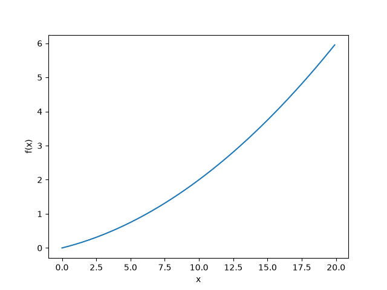  

3.计算函数导数  
现在计算函数在$x=5$和$x=10$处的导数  
```python
>>> numerical_diff(function_1, 5)
0.1999999999990898
>>> numerical_diff(function_1, 10)
0.2999999999986347
```
$f(x)=0.01x^2 + 0.1x$的解析解(对应的是数值解)是$\frac{df(x)}{dx} = 0.02x + 0.1$,因此在x=5和x=10处,真正的导数分别为0.2和0.3,和上面的数值微分的结果相比,虽然严格意义上内容不一致,但其实误差非常小,基本上可以认同它们是相等的  

4.函数和其对应切线  
使用上述的数值微分值作为斜率,画一条直线图像如下,可以确认这些直线确实对应函数的切线  
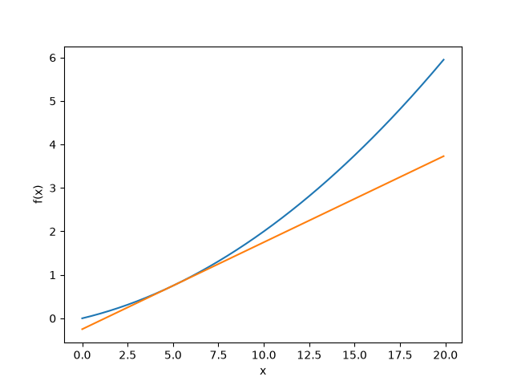  

### 3.3.3 偏导数  
1.背景  
本节要求偏导的函数为$f(x_0,x_1) = x_0^2 + x_1^2$,该公式有两个变量,用Python实现的代码为  
```python
def function_2(x):
    return x[0]**2 + x[1]**2
# 或者 return np.sum(x**2)
```
上述二元函数的图像为  
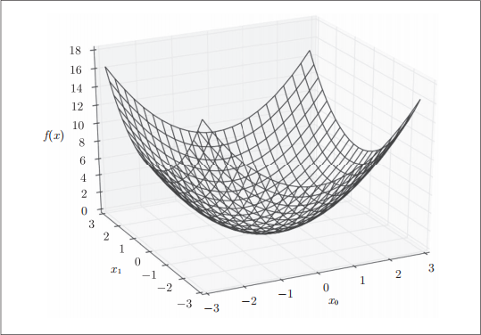  

2.求偏导数示例  
当$x_0=3,x_1=4$时,关于$x_0$的偏导数$\frac{\partial f}{\partial x_0}$  
```python
>>> def function_tmp1(x0):
...
 return x0*x0 + 4.0**2.0
...
>>> numerical_diff(function_tmp1, 3.0)
6.00000000000378
```
*提示:求偏导数的时一定是先固定一个变量,在此基础上再求另外一个变量在某点处的导数*  

## 3.4 梯度  
**目录:**  
3.4.1 概述  
3.4.2 梯度法  
3.4.3 神经网络的梯度  
3.4.4 神经网络的梯度  

### 3.4.1 概述  
1.梯度  
在之前的例子中,当时是固定了某个变量然后算另一个变量在某处的导数,现在希望求$x_0=3,x_1=4$时$(x_0,x_1)$的偏导数$(\frac{\partial f}{\partial x_0},\frac{\partial f}{\partial x_1})$,另外像$(\frac{\partial f}{\partial x_0},\frac{\partial f}{\partial x_1})$这样的由<font color="#FF00FF">全部变量的偏导数</font>(类似偏导函数)汇总而成的向量称为<font color="#FF00FF">梯度</font>  

2.梯度实现代码  
```python
def numerical_gradient(f, x):
    h = 1e-4 # 0.0001
    grad = np.zeros_like(x) # 生成和 x 形状相同的数组
for idx in range(x.size):
    tmp_val = x[idx]
    # f(x+h) 的计算,直接对整个数组的所有元素操作
    x[idx] = tmp_val + h
    fxh1 = f(x)
    # f(x-h) 的计算
    x[idx] = tmp_val - h
    fxh2 = f(x)
    # 中心差分法
    grad[idx] = (fxh1 - fxh2) / (2*h)
    x[idx] = tmp_val # 还原值
return grad

# 这里已经不是二元函数了
def function_2(x):
    if x.ndim == 1:
        return np.sum(x**2)
    else:
        return np.sum(x**2, axis=1)
```
这里用该函数实际计算一下梯度,如此就可以计算$(x_0,x_1)$在各点处的梯度,上例中点(3,4)处的梯度是(6,8)  
```python
>>> numerical_gradient(function_2, np.array([3.0, 4.0]))
array([ 6., 8.])A
>>> numerical_gradient(function_2, np.array([0.0, 2.0]))
array([ 0., 4.])
>>> numerical_gradient(function_2, np.array([3.0, 0.0]))
array([ 6., 0.])
```
*提示:关于`numerical_gradient`这个函数重点强调一下,其中的x.size这个方法,就是数组的大小,比如上述np.array([3.0, 4.0])的例子,它返回的就是2,所以说这个方法并不是一次性求,而是<font color="#00FF00">分别求每个点的偏导数</font>,而且为什么function_2变成一元函数了,因为在当前的这个二元函数中,求任意一个变量的导数另外一个变量都视为常数,所以另外一个变量在本例中不产生任何作用*

3.梯度图像  
为了更好地理解,这里把$f(x_0 + x_1) = x_0^2 + x_1^2$画在图上,不过这里画的是<font color="#00FF00">元素值为负梯度的向量</font>  
如图所示,梯度呈现为有向向量,梯度指向函数$f(x_0,x_1)$的最低处(即最小值处),而且离最低处越远,箭头越大  
梯度实际指向的是<font color="#00FF00">各点处的函数值降低的方向</font>,<font color="#FF00FF">梯度指向的方向是各点处的函数值减小最多的方向</font>
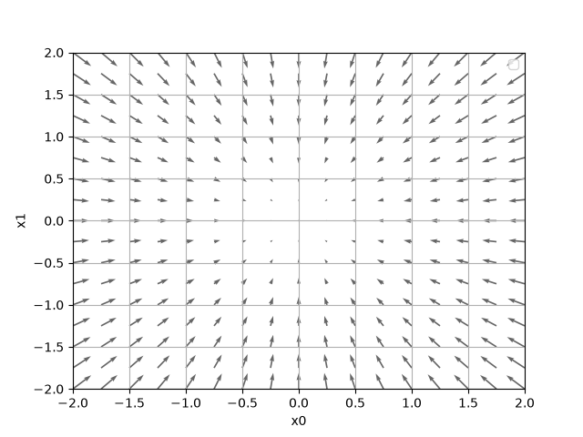  
```python
import numpy as np
import matplotlib.pylab as plt
from mpl_toolkits.mplot3d import Axes3D

def _numerical_gradient_no_batch(f, x):
    h = 1e-4 # 0.0001
    grad = np.zeros_like(x)
    
    for idx in range(x.size):
        tmp_val = x[idx]
        x[idx] = float(tmp_val) + h
        fxh1 = f(x) # f(x+h)
        
        x[idx] = tmp_val - h 
        fxh2 = f(x) # f(x-h)
        grad[idx] = (fxh1 - fxh2) / (2*h)
        
        x[idx] = tmp_val # 还原值
        
    return grad

def numerical_gradient(f, X):
    if X.ndim == 1:
        return _numerical_gradient_no_batch(f, X)
    else:
        grad = np.zeros_like(X)
        
        for idx, x in enumerate(X):
            grad[idx] = _numerical_gradient_no_batch(f, x)
        
        return grad

def function_2(x):
    if x.ndim == 1:
        return np.sum(x**2)
    else:
        return np.sum(x**2, axis=1)

def tangent_line(f, x):
    d = numerical_gradient(f, x)
    print(d)
    y = f(x) - d*x
    return lambda t: d*t + y
     
if __name__ == '__main__':
    # 步长和范围
    x0 = np.arange(-2, 2.5, 0.25)
    x1 = np.arange(-2, 2.5, 0.25)
    X, Y = np.meshgrid(x0, x1)
    
    X = X.flatten()
    Y = Y.flatten()
    
    grad = numerical_gradient(function_2, np.array([X, Y]).T)
    
    plt.figure()
    plt.quiver(X, Y, -grad[:, 0], -grad[:, 1],  angles="xy", color="#666666")#,headwidth=10,scale=40,color="#444444")
    plt.xlim([-2, 2])
    plt.ylim([-2, 2])
    plt.xlabel('x0')
    plt.ylabel('x1')
    plt.grid()
    plt.legend()
    plt.draw()
    plt.show()
```

### 3.4.2 梯度法  
1.梯度法概述  
神经网络的学习目标是找到最优参数,即找到使损失函数取最小值时的函数,但是一般而言损失函数很复杂,很难知道它在何时取最小值,而通过梯度来寻找函数最小值的方法就是<font color="#FF00FF">梯度法</font>  
注意,梯度表示的是各点处的函数值减小最多的方向,因此无法保证梯度所指的方向就是函数的最小值或者真正应该前进的方向(这个在机器学习中也有提到过)  

函数的极小值、最小值和<font color="#FFC800">鞍点</font>处的梯度为0,鞍点是从某个方向上看是极大值,从另一个方向上看是极小值的点,虽然梯度法要寻找梯度为0的地方,但是那个地方不一定就是最小值(也有可能是极小值或鞍点),此外当函数很复杂且呈现扁平状的时候,学习可能会进入一个几乎平坦的地区,陷入一个称为<font color="#FFC800">学习高原</font>的无法前进的停滞期  

虽然梯度的方向并不一定指向最小值,但沿着它的方向能够最大限度地减小函数的值。因此,在寻找函数的最小值(或者尽可能小的值)的位置的任务中,要以梯度的信息为线索,决定前进的方向  

在梯度法中,函数的取值从当前位置沿着梯度方向前进一定距离,然后在新的地方重新求梯度,再沿着新梯度方向前进,如此反复,不断地沿梯度方向前进,像这样,通过不断地沿梯度方向前进,逐渐减小函数值的过程就是<font color="#FF00FF">梯度法</font>  

2.梯度法表示  
$$\begin{aligned}
x_0 &= x_0 - \eta \frac{\partial f}{\partial x_0} \\
x_1 &= x_1 - \eta \frac{\partial f}{\partial x_1}
\end{aligned}$$
上述式子中$\eta$表示更新量即<font color="#FF00FF">学习率</font>(参考机器学习的知识点),学习率就是学习的效率,即在一次学习中应该多大程度上更新参数  
上述式子表示更新一次,实际上这个步骤会反复执行,通过反复执行该函数最终减小函数的值  
*提示:当前学习率的确定是有说法的,暂且不表*  

3.梯度法的实现  
```python
def gradient_descent(f, init_x, lr=0.01, step_num=100):
    x = init_x
for i in range(step_num):
    grad = numerical_gradient(f, x)
    x -= lr * grad
return x
```
*解释:f是目标函数,init_x是初始值,lr是学习率,step_num是梯度法的重复次数,`gradient_descent()`函数用来求函数的梯度,用该梯度乘以学习率得到的值进行更新操作*  
使用这个函数可以求函数的极小值,甚至是最小值;这个函数实际上很刁的,如果函数在该点处的导数为正,则函数值会减小向X轴负半轴运动,如果函数在该点处的导数为负,则函数值会增大向X轴整半轴运动;所以该函数总是往<font color="#FF00FF">沟里走</font>  

4.使用梯度法求最小值  
*问题:使用梯度法求$f(x_0+x_1) = x_0^2+x_1^2$的最小值*  
```python
>>> def function_2(x):
    return x[0]**2 + x[1]**2
>>> init_x = np.array([-3.0, 4.0])
>>> gradient_descent(function_2, init_x=init_x, lr=0.1, step_num=100)
array([-6.11110793e-10, 8.14814391e-10])
```
这里的初始值为(3,4),使用梯度法寻找最小值最终的结果为(-6.1e-10,8.1e-10)非常接近真实最小值(0,0),所以使用梯度法基本上得到了正确结果,用图表示其更新过程如下所示  
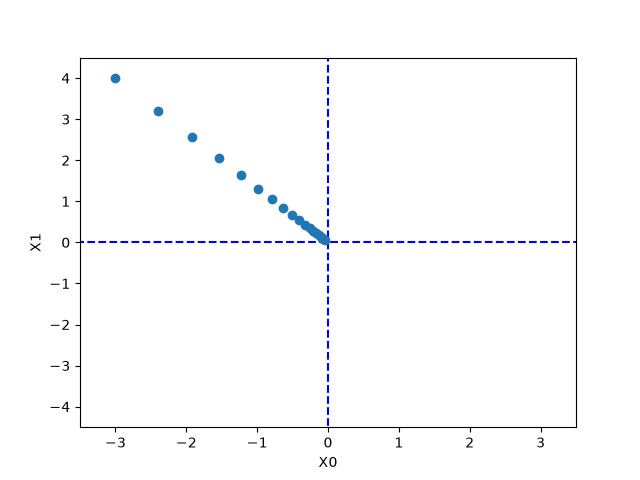  

5.超参数  
像学习率这样的参数称为<font color="#00FF00">超参数</font>,这是一种和神经网络参数性质不同的参数,神经网络参数是通过训练数据和学习算法自动获得的,学习率这样的<font color="#00FF00">超参数是人工设定的</font>  

### 3.4.3 神经网络的梯度  
1.梯度的目的  
现在来到神经网络梯度了,神经网络的梯度就是损失函数关于权重参数的梯度(偏导数),其实谁关于谁可以理解为,比如之前二次函数通过改变参数X最终将函数指减少,你通过改变谁来最终让谁减少,<font color="#FF00FF">通过改变权重最终让损失函数减少</font>  

2.神经网络的梯度公式  
例如有一个2*3的权重W的神经网络,损失函数用L表示,此时梯度可以用$\frac {\partial L}{\partial W}$表示,数学表示如下  
$$W = \begin{pmatrix} w_{11} & w_{21} &w_{31} \\ w_{12} & w_{22} & w_{32} \end{pmatrix}$$
$$\frac {\partial L}{\partial W} = \begin{pmatrix} \frac {\partial L}{\partial w_{11}} & \frac {\partial L}{\partial w_{12}} &\frac {\partial L}{\partial w_{13}} \\ \\ \frac {\partial L}{\partial w_{21}} & \frac {\partial L}{\partial w_{21}} & \frac {\partial L}{\partial w_{23}} \end{pmatrix}$$  

$\frac {\partial L}{\partial W}$的元素由各个关于$W$的偏导数构成,比如第一行第一列的$\frac {\partial L}{\partial w_{11}}$<font color="#00FF00">表示当$w_{11}$稍微变化时,损失函数$L$会发生多大变化(其变化率/导数是多少)</font>  

3.神经网络类  
下面以一个简单的神经网络为例,来实现求梯度的代码,为此先实现一个`SimpleNet`类  
```python
import sys, os
sys.path.append(os.pardir)  # 为了导入父目录中的文件而进行的设定
import numpy as np
from common.functions import softmax, cross_entropy_error
from common.gradient import numerical_gradient

class simpleNet:
    def __init__(self):
        # 用高斯分布进行初始化权重参数
        self.W = np.random.randn(2,3)

    def predict(self, x):
        return np.dot(x, self.W)

    # x接收输入数据
    # t接收正确解标签
    def loss(self, x, t):
        # 神经网络计算
        z = self.predict(x)
        y = softmax(z)
        # 损失函数计算,y是最终预测结果,t是正确答案标签
        loss = cross_entropy_error(y, t)

        return loss
```
下面简单试用一下这个类  
```python
>>> net = simpleNet()
>>> print(net.W) # 权重参数
[[ 0.47355232 0.9977393 0.84668094],
[ 0.85557411 0.03563661 0.69422093]]
>>>
>>> x = np.array([0.6, 0.9])
>>> p = net.predict(x)
>>> print(p)
[1.05414809 0.63071653 1.1328074] # 神经网络结果
>>> np.argmax(p) # 最大值的索引
2
>>>
>>> t = np.array([0, 0, 1]) # 正确解标签
>>> net.loss(x, t) # 计算损失函数
0.92806853663411326
```

4.求解梯度  
```python
>>> def f(W):
    return net.loss(x, t)
>>> dW = numerical_gradient(f, net.W)
>>> print(dW)
[[ 0.21924763 0.14356247 -0.36281009]
[ 0.32887144 0.2153437 -0.54421514]]
```
上述定义的f就是目标函数,即要找出该函数的极小值,net.W是要达到目的时准备改变的参数,函数`f(W)`的W参数是一个加参数,实际上并不会被用到,但是`numerical_gradient`函数内部会调用f并传参,所以这里是为了保持兼容  
进一步解释代码,首先很重要的一点是net是一个类,`numerical_gradient`函数内部会修改net.W的值(并且是一个一个地修改,比如先通过一个$\Delta x$大小修改$w_{11}$后再修改$w_{12}$)修改完成后立马调用函数`f`即损失函数,损失函数会给出这个权重修改完后的对应值的改变,然后再利用<font color="#00FF00">中心差分</font>算出本次修改的导数,即最终得到如公式所示的上述`dW`的结果  

5.分析更新效果  
上述计算进行了一次偏导数(梯度),从最终的结果来看在$\frac {\partial L}{\partial W}$中的$\frac {\partial L}{\partial w_{11}}$的值大约是0.2,这表示如果将$w_{11}$的值增加$h$($\Delta x$),那么损失函数会增加$0.2h$,在比如$\frac {\partial L}{\partial w_{23}}$对应的值大约是-0.5,这表示如果将$w_{23}$的值增加$h$,那么损失函数会减少$0.5h$,因此从减小损失函数的值目的出发,$w_{23}$属于正方向更新,$w_{11}$属于负方向更新  
*补充:还要提一点,在计算偏导数时,使用是向x轴的正半轴走一个微量$\Delta x$,如果导数为正那就向相反的方向走就一定能够使得函数值变小,因为对<font color="#FF00FF">当前点</font>而言,曲线(连续函数)一定有坡度,<font color="#00FF00">如果往前走一步如果是爬坡,那么往后走一步一定是下坡</font>*  

6.展望  
既然已经求得神经网络的梯度,此时只需要根据梯度更新权重参数即可,至此已经可以实现神经网络的学习了  

## 3.5 学习算法的实现  
**目录:**  
3.5.1 随机梯度下降  
3.5.2 2层神经网络  
3.5.3 mini-batch的实现  
3.5.4 基于测试数据的评价  

### 3.5.1 随机梯度下降  
按照之前的4个小节的学习,现在要通过梯度下降法更新参数,不过因为这里使用的数据是随机选择的mini batch数据,所以又称为随机梯度下降法,即<font color="#00FF00">对随机选择的数据进行的梯度下降法</font>,随机梯度下降法一般由一个名为SGD的函数来实现  


### 3.5.2 2层神经网络  
1.TwoLayerNet类
为了实现2层神经网络先定义一个TwoLayerNet类,实现代码可跳转[TwoLayerNet](resources/DeepLearing/01.py)  

2.函数解释  
2.1 TwoLayerNet类中的变量  
|  变量  |                                                         说明                                                          |
|:------:|:---------------------------------------------------------------------------------------------------------------------:|
| params |               保存神经网络的参数的字典型变量 </br> params['W1']是第1层的权重,params['b1']是第1层的偏置                |
| grads  | 保存梯度的字典型变量(`numerical_gradient()`方法的返回值)<br>grads['W1']是第1层权重的梯度,grads['b1']是第1层偏置的梯度 |

2.2 TwoLayerNet类中的方法  
|                        方法                        |                                          说明                                          |
|:--------------------------------------------------:|:--------------------------------------------------------------------------------------:|
| __init__(self, input_size,hidden_size,output_size) | 进行初始化<br>参数从头开始依次表示输入层的神经元数、隐藏层的神经元数、输出层的神经元数 |
|                  predict(self,x)                   |                                进行推理,参数x是图像数据                                |
|                   loss(self,x,t)                   |                                    计算损失函数的值                                    |
|                 accuracy(self,x,t)                 |                                    计算总体识别精度                                    |
|            numerical_gradient(self,x,t)            |                                   计算权重参数的梯度                                   |
|                gradient(self, x, t)                |                              numerical_gradient()的高速版                              |

3.函数解释  
3.1 `__init__`函数  
`__init__(input_size,hidden_size,output_size)`函数是类的初始化方法,input_size表示输入层神经元数、hidden_size是隐藏层神经元数、output_size是输出层神经元数量,在进行手写识别的时候因为输入图像大小为784(28*28),输出为10个类别,所以指定参数`input_size=784`、`output_size=10`将隐藏层的参数`hidden_size`指定为一个合理值即可  
```python
net = TwoLayerNet(input_size=784, hidden_size=100, output_size=10)
# 第一层权重参数的形状
net.params['W1'].shape # (784, 100)
net.params['b1'].shape # (100,)
net.params['W2'].shape # (100, 10)
net.params['b2'].shape # (10,)
```
此外该初始化方法会对权重参数进行初始化,如何设置权重参数的初始值暂且不表,目前权重使用符合高斯分布的随机数进行初始化,偏移量使用0进行初始化  

3.2 `loss`函数  
损失函数会基于`predict()`推理的结果和正确解标签计算交叉熵误差  

3.3 `numerical_gradient`函数  
`numerical_gradient(self, x, t)`函数会计算各个参数(权重+偏移量)的梯度,根据<font color="#00FF00">数值微分法</font>计算各个参数相对于<font color="#00FF00">损失函数</font>的梯度,参考[[DeepLearing#343-神经网络的梯度]]  

3.4 `gradient`函数  
`numerical_gradient`函数基于数值微分计算参数的梯度,下一章将介绍高速计算梯度的方法,即<font color="#FF00FF">误差反向传播法</font>,误差反向传播所求到的梯度和数值微分法的结果基本一样,但是可以高速处理  


### 3.5.3 mini-batch的实现  
1.概述  
神经网路的学习实现使用的就是前面介绍过的mini-batch学习,即从训练数据中随机选择一部分数据再以这些mini-batch为对象,使用梯度更新参数的过程,下面以TwoLayerNet类为例,使用MINIST数据集进行学习  
```python
(x_train, t_train), (x_test, t_test) = load_mnist(normalize=True, one_hot_label=True)

train_loss_list = []

# 超参数(手动设置的参数)
iters_num = 10000  # 适当设定循环的次数
train_size = x_train.shape[0]
batch_size = 100
learning_rate = 0.1

# 神经网络
network = TwoLayerNet(input_size=784, hidden_size=50, output_size=10)

for i in range(iters_num):
    # 获取mini-batch
    batch_mask = np.random.choice(train_size, batch_size)
    x_batch = x_train[batch_mask]
    t_batch = t_train[batch_mask]
    
    # 计算梯度->使用数值微分/反向传播
    #grad = network.numerical_gradient(x_batch, t_batch)
    grad = network.gradient(x_batch, t_batch)
    
    # 更新参数
    for key in ('W1', 'b1', 'W2', 'b2'):
        network.params[key] -= learning_rate * grad[key]
    
    # 记录学习过程
    loss = network.loss(x_batch, t_batch)
    train_loss_list.append(loss)

# 图像绘制
x = np.arange(len(train_loss_list))
plt.plot(x, train_loss_list, label='train loss')
plt.xlabel("iteration")
plt.ylabel("loss")
plt.title("Training Loss Curve")
plt.legend(loc='upper right')
plt.show()
```

2.代码解释  
这里mini-batch的大小为100,需要每次从60000个训练数据中随机取出100个数据,然后对这100笔数据的mini-batch求梯度,使用随机梯度下降算法SGD更新参数,这里梯度法的更新次数为10000次(即<font color="#FF00FF">进行10000次的学习,每次学习100个数据</font>),每更新一次都对训练数据计算损失函数的值,并把该值添加到train_loss_list数组中,用图像表示这个损失函数的值的推移,可以发现随着学习进行,<font color="#00FF00">损失函数的值在不断减小</font>,表示神经网络的权重参数在逐渐拟合数据  
*提示:弄明白这里的代码,iters_num是一共进行多少轮学习,每轮学习都会从整个数据集中随机取出100条数据进行学习,所以最终一共会有10000\*100=1000000张图片被学习,之所以采用mini-batch之前也说过,是为了方便损失函数的计算*  
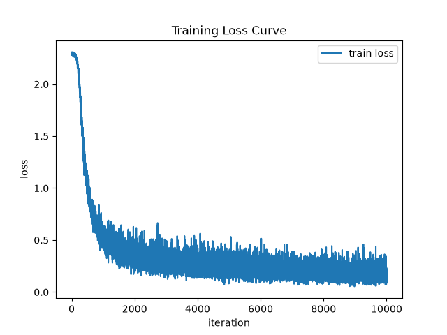  

### 3.5.4 基于测试数据的评价  
1.更加精确评估神经网络  
根据[[DeepLearing#353-mini-batch的实现]]发现通过反复学习确实可以降低损失函数的值,不过这个损失函数是<font color="#00FF00">对训练数据的某个mini-batch的损失函数</font>,在神经网络的学习中,必须确认是否能够正确识别训练数据以外的其他数据,即确认是否会发生<font color="#FF00FF">过拟合</font>  
神经网络学习的目标是掌握<font color="#00FF00">泛化能力</font>,因此要评价神经网络的泛化能力,就必须使用不包含在训练数据中的数据,下述代码每经过一个epoch都会记录下训练数据和测试数据的识别精度  

2.epoch  
epoch是一个单位,一个epoch表示学习中所有训练数据均被使用过一次时的学习次数,比如对于2000条数据,每次学习100条数据,那么理论上只要学习20次就会把所有数据全部学习一遍,此时将所有数据都学习过一次时对应的学习次数称为epoch  
所以`iter_per_epoch = max(train_size / batch_size, 1)`这条代码,为什么是train_size/batch_size,因为每次都从总数据集中取batch_size大小进行学习,所有每学习train_size/batch_size次时所有数据都会学习完一轮,此时就需要记录一轮学习完毕后训练数据和测试数据的识别精度  
*提示:根据上述代码,假设训练数据是60000,那么一共学习10000轮,每轮学习100条数据,最终本算法实际上学习到的图片数量为10000\*100=1000000条,实际上是远远大于60000条的*  
*提示:当然真正的算法会先把总数据量按照batch_size进行切分,而这里的算法是直接从总数据中每次随机取100条,理论上可能有些数据无法学习,但这里就忽略了*  

3.代码实现  
```python
# 读入数据
(x_train, t_train), (x_test, t_test) = load_mnist(normalize=True, one_hot_label=True)

# 神经网络
network = TwoLayerNet(input_size=784, hidden_size=50, output_size=10)

# 超参数
iters_num = 10000  # 适当设定循环的次数
train_size = x_train.shape[0]
batch_size = 100
learning_rate = 0.1

# 损失函数曲线、训练集和测试集的准确度
train_loss_list = []
train_acc_list = []
test_acc_list = []

iter_per_epoch = max(train_size / batch_size, 1)

for i in range(iters_num):
    # 获取mini-batch
    batch_mask = np.random.choice(train_size, batch_size)
    x_batch = x_train[batch_mask]
    t_batch = t_train[batch_mask]
    
    # 计算梯度
    #grad = network.numerical_gradient(x_batch, t_batch)
    grad = network.gradient(x_batch, t_batch)
    
    # 更新参数
    for key in ('W1', 'b1', 'W2', 'b2'):
        network.params[key] -= learning_rate * grad[key]

    # 记录学习过程
    loss = network.loss(x_batch, t_batch)
    train_loss_list.append(loss)

    # 每epoch后记录算法对训练集和测试集的准确率
    if i % iter_per_epoch == 0:
        train_acc = network.accuracy(x_train, t_train)
        test_acc = network.accuracy(x_test, t_test)
        train_acc_list.append(train_acc)
        test_acc_list.append(test_acc)
        print("train acc, test acc | " + str(train_acc) + ", " + str(test_acc))
```

4.训练结果图像表示  
将上述代码中得到的结果用图表示如下,实线表示训练数据的识别精度,测试数据的识别精
度,随着epoch的进行(学习的进行),训练数据和测试数据评价的识别精度都提高了,并且这两个识别<font color="#00FF00">精度基本上没有差异</font>(两条线基本重叠在一起);因此可以说这次的学习中没有发生过拟合的现象  
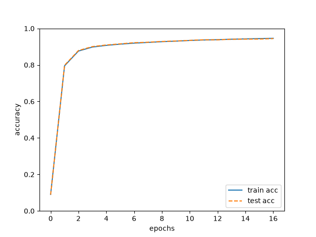  

# 4.误差反向传播法  
**目录:**  
4.1 计算图  
4.2 链式法则  
4.3 反向传播  
4.4 简单层的实现  
4.5 激活函数层的实现  
4.6 Affine/Softmax层的实现  
4.7 误差反向传播法的实现  

## 4.1 计算图  
**目录:**  
4.1.1 概述  
4.1.2 用计算图求解  
4.1.3 局部计算  
4.1.4 计算图的优势  

### 4.1.1 概述  
要理解误差反向传播法,一般有两种方法即基于数学式的和基于计算图的,本教材会从更容易上手的计算图来展开  

### 4.1.2 用计算图求解  
1.买苹果的问题  
*问题:小明在超市买了2个100元一个的苹果,消费税是10%,请计算支付金额*  
计算图通过节点和箭头表示计算过程,节点用○表示,○中是计算的内容;将计算的中间结果写在箭头的上方,<font color="#00FF00">表示各个节点的计算结果从左向右传递</font>,上述问题的求解过程如下  
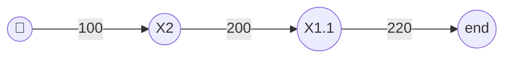
如上图所示,开始时苹果的100元流到"×2"节点,变成200元,然后被传递给下一个节点,接着这个200元流向"×1.1"节点,变成220元,因此从这个计算图的结果可知答案为220元  
除了上述表示法之外还有一种表示方法,就是○中只写计算符号,把乘数单独标记在外面,例如  
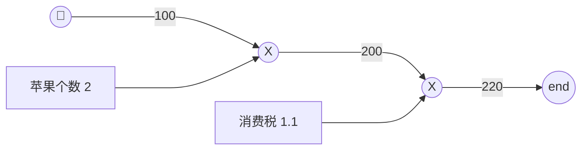

2.买苹果和橘子  
*问题:小明在超市买了2个苹果、3个橘子,每个苹果100元,每个橘子150元,消费税是10%,请计算支付金额*  
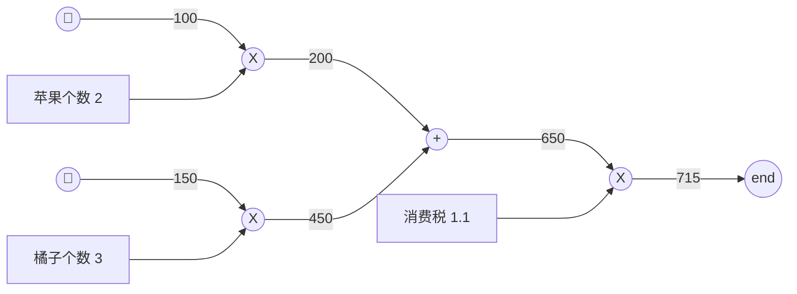

3.计算图的流程  
根据上述的两个问题,得知在求解计算图时需要按如下流程进行,(1)构建计算图;(2)在计算图上,从左向右进行计算  
这里从左向右进行计算是一种正方向上的传播,简称<font color="#FF00FF">正向传播</font>,正向传播是从计算图出发点到结束点的传播,同理从右到左的传播就是<font color="#FF00FF">反向传播</font>  

### 4.1.3 局部计算  
1.局部计算  
计算图的特征是可以通过传递<font color="#00FF00">局部计算</font>获得最终结果,局部计算是指无论全局发生了什么,都能<font color="#00FF00">只根据与自己相关的信息输出接下来的结果</font>  

2.例子说明  
在超市里买了2个苹果和其他很多东西,此时可以画出如图所示的计算图  
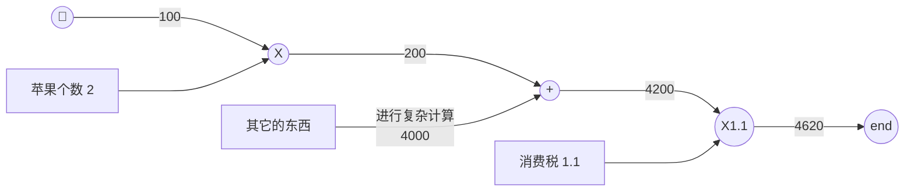
上图的重点是,苹果和其他很多东西的求和运算(4000+200=4200),其中并不关心4000这个数字是如何计算出来的,而只要把这两个数字相加即可,<font color="#00FF00">即各个节点只需要处理与自已有关的计算</font>  
综上,计算图可以集中精力于局部计算,无论全局的计算有多么复杂,各个步骤所要做的就是对象节点的局部计算;最终便可以获得全局的复杂计算的结果  

### 4.1.4 计算图的优势  
1.优点汇总  
* 无论全局的计算多么复杂,都可以通过局部计算使各个节点致力于简单的计算,从而简化问题
* 利用计算图可以将中间的节点全部保存起来
* <font color="#00FF00">通过反向传播高效计算导数</font>

2.买苹果问题

回顾之前的买苹果问题,假设想知道苹果价格的上涨会在多大程度上影响最终的支付金额,即求支付金额关于苹果的价格的导数,设苹果的价格为$x$,支付金额为$L$,则相当于求$\frac{\partial L}{\partial x}$,这个公式表示当苹果的价格稍微上涨时,支付金额会增加多少  

3.反向传播求导数  
支付金额关于苹果价格的导数的值可以通过计算图的反向传播求出来,如下图所示  
反向传播使用与正向传播相反的箭头(粗线)表示,反向传播传递局部函数,将导数的值写在箭头的下方,在这个例子中反向传播从右向左传递导数的值(1->1.1->2.2),即支付金额关于苹果价格的导数的值为2.2,即苹果每上涨1元最终的支付金额会增加2.2元(严格来讲,如果苹果增加某个微小值则最终支付的金额会是该微小值的2.2倍)  
计算图的另一个好处是,计算中途求得的导数的结果(中间传递的导数)可以被共享,从而可以
高效地计算多个导数
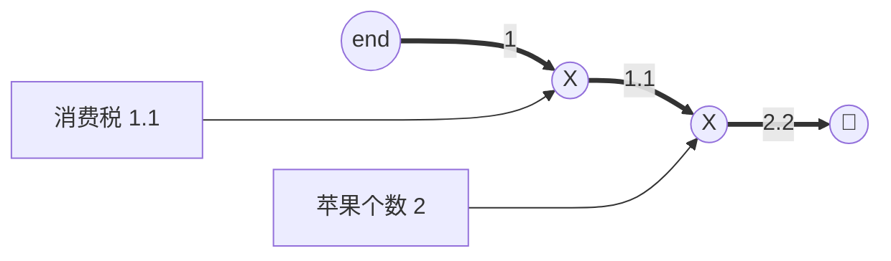

## 4.2 链式法则  
**目录:**  
4.2.1 计算图的反向传播  
4.2.2 链式法则  
4.2.3 链式法则和计算图  

### 4.2.1 计算图的反向传播  
1.概述  
反向传播将局部函数从右到左传递,传递局部函数的原理是基于 **<font color="#FF00FF">链式法则</font>** 的  
现假设存在$y=f(x)$的计算,计算的反向传播如下图所示  
  
将信号E乘以节点的局部导数$\frac{dy}{dx}$然后将结果传递给下一个节点,这个局部导数说的是正向传播中$y=f(x)$的导数,比如假设$y=f(x)=x^2$则局部导数为$\frac{dy}{dx}=2x$把这个局部导数乘以上游传过来的值(本例中为E)然后传递给前面的节点,反向传播的原理可以通过链式法则进行解释  
*<font color="#FF00FF">提示:可以说整个地4章的内容就是基于链式法则的,所以链式法则是最本质的东西,很重要</font>*  

### 4.2.2 链式法则  
1.复合函数  
先定义复合函数,$z=(x+y)^2$是由两个式子构成的,$z=t^2$和$t=x+y$  

2.链式法则  
*要点:如果某个函数由复合函数表示,则该复合函数的导数可以用构成复合函数的各个函数的导数的乘积表示*  
以上述的两个公式为例,$\frac{\partial z}{\partial x}$(z关于x的导数)可以用$\frac{\partial z}{\partial t}$和$\frac{\partial t}{\partial x}$的乘积表示,用数学式表示如下$\frac{\partial z}{\partial x}=\frac{\partial z}{\partial t}\frac{\partial t}{\partial x}$再把式子中的$\partial t$越去即可  
使用链式法则求$\frac{\partial z}{\partial x}$的导数,为此要先求局部导数$\frac{\partial z}{\partial t}=2t$ $\frac{\partial t}{\partial x}=1$最后计算$\frac{\partial z}{\partial x}=\frac{\partial z}{\partial t}\frac{\partial t}{\partial x}=2t * 1 = 2(x + y)$  

### 4.2.3 链式法则和计算图  
1.计算图表示  
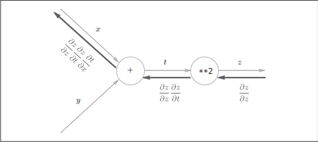  
上图为链式法则的计算图表示,其中**2表示平方运算,图中最左边的反向传播结果,根据链式法则,$\frac{\partial z}{\partial z}\frac{\partial z}{\partial t}\frac{\partial t}{\partial x}=\frac{\partial z}{\partial t}\frac{\partial t}{\partial x}=\frac{\partial z}{\partial x}$成立,对应z关于x的导数  

2.将式子结果带入图中  
将[[DeepLearing#422-链式法则]]中的$\frac{\partial z}{\partial t}=2t$ $\frac{\partial t}{\partial x}=1$结果带入图中得到  
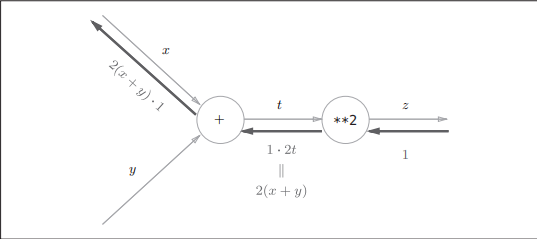  


## 4.3 反向传播  
**目录:**  
4.3.1 加法节点的方向传播  
4.3.2 乘法节点的反向传播  
4.3.3 苹果的例子  

### 4.3.1 加法节点的方向传播  
1.背景  
现以$z=x+y$为对象,观察其反向传播,$z=x+y$的导数为$\frac{\partial z}{\partial x}=1$ $\frac{\partial z}{\partial y}=1$  
用图表示如下  
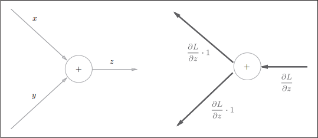  

2.执行流程  
反向传播将从上游传过来的导数(本例中是$\frac{\partial L}{\partial z}$)乘以1,然后传向下游,因为加法节点的反向传播只乘以1,所以<font color="#FF00FF">输入的值会原封不动地流向下一个节点</font>  
首先要搞清楚,如果是加法节点,<font color="#00FF00">两个变量的导数一定为1</font>,也就是不存在$2x$这种情况,因为如果是$2x$它实际上可以这么转换,转换为m和y相加  
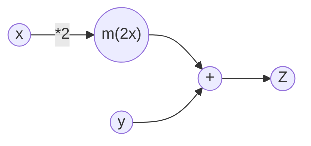

3.模型的最终输出  
在本例中,把上游传过来的导数值设为$\frac{\partial L}{\partial z}$,如下图所示假定一个最终输出值为L的大型计算图,$z=x+y$的计算位于这个大型计算图的某个地方,从上游会传来$\frac{\partial L}{\partial z}$的值,并向下游传递$\frac{\partial L}{\partial x}$和$\frac{\partial L}{\partial y}$  
加法节点存在于某个最后输出的计算的一部分,反向传播时,从最右边的输出出发,<font color="#FF00FF">局部导数</font>从节点向节点反方向传播  
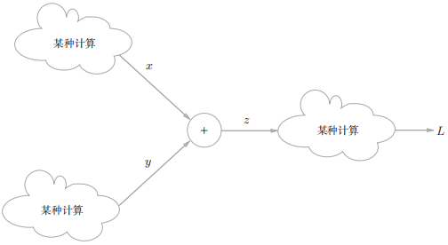  

4.具体的例子  
假设有10+5=15这个计算,反向传播时,从上游会传来值1.3,因为加法节点的反向传播只是将输入信号输出到下一个节点,所以反向传播将1.3向下一个节点传递  

### 4.3.2 乘法节点的反向传播  
1.背景  
现以$z=xy$为对象,这个式子的导数为$\frac{\partial z}{\partial x}=y$ $\frac{\partial z}{\partial y}=x$  
乘法的反向传播会将上游的值乘以正向传播时的<font color="#00FF00">输入信号</font>的<font color="#00FF00">翻转值</font>后传递给下游,所谓的翻转值就是乘以另外一边的输入信号,比如正向传播时信号是x的话,反向传播时则是y;正向传播时信号是y的话,反向传播时则是x  
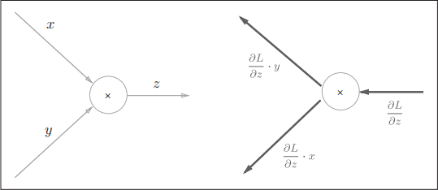  

2.例子  
假设有计算$10 \times 5=50$,反向传播时从上游传来1.3,因为乘法的反向传播会乘以输入信号的翻转值,所以各自可按1.3 × 5 = 6.5、1.3 × 10 = 13计算  
另外,加法的反向传播只是将上游的值传给下游,并不需要正向传播的输入信号;而,乘法的反向传播<font color="#00FF00">需要正向传播时的输入信号值</font>,因此实现乘法节点的反向传播时,要保存正向传播的输入信号  
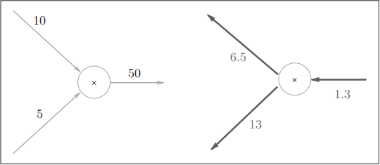  

### 4.3.3 苹果的例子  
1.问题  
回到最开始买苹果的例子,现在要解决的是苹果的价格、苹果的个数、消费税这3个变量如何各自影响最终支付金额,即分别求最终价格关于这三个变量的导数  

2.图  
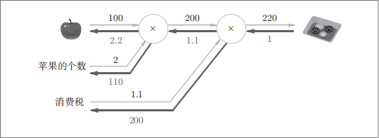  
如前所述,乘法节点的反向传播会将输入信号翻转后传给下游,从上图可知,苹果的价格的导数是2.2,苹果的个数的导数是110,消费税的导数是200  
这些导数可以解释为,消费税对最终价格的影响的变化率是200,苹果价格对最终价格的变化率是2.2,苹果个数对最终价格的影响的变化率是110  

## 4.4 简单层的实现  
**目录:**  
4.4.1 层  
4.4.2 乘法层的实现  
4.4.3 加法层的实现  


### 4.4.1 层  
本节将用Python实现前面的购买苹果的例子,把要实现的计算图的乘法节点称为<font color="#00FF00">乘法层</font>加法节点称为<font color="#00FF00">加法层</font>  
后续要把构建神经网络的<font color="#00FF00">层</font>实现为一个类,所谓的层是神经网路的功能单位,比如负责sigmoid函数的Sigmoid、负责矩阵乘积的Affine等,都以层为单位进行实现,因此这里也以层为单位来实现乘法节点和加法节点  
*注意:把层抽象为类,所以一层对应一个类的实例化对象*  

### 4.4.2 乘法层的实现  
1.代码  
层的实现中有两个共通的方法`forward()`和`backward()`,分别对应正向传播和反向传播  
```python
class MulLayer:
    def __init__(self):
        self.x = None
        self.y = None

    def forward(self, x, y):
        self.x = x
        self.y = y                
        out = x * y
        return out

    def backward(self, dout):
        dx = dout * self.y
        dy = dout * self.x
        return dx, dy
```

2.函数解释  
`__init__()`中会初始化实例变量x和y,它们用于保存正向传播时的输入值;`forward()`接收x和y两个参数,将它们相乘后输出;`backward()`将从上游传来的导数乘以正向传播的翻转值,然后传给下游  

3.买苹果  
上述函数就是MulLayer(乘法层)的实现,现在用它实现前面购买苹果的例子  
```python
# coding: utf-8
from layer_naive import *

apple = 100
apple_num = 2
tax = 1.1

# 一层对应一个实例
mul_apple_layer = MulLayer()
mul_tax_layer = MulLayer()

# forward
apple_price = mul_apple_layer.forward(apple, apple_num)
price = mul_tax_layer.forward(apple_price, tax)

# backward
dprice = 1
dapple_price, dtax = mul_tax_layer.backward(dprice)
dapple, dapple_num = mul_apple_layer.backward(dapple_price)

print("price:", int(price))
print("dApple:", dapple)
print("dApple_num:", int(dapple_num))
print("dTax:", dtax)
# 输出结果
# price: 220
# dApple: 2.2
# dApple_num: 110
# dTax: 200
```

### 4.4.3 加法层的实现  
1.代码  
```python
class AddLayer:
    def __init__(self):
        pass

    def forward(self, x, y):
        out = x + y
        return out

    def backward(self, dout):
        dx = dout * 1
        dy = dout * 1
        return dx, dy
```

2.函数解释  
加法层不需要特意进行初始化,所以`__init__()`中什么也不运行(`pass`语句表示什么也不运行),加法层的`forward()`接收x和y两个参数,将它们相加后输出,`backward()`将上游传来的导数原封不动地传递给下游  

3.实现买苹果和橘子的例子  
现在同时使用加法层和乘法层来实现买苹果和橘子的例子  

```python
from layer_naive import *

# 初始参数
apple = 100
apple_num = 2
orange = 150
orange_num = 3
tax = 1.1

# layer
mul_apple_layer = MulLayer()
mul_orange_layer = MulLayer()
add_apple_orange_layer = AddLayer()
mul_tax_layer = MulLayer()

# forward
apple_price = mul_apple_layer.forward(apple, apple_num)  # (1)
orange_price = mul_orange_layer.forward(orange, orange_num)  # (2)
all_price = add_apple_orange_layer.forward(apple_price, orange_price)  # (3)
price = mul_tax_layer.forward(all_price, tax)  # (4)

# backward
dprice = 1
dall_price, dtax = mul_tax_layer.backward(dprice)  # (4)
dapple_price, dorange_price = add_apple_orange_layer.backward(dall_price)  # (3)
dorange, dorange_num = mul_orange_layer.backward(dorange_price)  # (2)
dapple, dapple_num = mul_apple_layer.backward(dapple_price)  # (1)

print("price:", int(price))
print("dApple:", dapple)
print("dApple_num:", int(dapple_num))
print("dOrange:", dorange)
print("dOrange_num:", int(dorange_num))
print("dTax:", dtax)
# 输出结果
# price: 715
# dApple: 2.2
# dApple_num: 110
# dOrange: 3.3000000000000003
# dOrange_num: 165
# dTax: 650
```

4.小节  
计算图中层的实现(这里是加法层和乘法层)非常简单,使用这些层可以进行复杂的导数计算。下面,我们来<font color="#FF00FF">实现神经网络中使用的层</font>  

## 4.5 激活函数层的实现  
**目录:**  
4.5.1 ReLU层  
4.5.2 Sigmoid层  


### 4.5.1 ReLU层  
1.概述  
我们将计算图的思路应用到神经网络中,这里我们把构成<font color="#00FF00">神经网络的层抽象为一个类</font>,先来实现激活函数的ReLU层和Sigmoid层  

2.ReLU函数和导数  
ReLU函数可以表示为  
$$y = \begin{cases} 
x \quad (x > 0) \\ 
0 \quad (x \le 0) \\ 
\end{cases}$$
其对应的导数为
$$\frac{dy}{dx} = \begin{cases} 
1 \quad (x > 0) \\ 
0 \quad (x \le 0) \\ 
\end{cases}$$

3.正向传播和反向传播  
如果正向传播时的输入x大于0,则反向传播会将上游的值原封不动地传给下游;如果正向传播时的x小于等于0,则反向传播中传给下游的信号将停在此处,用计算图表示如下  
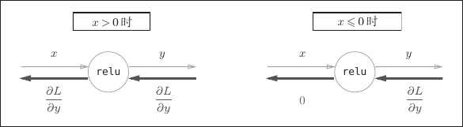  

4.代码实现  
```python
class Relu:
    def __init__(self):
        self.mask = None

    def forward(self, x):
        # self.mask保存True/False数组,将x中所有<=0的元素保存为True
        self.mask = (x <= 0)
        # 拷贝x数组
        out = x.copy()
        # 将原本x中所有<=0的元素全部置为0,满足ReLU公式
        out[self.mask] = 0
        return out

    def backward(self, dout):
        # 根据正向传播中所有x<=0的地方,将其反向传播的值置为0
        dout[self.mask] = 0
        dx = dout
        return dx
```
如果正向传播时的输入值小于等于0,则反向传播的值为0,因此反向传播中会使用正向传播时保存的mask,将从上游传来的dout的mask中的元素为True的地方设为0  
*补充:ReLU层的作用就像电路中的开关一样;正向传播时,有电流通过的话,就将开关设为 ON;没有电流通过的话,就将开关设为OFF;反向传播时,开关为ON的话,电流会直接通过;开关为OFF的话,则不会有电流通过*  

5.代码测试  
```python
>>> x = np.array( [[1.0, -0.5], [-2.0, 3.0]] )
>>> print(x)
[[1.0 -0.5]
[-2.0 3.0]]
>>> mask = (x <= 0)
>>> print(mask)
[[False True]
[True False]]
```

### 4.5.2 Sigmoid层  
1.sigmoid函数式子  
$$y = \frac{1}{1 + e^{-x}}$$  
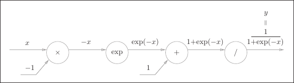  
上图中除了×和+之外,还有exp和/运算,exp会进行$y=e^x$计算,/会进行$y=\frac{1}{x}$计算  

2.反向传播  
在这张图中,×和+的反向传播在之前[[DeepLearing#43-反向传播]]已经介绍过了,主要就是$y=e^x$和$y=\frac{1}{x}$的反向传播,分别对它们求导得  
$\frac{dy}{dx}=-\frac{1}{x^2}=-y^2$ $\frac{dy}{dx}=e^x$  
最终得到如下图所示的方向传播路径  
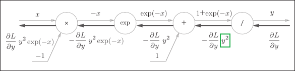  
*注意:图中直接使用$y^2$,理论上应该是$-\frac{\partial L}{\partial y}\frac{1}{x^2}$其中x是$1+e^{-x}$这个整体,但其实$\frac{1}{x^2}=y^2={(\frac{1}{1+e^{-x}})}^2$是一样的,直接用算好的结果即可,而不是重复去计算*  
然后为什么经过$e^x$函数的反向传播是$-\frac{\partial L}{\partial y}y^2e^{-x}$,反向传播应该乘其导数$e^x$,这是因为这里要把$-x$看成一个整体,就好比之前的乘法层,如果另一侧是-100你肯定要取-100,而不是100,这里的$-x$也是针对输入参数$x$而言的  

3.sigmoid反向传播  
根据上述内容,计算图可以进行sigmoid层的反向传播,反向传播的最终结果为<font color="#FF00FF">$\frac{\partial L}{\partial y}y^2e^{-x}$</font>,这个值会继续传播给下游节点,$\frac{\partial L}{\partial y}y^2e^{-x}$只需要根据正向传播的输入$x$和输出$y$就可以计算出来,因此上述的计算图可以集约化为<font color="#00FF00">sigmoid节点</font>  
  
第2点的图和集约化图的计算结果是完全相同的,但简洁版的计算图可以省略反向传播中的计算过程,因此计算效率较高,而且也不需要关注中间的实现细节  

4.化简  
$\frac{\partial L}{\partial y}y^2e^{-x}$可以进一步化简  
$$\begin{aligned}
\frac{\partial L}{\partial y} y^2 e^{-x} &= \frac{\partial L}{\partial y} \frac{1}{(1+e^{-x})^2} e^{-x} \\
&= \frac{\partial L}{\partial y} \frac{1}{1+e^{-x}} \frac{e^{-x}}{1+e^{-x}} \\
&= \frac{\partial L}{\partial y} y(1-y)
\end{aligned}$$
因此如下图所示的sigmoid层的反向传播,只需要根据正向传播的输出就能计算出结果  
  

5.代码实现  
```python
class Sigmoid:
    def __init__(self):
        self.out = None

    def forward(self, x):
        out = sigmoid(x)
        self.out = out
        return out
    
    def backward(self, dout):
        dx = dout * (1.0 - self.out) * self.out
        return dx
```
在上述代码中,正向传播时将输出保存在了实例变量out中,反向传播时,使用该变量out进行计算  

## 4.6 Affine/Softmax层的实现  
**目录:**  
4.6.1 Affine层  
4.6.2 批版本的Affine层  
4.6.3 Softmax-with-Loss层  


### 4.6.1 Affine层  
1.仿射变换  
神经网络的正向传播中进行的矩阵的乘积运算在几何学领域被称为<font color="#00FF00">仿射变换</font>,这里将进行仿射变换的处理实现为Affine层  
所谓的仿射变换包括一次线性变换和一次平移,分别对应神经网路的加权和运算与加偏移量运算  
*提示:Affine层主要用于解决矩阵乘法计算的正向传播和反向传播*  
*注意:Affine层只是完成基础的点乘运算,计算结果还需要再经过激活函数的计算,才能作为下一层的输入*  

2.矩阵相乘  
之前在介绍[[DeepLearing#243-各层间信号传递的实现]]时,计算各层间信号传递时使用的是`Y = np.dot(X,W) +B`的计算方式,它可以用计算图表示  
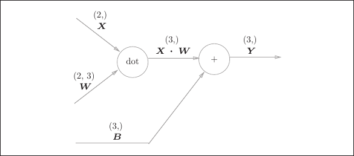  

3.反向传播  
以矩阵为对象的反向传播,按矩阵的各个元素进行计算时,步骤和以标量(普通变量)的计算图相同,如此可以得到如下式子  
$$\begin{aligned}
    \frac{\partial L}{\partial X} = \frac{\partial L}{\partial X} \cdot W^T
\end{aligned}$$

$$\begin{aligned}
    \frac{\partial L}{\partial W} = X^T \cdot \frac{\partial L}{\partial Y}
\end{aligned}$$

根据上述式子写出对应的计算图反向传播,要注意$X$和$\frac{\partial L}{\partial X}$形状相同$W$和$\frac{\partial L}{\partial W}$形状相同,$X=(x_0,x_1,x_2,...,x_n)$$\frac{\partial L}{\partial X} = (\frac{\partial L}{\partial x_0},\frac{\partial L}{\partial x_1},...,\frac{\partial L}{\partial x_n})$  
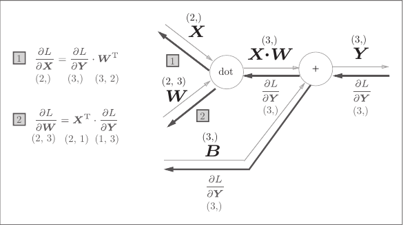  
*提示:这里要特别注意矩阵的形状,只有矩阵形状对应上才能够自然推导出公式*  

### 4.6.2 批版本的Affine层  
1.计算图
*提示:本节和当时的[[DeepLearing#263-批处理]]的内容很类似*  
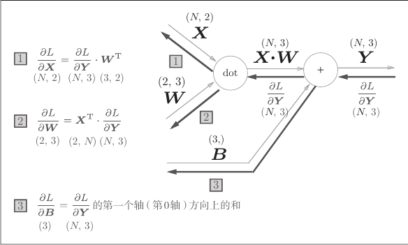  
上图是批版本Affine层的计算图,现在输入的$X$的形状是(N,2)  

2.正向传播偏移量  
正向传播时偏移量被加到$X \cdot W$的各个数据上,比如N=2时,偏移量会被分别加到这两个数据上,具体的例子如下所示  
```python
>>> X_dot_W = np.array([[0, 0, 0], [10, 10, 10]])
>>> B = np.array([1, 2, 3])
>>>
>>> X_dot_W
array([[ 0, 0, 0],[ 10, 10, 10]])
>>> X_dot_W + B
array([[ 1, 2, 3],[11, 12, 13]])
```

3.反向传播偏移量
因此反向传播时,各个数据的反向传播值需要汇总为偏移量的元素,用代码表示如下  
在这个例子中,假定数据有两个(N=2),偏移量的反向传播会对这两个数据的导数按元素进行求和,因此这里使用了np.sum()对第0轴(以数据为单位的轴)方向上的元素进行求和  
```python
>>> dY = np.array([[1, 2, 3,], [4, 5, 6]])
>>> dY
array([[1, 2, 3],[4, 5, 6]])
>>>
>>> dB = np.sum(dY, axis=0)
>>> dB
array([5, 7, 9])
```
*通俗解释:<font color="#00FF00">因为$B$在正向传播时同时影响了样本1和样本2,所以在更新$B$时,必须把这两部分对$B$的影响全部加起来,才是$B$最终受到的总梯度</font>*  

4.代码实现  
综上所述,Affine的实现如下所示  
```python
class Affine:
    
    def __init__(self, W, b):
        self.W = W
        self.b = b
        self.x = None
        self.dW = None
        self.db = None
def forward(self, x):
    self.x = x
    out = np.dot(x, self.W) + self.b
    return out

def backward(self, dout):
    dx = np.dot(dout, self.W.T)
    self.dW = np.dot(self.x.T, dout)
    self.db = np.sum(dout, axis=0)
    return dx
```

### 4.6.3 Softmax-with-Loss层  
1.概述  
*提示:现在已经学了很多函数,急不得的话可以回顾一下[[DeepLearing#22-激活函数]]和[[DeepLearing#25-输出层的设计]]*  
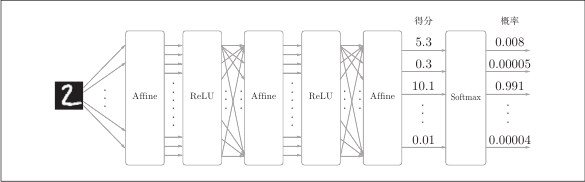  
输入图像通过Affine层和ReLU层进行转换,10个输入通过Softmax层进行正规化后再输出(即将输出值的和调整为1),此外因为有10个手写数字的分类,所以Softmax层的输出也有10个  
神经网络有学习和推理两个阶段,而神经网络的推理阶段一般不使用Softmax层,在进行推理时因为最终只需要给出一个答案,所以此时只对得分的最大值感兴趣,此时直接将最后一个Affine的输出作为结果,而神经网路的学习是需要Softmax层的  

2.Softmax层的计算图  
因为这里也包含作为损失函数的交叉熵误差,所以又称为Softmax-with-Loss层,Softmax-with-Loss层(Softmax函数和交叉熵误差)的计算图如图所示,此图较为复杂,图中直接给出了最终结果  
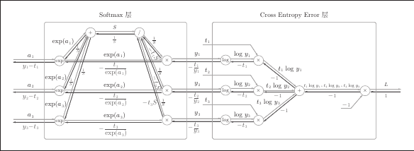  

3.简化图  
  
在上述计算图中,`softmax`函数记为`Softmax`层,交叉熵误差记为`Cross Entropy Error`层,这里要进行3类分类,从前面的层接受3个输入,Softmax层将输入$(a_1,a_2,a_3)$正规化,输出$(y_1,y_2,y_3)$,Cross Entropy Error层接收Softmax的输出(y1,y2,y3)和结果标签(t1,t2,t3),从这些数据中输出损失L  

4.反向传播  
在上图简化图中,注意其反向传播的结果,Softmax层的反向传播得到了($y_1-t_1,y_2-t_2,y_3-t_3$)这样的"漂亮"结果,由于($y_1,y_2,y_3$)是Softmax层的输出($t_1,t_2,t_3$)是监督数据,所以($y_1−t_1,y_2 − t_2, y_3 − t_3$)是Softmax层的输出和结果标签的差分,神经网络的反向传播会把这个差分表示的误差传递给
前面的层,这是神经网络学习中的重要性质  
神经网络学习的目的就是通过调整权重参数,使神经网络的输出(Softmax的输出)接近结果标签(t).因此,必须将神经网络的输出与结果标签的误差高效地传递给前面的层.刚刚的$(y_1 - t_1, y_2 - t_2, y_3 - t_3)$正是Softmax层的输出与教师标签的差,直截了当地表示了当前神经网络的输出与教师标签的误差  

5.举例子  
这里考虑一个具体的例子,比如思考教师标签是 $(0,1,0)$ ,Softmax层的输出是 $(0.3,0.2,0.5)$ 的情形,因为正确解标签处的概率是0.2(20%),这个时候的神经网络未能进行正确的识别,此时,Softmax层的反向传播传递的是 $(0.3, -0.8, 0.5)$ 这样一个大的误差.因为这个大的误差会向前面的层传播,所以Softmax层前面的层会从这个大的误差中学习到"大"的内容  

再举一个例子,比如思考教师标签是 $(0, 1, 0)$,Softmax层的输出是 $(0.01, 0.99, 0)$ 的情形(这个神经网络识别得相当准确).此时Softmax层的反向传播传递的是 $(0.01, -0.01, 0)$ 这样一个小的误差.这个小的误差也会向前面的层传播,因为误差很小,所以Softmax层前面的层学到的内容也很"小".

6.Softmax-with-Loss层的实现  
```python
class SoftmaxWithLoss:
    def __init__(self):
    self.loss = None # 损失
    self.y = None # softmax的输出
    self.t = None # 监督数据(one-hot vector)

def forward(self, x, t):
    self.t = t
    self.y = softmax(x)
    # 当前batch的平均损失函数
    self.loss = cross_entropy_error(self.y, self.t)
    return self.loss

def backward(self, dout=1):
    batch_size = self.t.shape[0]
    # 为什么除以batch_size?
    dx = (self.y - self.t) / batch_size
    return dx
```
为什么除以batch_size?在Softmax层确实是($y_n-t_n$),但是来到Cross Entropy Error层的反向传播时,因为L是全部损失函数的平均值,根据数学上的计算这一层的导数是$\frac{1}{N}$,但图中未标出  
*注意:SoftmaxWithLoss的意思就是包含损失函数,所以在`forward`方法中会计算经过Softmax层后的损失函数,调用`cross_entropy_error`函数*  

## 4.7 误差反向传播法的实现  
**目录:**  
4.7.1 误差反向传播法的神经网络实现  
4.7.2 误差反向传播法的梯度确认  
4.7.3 使用误差反向传播法学习  

### 4.7.1 误差反向传播法的神经网络实现  
1.学习流程  
可以参考之前[[DeepLearing#35-学习算法的实现]]的相关内容,大致流程为mini-batch->计算梯度->更新参数->循环  
现在有了反向传播就可以优化原本采用数值微分计算的梯度  
现在将2层神经网络实现为[TwoLayerNet](./resources/DeepLearing/02.py)类  

2.TwoLayerNet的实例变量  
| 实例变量  | 说明                                                                                                                                          |
|:----------|:----------------------------------------------------------------------------------------------------------------------------------------------|
| params    | 保存神经网络的参数的字典型变量<br>params['W1']是第1层的权重,params['b1']是第1层的偏置<br>params['W2']是第2层的权重,params['b2']是第 2层的偏置 |
| layers    | 保存神经网络的层的有序字典型变量<br>以layers['Affine1'], layers['ReLu1'],layers['Affine2']的形式,通过有序字典保存各个层                       |
| lastLayer | 神经网络的最后一层<br>本例中为SoftmaxWithLoss层                                                                                               |

3.TwoLayerNet类的方法  
| 方法                                                               | 说明                                                                                                            |
|:-------------------------------------------------------------------|:----------------------------------------------------------------------------------------------------------------|
| __init__(self,input_size,hidden_size,output_size, weight_init_std) | 进行初始化<br>参数从头开始依次是输入层的神经元数,隐藏层的神经元数,输出层的神经元数,初始化权重时的高斯分布的规模 |
| predict(self, x)                                                   | 进行识别(推理)<br>参数x是图像数据                                                                               |
| loss(self,x,t)                                                     | 计算损失函数的值<br>参数x是图像数据,t是正确解标签                                                               |
| accuracy(self,x,t)                                                 | 计算识别精度                                                                                                    |
| numerical_gradient(self, x, t)                                     | 通过数值微分计算关于权重参数的梯度(同上一章)                                                                    |
| gradient(self, x, t)                                               | 通过误差反向传播法计算关于权重参数的梯度                                                                        |

4.代码解释  
在[TwoLayerNet](./resources/DeepLearing/02.py)类中使用了`OrderedDict`类,它是有序字典,因此神经网络的正向传播只需按照添加元素的顺序调用各层的`forward()`方法就可以完成处理,而反向传播只需要按照相反的顺序调用各层即可  
因为Affine层和ReLU层的内部会正确处理正向传播和反向传播,所以这里要做的事情仅仅是<font color="#00FF00">以正确的顺序连接各层</font>,再按顺序(或者逆序)调用各层(模块化设计)  

### 4.7.2 误差反向传播法的梯度确认  
1.求解梯度的两种方法  
基于数值微分方法和基于解析性地求解数学式的方法是计算梯度的两种方法,后一种方法通过使用误差反向传播法,即使存在大量的参数,也可以高效地计算梯度  
误差反向传播法完全是数值微分法的上位替代,数值微分法实现简单,而误差反向传播法实现困难,所以一般可以<font color="#00FF00">用数值微分法来检验误差反向传播法是否正确</font>这种操作被称为<font color="#FF00FF">梯度确认</font>  

2.梯度确认的代码  
```python
# 读入数据
(x_train, t_train), (x_test, t_test) = load_mnist(normalize=True, one_hot_label=True)

network = TwoLayerNet(input_size=784, hidden_size=50, output_size=10)

x_batch = x_train[:3]
t_batch = t_train[:3]

grad_numerical = network.numerical_gradient(x_batch, t_batch)
grad_backprop = network.gradient(x_batch, t_batch)

for key in grad_numerical.keys():
    diff = np.average( np.abs(grad_backprop[key] - grad_numerical[key]) )
    print(key + ":" + str(diff))
# 运行结果如下
# W1:4.18302514043381e-10
# b1:2.650338259604229e-09
# W2:6.200822667225752e-09
# b2:1.397117932164238e-07
```
读入MNIST数据集,使用训练数据的一部分,确认数值微分求出的梯度和误差反向传播法求出的梯度的误差,这里误差的计算方法是求各个权重参数中对应元素的差的绝对值,并计算其平均值
从结果看出,通过数值微分和误差反向传播法求出的梯度的差非常小,此时便认为通过反向传播法求得的梯度是正确的  
*提示:数值微分和误差反向传播法的计算结果之间的误差为0是很少见的,这是因为受到计算机数值精度的限制,所以误差一般不为0,而是一个很小的数值,如果结果很大,说明误差反向传播存在错误*  

### 4.7.3 使用误差反向传播法学习  
详情见[[DeepLearing#353-mini-batch的实现]]完全一样的代码,其中  
```python
# 二选一,第一个是数值微分,第二个是反向传播
grad = network.numerical_gradient(x_batch, t_batch)
grad = network.gradient(x_batch, t_batch)
```

# 5.与学习相关的技巧  
**目录:**  
5.1 参数的更新  
5.2 权重的初始值  
5.3 Batch Normalization  
5.4 正则化  
5.5 超参数的验证  
5.6 CNN的可视化  


## 5.1 参数的更新  
**目录:**  
5.1.1 全章概述  
5.1.2 SGD的缺点  
5.1.3 Momentum  
5.1.4 AdaGrad  
5.1.5 Adam  
5.1.6 使用何种更新方法  

### 5.1.1 全章概述  
1.概述
本章涉及寻找最优权重参数的最优化方法、权重参数的初始值、超参数的设定方法  
为了应对过拟合,本章还将介绍权值衰减、Dropout等正则化方法  
本章还对Batch Normalization方法进行简单介绍  

2.随机梯度下降的问题  
神经网络的学习的目的是找到使损失函数的值尽可能小的参数,即寻找最优参数的问题,解决这个问题的过程称为<font color="#00FF00">最优化</font>,但是由于神经网络的庞大和复杂,最优化问题十分复杂  
之前的章节中,为了找到最优参数算法将参数的梯度(导数)作为线索,使用参数的梯度,沿梯度方向更新参数,并重复这个步骤多次,从而逐渐靠近最优参数,这个过程称为<font color="#00FF00">随机梯度下降法</font>也称SGD  
但是根据不同的问题也存在比SGD更加聪明的方法,接下来将介绍SGD的缺点并介绍SGD以外的其他最优化方法  

3.复习SGD  
参考[[DeepLearing#34-梯度]]的相关知识点  

3.SGD的缺点  
随机梯度下降法的本质,其实就是在一个漆黑一片的世界中找到最深的一个坑,唯一能够参考的就是这个世界的坡度

### 5.1.2 SGD的缺点  
1.函数最小值  
现在来求$f(x,y)=\frac{1}{20}x^2 + y^2$函数的最小值,它的函数图像和等高线如下图所示  
  

2.函数的梯度  
  
这个梯度的特征是,y轴方向上大,x轴方向上小;换句话说,就是y轴方向的坡度大,而x轴方向的坡度小  

3.梯度下降  
现在对该函数进行梯度下降算法,从$(x,y) = (-7.0,2.0)$开始,最终SGD算法呈现<font color="#00FF00">Z字形</font>,这是一个相当低效的路径,SGD的缺点是如果函数的形状非均向(比如呈延伸状)搜索的路径就会非常低效,SGD低效的根本原因是,梯度的方向并没有指向最小值的方向  
  

### 5.1.3 Momentum  
1.公式表示  
用数学式表示Momentum方法如下所示  
$$\begin{aligned}
v &\leftarrow \alpha v - \eta \frac{\partial L}{\partial W} \\
W &\leftarrow W + v
\end{aligned}$$  
和前面的SGD一样,$W$表示更新的权重参数,$\frac{\partial L}{\partial W}$表示损失函数关于$W$的梯度,$\eta$表示学习率,新变量$v$对应物理上的速度,上述式子表现了<font color="#00FF00">物体在梯度方向上受力,在这个力的作用下,物体的速度增加这一物理法则</font>,这种算法给人的感觉就好像是小球在地面上滚动  
其中$\frac{\partial L}{\partial W}$是外力(重力),它推动小球往底部走,当物体不受任何外力的时候,也就是$\frac{\partial L}{\partial W}=0$时,此时需要由$\alpha v$这一项让小球逐渐减速,比如将$\aleph$设定为0.9之类的值,这样由于$v \leftarrow \alpha v$会让$v$的速度不断减小  

2.代码实现  
```python
class Momentum:
    def __init__(self, lr=0.01, momentum=0.9):
        self.lr = lr
        self.momentum = momentum
        self.v = None
    
    # params是神经网络的权重(字典,比如{'W1': array(...),'b1':array(...)})
    def update(self, params, grads):
        if self.v is None:
            self.v = {}
            # 创建一个和权重形状完全相同的全0数组,作为初始速度
            # key就是权重的名称,比如W1、B1、W2、B2
            for key, val in params.items():                                
                self.v[key] = np.zeros_like(val)
                
        for key in params.keys():
            self.v[key] = self.momentum*self.v[key] - self.lr*grads[key] 
            params[key] += self.v[key]
```

3.代码解释  
这里的params和grads会按照神经网络的层<font color="#00FF00">同时存放整个网络所有层的参数</font>(例如W1,b1,W2,b2等),一开始V什么都不保存,只有在第一次更新的时候,会按照<font color="#00FF00">字典型变量的形式保存与参数结构相同的数据</font>,并且每一层初始的速度都是v=0  
*注意:v和神经网络层是对应的,比如W1对应一个v,B1对应一个v*  

4.举个例子  
假设当前算出来的梯度`grads['W'] = 2.0`,第一次更新速度$\text{self.v['W']} = 0.9 \times 0 - 0.01 \times 2.0 = -0.02$(此时小球获得了向左的微小速度),接着更新权重;第一次更新速度依旧假设梯度是`grads['W'] = 2.0`,此时计算速度$\text{self.v['W']} = 0.9 \times (-0.02) - 0.01 \times 2.0 = -0.018 - 0.02 = -0.038$  
发现规律,第一次的速度是`-0.02`第二次则加剧到`-0.038`,这就是这个算法的优势,如果连续多步的梯度方向一致,速度会不断叠加变大,从而让参数更新得更快,越过平坦的弯路,其本质是因为将上一步的v保存了下来  

5.最终梯度效果  
  
发现Z字形的程度减轻了,因为虽然x轴方向上受到的力非常小,但是一直在同一方向上受力,所以朝同一个方向会有一定的加速;反过来,虽然y轴方向上受到的力很大,但是因为交互地受到正方向和反方向的力,它们会互相抵消,所以y轴方向上的速度不稳定  
所以该算法总结就是:<font color="#FF00FF">加速下降</font>+<font color="#FF00FF">抵抗震荡</font>

### 5.1.4 AdaGrad  
1.学习率  
在神经网络的学习中,学习率(数学式中记为 $\eta$)的值很重要,学习率过小,会导致学习花费过多时间;反过来,学习率过大,则会导致学习发散而不能正确进行  
在关于学习率的有效技巧中,有一种被称为<font color="#FF00FF">学习率衰减</font>(learning rate decay)的方法,即随着学习的进行,使学习率逐渐减小,这种方法会使全体参数的学习率一起降低,而AdaGrad进一步发展了这个想法,即<font color="#00FF00">针对每个参数定制其学习率</font>  

2.数学式  
下面这个式子是AdaGrad更新方法的数学式表示  
$$h \leftarrow h + \frac{\partial L}{\partial W} \odot \frac{\partial L}{\partial W}$$$$W \leftarrow W - \eta \frac{1}{\sqrt{h}} \frac{\partial L}{\partial W}$$  

上述式子中,$W$表示要更新的权重参数,$\frac{\partial L}{\partial W}$表示损失函数关于$W$的梯度,$\eta$表示学习率,$h$它保存了以前的所有梯度值的平方和,$\odot$是点乘不是矩阵相乘,是<font color="#00FF00">两个矩阵对应的元素相乘</font>,且形状必须一致  
在更新参数的时候,通过乘以$\frac{1}{\sqrt{h}}$就可以调整学习的尺度,那么参数的元素中变动较大的元素的学习率将变小,正好符合学习率衰减的描述,但它是参数级定制的  
*注意:这不意味着元素变动较小的学习率会变大,否则会导致学习发散无法收敛*  
*补充:AdaGrad会记录过去所有梯度的平方和,因此学习越深入,更新的幅度就越小;实际上,如果无止境地学习,更新量就会变为0,完全不再更新.为了改善这个问题,可以使用RMSProp 方法,RMSProp方法并不是将过去所有的梯度一视同仁地相加,而是逐渐地遗忘过去的梯度,在做加法运算时将新梯度的信息更多地反映出来.这种操作从专业上讲,称为"指数移动平均",呈指数函数式地减小过去的梯度的尺度*  

3.代码实现  
```python
class AdaGrad:

    def __init__(self, lr=0.01):
        self.lr = lr
        self.h = None
        
    def update(self, params, grads):
        if self.h is None:
            self.h = {}
            for key, val in params.items():
                self.h[key] = np.zeros_like(val)
            
        for key in params.keys():
            self.h[key] += grads[key] * grads[key]
            params[key] -= self.lr * grads[key] / (np.sqrt(self.h[key]) + 1e-7)
```
*提示:代码在最后一行加上了微小值`1e-7`为了防止除零异常*  

4.梯度下降  
最终该代码的梯度下降效果为  
  
可以发现,函数的取值高效地向着最小值移动,由于$y$轴方向上的梯度较大,因此刚开始变动较大,但是后面会根据这个较大的变动按比例进行调整,减小更新的步伐,所以Z字形的变动程度有所衰减  

### 5.1.5 Adam  
1.Adam概述  
Momentum参照小球在碗中滚动的物理规则进行移动,AdaGrad为参数的每个元素适当地调整更新步伐,Adam算法的思路就是同时应用两者

2.实现代码  
```python
class Adam:
    def __init__(self, lr=0.001, beta1=0.9, beta2=0.999):
        self.lr = lr
        self.beta1 = beta1
        self.beta2 = beta2
        self.iter = 0
        self.m = None
        self.v = None
        
    def update(self, params, grads):
        if self.m is None:
            self.m, self.v = {}, {}
            for key, val in params.items():
                self.m[key] = np.zeros_like(val)
                self.v[key] = np.zeros_like(val)
        
        self.iter += 1
        lr_t  = self.lr * np.sqrt(1.0 - self.beta2**self.iter) / (1.0 - self.beta1**self.iter)         
        
        for key in params.keys():
            #self.m[key] = self.beta1*self.m[key] + (1-self.beta1)*grads[key]
            #self.v[key] = self.beta2*self.v[key] + (1-self.beta2)*(grads[key]**2)
            self.m[key] += (1 - self.beta1) * (grads[key] - self.m[key])
            self.v[key] += (1 - self.beta2) * (grads[key]**2 - self.v[key])
            
            params[key] -= lr_t * self.m[key] / (np.sqrt(self.v[key]) + 1e-7)
            
            #unbias_m += (1 - self.beta1) * (grads[key] - self.m[key]) # correct bias
            #unbisa_b += (1 - self.beta2) * (grads[key]*grads[key] - self.v[key]) # correct bias
            #params[key] += self.lr * unbias_m / (np.sqrt(unbisa_b) + 1e-7)
```
*提示:Adam会设置3个超参数,分别是学习率$\alpha$、一次Momentum系数$\beta_1$、二次Momentum系数$\beta_2$,根据论文标准的设定值是$\beta_1=0.9 \quad \beta_2=0.999$*  

3.梯度下降  
  
Adam的学习过程和Momentum十分类似,但是相比之下,Adam小球左右摇晃的程度有所减轻  


### 5.1.6 使用何种更新方法  
1.指正  
实际上上述一共介绍的4种方法,各有自已的优缺点,在不同的问题中它们的表现都不相同,所以不存在谁比谁好的问题  

2.MINIST数据集更新方法的比较  
以之前的手写数字识别为例,比较这4种算法,最终的结果如下图所示,这个实验以一个5层神经网络为对象,其中每层有100个神经元,激活函数使用的是ReLU,一般而言其它三种方法会比SGD学习地更快,识别精度也更高  
  

## 5.2 权重的初始值  
**目录:**  
5.2.1 设置权值初始值为0  
5.2.2 隐藏层的激活值的分布  
5.2.3 ReLU的权重初始值  
5.2.4 基于MINIST数据集的权重初始值的比较  


### 5.2.1 设置权值初始值为0  
1.概述  
神经网络的学习中,权值的初始值特别重要,甚至关系到神经网络的学习能否成功  

2.权重初始值设为0  
不能将权重初始值设为0,或者说不能将权重初始值设为一样的值;是因为在误差反向传播中,会导致所有的权重值进行相同的更新,假设权重和偏移量初始值全为0,在进行正向传播的时候每个神经元的输入都为0,也就导致了<font color="#00FF00">所有神经元输出完全一模一样</font>,在进行反向传播的时候,根据公式$W \leftarrow W - \eta \frac{\partial L}{\partial W}$因为所有的梯度都相同,会导致所有权重在更新时全部加上或减去一模一样的值  
因此权重被更新为相同的值,并拥有了对称的值,这使得神经网络拥有许多不同的权重的意义丧失了,所以为了打破这种均一化(<font color="#FF00FF">对称性</font>)<font color="#00FF00">必须随机生成初始值</font>  

### 5.2.2 隐藏层的激活值的分布  
1.激活值  
本节关注隐藏层的激活值即激活函数的输出数据,观察权重初始值如何影响隐藏层的激活值的分布的,现在向一个5层神经网络传入随机生成的输入数据,用直方图绘制各层激活值的数据分布,代码如下  

2.标准差为1的激活值分布  
假设神经网络有5层,每层有100个神经元,然后使用标准差为1的高斯分布,随机生成1000个数据作为输入数据,并将其传给5层神经网络,激活函数使用sigmoid  
```python
def sigmoid(x):
    return 1 / (1 + np.exp(-x))


def ReLU(x):
    return np.maximum(0, x)


def tanh(x):
    return np.tanh(x)
    
input_data = np.random.randn(1000, 100)  # 1000个数据
node_num = 100  # 各隐藏层的节点（神经元）数
hidden_layer_size = 5  # 隐藏层有5层
activations = {}  # 激活值的结果保存在这里

x = input_data

for i in range(hidden_layer_size):
    if i != 0:
        x = activations[i-1]

    # 改变初始值进行实验！
    w = np.random.randn(node_num, node_num) * 1
    # w = np.random.randn(node_num, node_num) * 0.01
    # w = np.random.randn(node_num, node_num) * np.sqrt(1.0 / node_num)
    # w = np.random.randn(node_num, node_num) * np.sqrt(2.0 / node_num)
    a = np.dot(x, w)
    # 将激活函数的种类也改变,来进行实验！
    z = sigmoid(a)
    # z = ReLU(a)
    # z = tanh(a)
    activations[i] = z
```
  
由上图可知,因为使用的是sigmoid函数是S形的,各层的激活值会逐渐偏向0和1分布,最终使得反向传播的导数逐渐接近0(sigmoid函数的导数是$\frac{\partial L}{\partial y} y(1-y)$,其中y是神经元的输出),当输出为0或1时整个梯度的值都趋向0,最终导致所谓的<font color="#00FF00">梯度消失</font>  

3.标准差为0.01的激活值分布  
现在使用`w = np.random.randn(node_num, node_num) * 0.01`生成初始权重,各层的神经网络的激活值分布如下所示  
这次集中在0.5附近,此时不会发生梯度消失问题,但是激活值有所偏向又会导致[[DeepLearing#521-设置权值初始值为0]]时提到的对称性问题,这会导致神经网络权重变得没有意义  
所以各层激活值的分布要求有适当的广度,因为通过在各层间传递多样性的数据,神经网络可以进行高效学习,反之就会出现梯度消失或对称性问题  
  

4.Xavier初始值  
Xavier推导出的初始值为,如果前一层的节点数为n,则初始值使用标准差为$\frac{1}{\sqrt{n}}$的分布,使用Xavier初始值之后,前一层的节点数越多,要设定为目标节点的初始值的权重标准差就越小  
现在使用`w = np.random.randn(node_num, node_num) * np.sqrt(1.0 / node_num)`生成初始权重,各层的神经网络的激活值分布如下所示  
从图中看出,越是后面的层图像变得越歪斜,但是呈现了比之前更有广度的分布,因为各层间传递的数据有适当的广度,所以sigmoid函数的表现力不受限制,有望进行高效的学习  
  
*补充:在上图中,后面的层的分布呈稍微歪斜的形状,如果用tanh函数代替sigmoid函数,这个稍微歪斜的问题就能得到改善,实际上使用tanh函数后,会呈漂亮的吊钟形分布,tanh函数和sigmoid函数同是S型曲线函数,但tanh函数是关于原点 $(0, 0)$ 对称的S型曲线,而sigmoid函数是关于 $(x, y)=(0, 0.5)$ 对称的S型曲线,众所周知,<font color="#00FF00">用作激活函数的函数最好具有关于原点对称的性质</font>*  

### 5.2.3 ReLU的权重初始值  
1.ReLU的权重初始值  
Xavier初始值是以激活函数是线性函数为前提推导得出的,当激活函数使用ReLU时,一般推荐使用ReLU函数的专属初始值HE  
当前一层的节点数为$n$时,HE初始值使用标准差为$\sqrt{\frac{2}{n}}$的高斯分布  

2.激活值分布  
  
如果对ReLU函数使用标准差为0.01的高斯分布,最终表现为各层的激活值非常小(往0靠拢)会导致反向传播的梯度下降不明显基本没有学习进展;使用Xavier时,一开始表现良好,但随着层的加深,激活值偏向会一点点变大,学习出现梯度消失问题  
当初始值为HE时,各层中分布的广度相同,即便层加深,数据的广度也能保持不变,因此反向传播时也会传递合适的值  

### 5.2.4 基于MINIST数据集的权重初始值的比较  
1.不同初始权重对MINIST的影响  
现在准备三种权重初始值(标准差=0.01、Xavier初始值、HE初始值)进行试验

2.核心代码  
```python
# 0:读入MNIST数据==========
(x_train, t_train), (x_test, t_test) = load_mnist(normalize=True)

train_size = x_train.shape[0]
batch_size = 128
max_iterations = 2000


# 1:进行实验的设置==========
weight_init_types = {'std=0.01': 0.01, 'Xavier': 'sigmoid', 'He': 'relu'}
optimizer = SGD(lr=0.01)

networks = {}
train_loss = {}
for key, weight_type in weight_init_types.items():
    networks[key] = MultiLayerNet(input_size=784, hidden_size_list=[100, 100, 100, 100],
                                  output_size=10, weight_init_std=weight_type)
    train_loss[key] = []

# 2:开始训练==========
for i in range(max_iterations):
    batch_mask = np.random.choice(train_size, batch_size)
    x_batch = x_train[batch_mask]
    t_batch = t_train[batch_mask]
    
    for key in weight_init_types.keys():
        grads = networks[key].gradient(x_batch, t_batch)
        optimizer.update(networks[key].params, grads)
    
        loss = networks[key].loss(x_batch, t_batch)
        train_loss[key].append(loss)
    
    if i % 100 == 0:
        print("===========" + "iteration:" + str(i) + "===========")
        for key in weight_init_types.keys():
            loss = networks[key].loss(x_batch, t_batch)
            print(key + ":" + str(loss))
```

3.试验结果  
该试验中,神经网络有5层,每层有100个神经元,激活函数使用ReLU,一共学习2000次,从图中的结果可知,标准差为0.01时完全无法进行学习,这是因为正向传播中传递的值很小,所以反向传播时的梯度也很小,权重几乎不更新导致的  
当权重初始值为Xavier和HE时,可以正常学习并且HE初始值的学习进度更快一些
  

## 5.3 Batch Normalization  
**目录:**  
5.3.1 Batch Normalization算法  
5.3.2 Batch Normalization的评估  

### 5.3.1 Batch Normalization算法  
1.目的  
为了使各层拥有适当的广度,<font color="#00FF00">强制性</font>地调整激活值的分布就,Batch Normalization就是基于这个想法产生的  

2.概述  
Batch Norm有以下优点:(1)可以使学习快速进行、(2)不那么依赖初始值、(3)抑制过拟合  
Batch Norm的思路是调整各层的激活值使其拥有适当的广度,为此要向神经网络中插入对数据分布进行正规化的层,如下图所示  
  
Batch Norm会按学习时的mini-batch为单位,按mini-batch进行正规化,即进行使数据分布的均值为0、方差为1的正规化,用数学式表示如下  
$$\begin{aligned}
    \mu_B &= \frac{1}{m} \sum_{i=1}^m x_i \\ 
    \sigma_B^2 &= \frac{1}{m} \sum_{i=1}^m (x_i - \mu_B)^2 \\
    \hat{x}_i &= \frac{x_i - \mu_B}{\sqrt{\sigma_B^2 + \epsilon}}
\end{aligned}$$

这里对mini-batch的m个输入数据的集合$B=\left\{ x_1,x_2,...,x_m \right\}$求均值$\mu B$和方差$\sigma_B^2$,然后对输入数据进行均值为0、方差为1的正规化,式子中的$\epsilon$是一个微小值(防止除0异常)  
这个公式做的就是将mini-batch的输入数据$\left\{ x_1,x_2,...,x_m \right\}$变换为均值为0、方差为1的数据$\left\{ \hat{x_1},\hat{x_2},...,\hat{x_m} \right\}$,通过将这个处理插入到激活函数的前面/后面,可以减小数据分布的偏向  

接着Batch Norm层会对正规化后的数据进行缩放和平移变换,用数学式可以表示为$y_i = \gamma \hat{x}_i + \beta$,这里$\gamma$和$\beta$是参数,一开始$\gamma=1,\beta=0$然后再通过学习调整到合适的值  

上述就是Batch Norm的算法,这个算法是神经网络上的正向传播,计算图表示如下,Batch Norm的反向传播推导有些复杂,这里不介绍  
  

### 5.3.2 Batch Normalization的评估  
1.Batch Norm的试验效果  
现在对MINIST数据集使用Batch Norm层和不使用Batch Norm层时学习过程的变化,结果如下图所示,从图中可以发现使用Batch Norm时学习速度变快了  


2.不同初始值的学习过程  
现在使用标准差为不同的各种权重初始值进行学习,如下图所示,几乎所有的情况下都是使用 Batch Norm时学习进行得更快,同时也可以发现,在不使用Batch Norm的情况下,如果不赋予一个尺度好的初始值,学习将完全无法进行  
  

## 5.4 正则化  
**目录:**  
5.4.1 过拟合  
5.4.2 权值衰减  
5.4.3 Dropout  


### 5.4.1 过拟合  
1.过拟合  
过拟合指的是只能拟合训练数据,但不能很好地拟合不包含在训练数据中的其他数据的状态,机器学习的最终目标是提升模型的泛化能力,所以抑制过拟合很重要  
过拟合发生的原因通常有两个(1)模型拥有大量参数、表现力强,(2)训练数据少  

2.模拟过拟合  
现在强制满足这两个条件,模拟过拟合现象,为此准备从MINIST数据集原本的60000个训练数据中只选定300个,并且为了增加网络复杂度,使用7层网路(每层有100个神经元,激活函数为ReLU),试验代码如下  
```python
(x_train, t_train), (x_test, t_test) = load_mnist(normalize=True)

# 为了再现过拟合,减少学习数据
x_train = x_train[:300]
t_train = t_train[:300]

# weight decay（权值衰减）的设定 =======================
weight_decay_lambda = 0 # 不使用权值衰减的情况
# weight_decay_lambda = 0.1
# ====================================================

network = MultiLayerNet(input_size=784, hidden_size_list=[100, 100, 100, 100, 100, 100], output_size=10,
                        weight_decay_lambda=weight_decay_lambda)
optimizer = SGD(lr=0.01)

# 最大epochs次数
max_epochs = 201
train_size = x_train.shape[0]
batch_size = 100

train_loss_list = []
train_acc_list = []
test_acc_list = []

# 因为总数据量为300,batch_size为100,所以这里的epoch为3次,每3个batch就记录一次
iter_per_epoch = max(train_size / batch_size, 1)
epoch_cnt = 0

for i in range(1000000000):
    batch_mask = np.random.choice(train_size, batch_size)
    x_batch = x_train[batch_mask]
    t_batch = t_train[batch_mask]

    grads = network.gradient(x_batch, t_batch)
    optimizer.update(network.params, grads)

    if i % iter_per_epoch == 0:
        train_acc = network.accuracy(x_train, t_train)
        test_acc = network.accuracy(x_test, t_test)
        train_acc_list.append(train_acc)
        test_acc_list.append(test_acc)

        print("epoch:" + str(epoch_cnt) + ", train acc:" + str(train_acc) + ", test acc:" + str(test_acc))

        epoch_cnt += 1
        if epoch_cnt >= max_epochs:
            break
```

3.训练结果  
  
可以发现,过了100个epoch后,用训练数据测量到的识别精度几乎都为100%,但是对于测试数据离100%的识别精度还有较大差距,这是因为模型只拟合了训练数据的结果,从图中看出模型对训练时没有使用的一般数据(测试数据)拟合得不是很好  


### 5.4.2 权值衰减   
1.权值衰减  
权值衰退是一种被用来抑制过拟合的方法,改方法通过在学习的过程中对大的权重进行惩罚来抑制过拟合  
例如为损失函数加上权重的平方范数(L2范数),就可以抑制权重变大,如果将权重记为$W$,L2范数的权值衰减就是$\frac{1}{2} \lambda W^2$,然后将$\frac{1}{2} \lambda W^2$加到损失函数上;这里<font color="#00FF00">$\lambda$是控制正则化强度的超参数</font>,$\lambda$设置地越大对大的权重施加的惩罚就越重,此外开头的$\frac{1}{2}$是用于将$\frac{1}{2} \lambda W^2$的求导结果变成$\lambda W$的调整用常量  

对于所有权重,权值衰减方法都会为损失函数加上$\frac{1}{2} \lambda W^2$,因此在求权重梯度的计算中,要为之前的误差反向传播法的结果加上正则化项的导数$\lambda W$

2.代码调整  
把[[DeepLearing#541-过拟合]]中的`weight_decay_lambda = 0`代码切换为`weight_decay_lambda = 0.1`

2.实验结果  
现在选用$\lambda = 0.1$的权值衰减来进行试验,结果如下,虽然训练数据的识别精度和测试数据的识别精度之间有了差距,但是与之前没有使用权值衰减的结果相比,差距减小了,这说明过拟合受到了抑制,此外训练数据的识别精度没有达到100%(之前是100%)  
  

### 5.4.3 Dropout  
1.背景  
作为抑制过拟合的方法,[[DeepLearing#542-权值衰减]]的方法是为损失函数加上权重的L2范数的权值衰减的方法,但是如果网络的模型变得很复杂,只用权值衰减较难以应付了,所以为了解决这一问题提出了Dropout方法  

2.Droupout方法概述  
Droupout是一种<font color="#00FF00">在学习的过程中随机删除神经元的方法 </font>,训练时随机选出隐藏层的神经元然后将其删除,被删除的神经元不再进行信号的传递,效果如下图所示  
训练时,每传递一次数据就会随机选择要删除的神经元,测试时虽然会传递所有的神经元信号,但是对于各个神经元的输出,要乘上训练时的删除比例后再输出  
  

3.Dropout的实现  
```python
class Dropout:
    def __init__(self, dropout_ratio=0.5):
        self.dropout_ratio = dropout_ratio
        # mask是一个布尔数组
        self.mask = None

    def forward(self, x, train_flg=True):
        if train_flg:
            self.mask = np.random.rand(*x.shape) > self.dropout_ratio
            return x * self.mask
        else:
            return x * (1.0 - self.dropout_ratio)

    def backward(self, dout):
        return dout * self.mask
```

4.代码解释  
每次正向传播时,`self.mask`东中都会以False的形式保存要删除的神经元,self.mask会随机生成和x形状相同的数组,并将值比dropout_ratio大的元素设置为True,反向传播时的行为和ReLU相同,即正向传播时传递了信号的神经元,反向传播时按原样传递信号,正向传播没有传递信号的,反向传播将停在那里  

5.Dropout测试效果  
*提示:代码参考ch06/overfit_dropout.py*  
Dropout的实验和前面一样,使用7层网络(每层100个神经元,激活函数为ReLU),下面第一个结果不使用Dropout(和之前一样)、第二个结果使用的是Dropout  
通过使用Dropout,训练数据和测试数据的识别精度的差距变小了,并且训练数据没有达到100%的识别精度,像这样,通过使用Dropout,即便是表现力强的网络,也可以抑制过拟合  
  
  

6.集成学习  
机器学习中经常使用集成学习,就是让多个模型单独进行学习,推理时再取多个模型的输出平均值,比如准备5个结构相同(或相似)的神经网络,分别进行学习,测试时以这5个网络的输出平均值作为答案,一般通过集成学习神经网络的识别精度可以提高好几个百分点  
集成学习和Dropout有密切的关系,因为可以将Dropout理解为,通过在学习过程中随机删除神经元,从而每一次都让不同的模型进行学习,且推理时,通过对神经元的输出乘以删除比例(比如0.5),可以取得模型的平均值,可以简单理解为<font color="#00FF00">Dropout将集成学习的效果(模拟地)通过一个网络实现了</font>  

## 5.5 超参数的验证  
**目录:**  
5.5.1 验证数据  
5.5.2 超参数的最优化  
5.5.3 超参数最优化的实现  

### 5.5.1 验证数据  
1.超参数  
之前已经提到过,类似权重、偏移量这种神经网络可以自已学习的参数就是普通参数,而类似学习率、神经元数量、batch大小等就是<font color="#FF00FF">超参数</font>,超参数需要人工设定合适的值,否则模型的性能就会很差,所以章节将介绍高效寻找超参数值的方法  

2.验证数据  
之前讲到过,数据集分为训练数据和测试数据,分别用于学习和测试网络的泛化能力,但是在调整超参数的时候不能使用测试数据评估超参数的性能,因为如果使用测试数据评估超参数性能,就会导致<font color="#00FF00">超参数与测试数据发生过拟合</font>,这样一旦换一个新的数据集时模型的效果依旧不会好,实际上并没有提升模型的泛化能力(就好比不能用测试数据来训练模型一样,超参数的评估也不能用测试数据)  
于是乎,在调整超参数的时候,必须使用超参数专门的确认数据,也称为<font color="#FF00FF">验证数据</font>,用该数据集来评估超参数的好坏  

3.代码实现  
根据不同的数据集(是数据集自已分或不分),有时候会分为训练数据、验证数据、测试数据三部分,有时候只分为训练数据和测试数据两部分,有的则不进行分割,比如MINIST数据集只分为训练数据和测试数据,在这种情况下,可以从训练数据中事先分割20%的数据作为验证数据  
```python
(x_train, t_train), (x_test, t_test) = load_mnist(normalize=True)
# 打乱训练数据
x_train, t_train = shuffle_dataset(x_train, t_train)
# 分割验证数据
validation_rate = 0.20
validation_num = x_train.shape[0] * validation_rate

x_val = x_train[:validation_num]
t_val = t_train[:validation_num]
x_train = x_train[validation_num:]
t_train = t_train[validation_num:]
```
*提示:这里之所以大乱是因为,数据集可能存在偏向,比如数据集本身按从0-9的顺序编排了*  

### 5.5.2 超参数的最优化  
1.超参数范围  
进行超参数优化时,逐渐缩小优质超参数的存在范围非常重要,逐渐缩小范围的原理就是,一开始指定一个大范围,从这个范围中随机选出一个超参数(采样),用这个采样到的值进行识别精度的评估,然后多次重复该操作,观察识别精度的结果,根据结果缩小优质超参数的范围,最终便可确定超参数的合适范围  

2.大致范围  
超参数的范围只需要大致地指定就可以了,比如像0.001($10^{-3}$)到1000($10^3$)这种以10的阶乘的尺度制定范围,在超参数优化中,因为深度学习的时间很长,所以在超参数的搜索时要尽早放弃那些不符合逻辑的超参数,所以在超参数优化中,需要减少学习的epoch  


3.实现步骤归纳  
设定超参数范围->从设定的超参数范围中随机采样->使用采样到的超参数进行学习,通过验证数据评估识别精度(但是epoch设置地要小,也就是学习的轮次要尽可能少)->重复上述两步,根据识别精度的结果缩小超参数的范围  

4.贝叶斯最优化  
上述这种寻找超参数的方法,其实本质上是工程方法没有多大的科学性,如果需要更精炼的方法,可以使用<font color="#FF00FF">贝叶斯最优化</font>,贝叶斯最优化运用以<font color="#00FF00">贝叶斯定理</font>为中心的数学理论,能更加严密、高效地进行最优化  

### 5.5.3 超参数最优化的实现  
1.随机采样  
*提示:关于权值衰减详情见[[DeepLearing#542-权值衰减]]*
现在使用MINIST数据集进行超参数的最优化,我们将学习率和控制权值衰减强度的系数这两个超参数的搜索问题作为对象  
根据[[DeepLearing#552-超参数的最优化]]的内容,现在从0.001($10^{-3}$)到1000($10^3$)这样的对数尺度的范围中随机采样进行超参数的验证,在该实验中,权值衰减系数的初始范围为$10^{-8}$到$10^{-4}$,学习率的初始范围为$10^{-6}$到$10^{-2}$  

2.超参数的随机采样代码  
```python
weight_decay = 10 ** np.random.uniform(-8, -4)
lr = 10 ** np.random.uniform(-6, -2)
```
*提示:\*\*在Python中是幂运算,比如2\*\*3=8*  
像这样进行随机采样后,再使用那些值进行学习,多次使用各种超参数的值重复进行学习,观察合乎逻辑的超参数在什么范围,下面就以权值衰减系数为$10^{-8}$到$10^{-4}$、学习率为$10^{-6}$到$10^{-2}$的范围进行试验  

3.实验结果  
  
实验结果如图所示,按识别精度从高到低的顺序排列了验证数据的学习的变化,从图中可知直到"Best-5"左右,学习都进行地很顺利,因此观察"Best-5"之前的超参数的值,结果如下所示  
从结果来看,学习率在0.001到0.01、权值衰减系数在$10^{-8}$到$10^{-6}$之间时,学习可以顺利进行,如此便观察到可以使学习顺利进行的超参数范围,那么<font color="#00FF00">在此基础之上可以进行重复的操作,进一步缩小超参数的值</font>,这样就能缩小到合适的超参数的存在范围,然后在某个阶段,<font color="#00FF00">选择一个最终的超参数的值</font>  
```python
Best-1(val acc:0.79) | lr:0.009662653061015838, weight decay:1.9071741719714195e-08
Best-2(val acc:0.79) | lr:0.008204172425270467, weight decay:1.3486674326995804e-08
Best-3(val acc:0.74) | lr:0.009048394671139963, weight decay:3.419287278786253e-07
Best-4(val acc:0.73) | lr:0.008538611047937045, weight decay:3.578823904270029e-07
Best-5(val acc:0.7) | lr:0.007586869161292217, weight decay:3.606124337235959e-07
```

# 6.卷积神经网络(CNN)  
**目录:**  
6.1 整体结构  
6.2 卷积层  
6.3 池化层  
6.4 卷积层和池化层的实现  
6.5 CNN的实现  
6.6 CNN的可视化  
6.7 具有代表性的CNN  


## 6.1 整体结构  
1.概述  
CNN和之前的神经网络一样,可以像乐高积木一样通过组装层来构建,不过CNN中新出现了卷积层和池化层  

2.全连接  
*复习:Affine参考[[DeepLearing#46-affinesoftmax层的实现]]*  
在之前的神经网络中,相邻层的所有神经元之间都有连接,这称为<font color="#FF00FF">全连接</font>,当时用Affine层实现了全连接层,如果使用Affine层,一个5层的全连接神经网络就可以通过下图来表示  
如下图所示,全连接的神经网络中,Affine层后面跟着激活函数ReLU层(或者sigmoid层),这里堆叠了4层"Affine-ReLU"组合,然后第5层是Affine层,最有由softmax层输出最终结果(概率)  
  

3.CNN结构  
如图所示,CNN中新增了Convolution层和Pooling层(卷积层和池化层),CNN层的连接顺序是"Convolution->ReLU->(Pooling)",Pooling层有时会被省略,还需要注意的是靠近输出的层中使用了"Affine-ReLU"组合,此外最后输出层中使用了之前的"Affine-Softmax"组合  


## 6.2 卷积层(Convolution)  
**目录:**  
6.2.1 全连接层存在的问题  
6.2.2 卷积运算  
6.2.3 填充  
6.2.4 步幅  
6.2.5 3维数据的卷积运算  
6.2.6 结合方块思考  
6.2.7 批处理  

### 6.2.1 全连接层存在的问题  
1.形状的忽视  
全连接的神经网络使用了全连接层(Affine层),在全连接层中,相邻层的神经元全部连接在一起,输出的数量可以任意决定  
全连接层存在的问题就是,数据的形状被<font color="#00FF00">忽视</font>,比如输入数据是图像时,图像通常是高、长、通道方向上的3维形状,但是向全连接层输入时,需要将3维数据拉平为1维数据,就比如之前的MINIST数据集的例子,输入图像就是1通道、高28像素、长28像素的形状(1,28,28),但是却被强行排列成1列(拉平为1维数据),以784个数据的形式输入到最开始的Affine层  
图像是3维图像,这个形状应含有重要的空间信息,例如空间上相邻的像素会有相似的值、RGB的各个通道之间分别有密切的关联性、相距较远的像素之间则没有什么关联性等,所以3维形状中可能隐藏有值得提取的本质模式,<font color="#00FF00">但是全连接层会忽视形状,将全部的输入数据作为相同的神经元(同一维度的神经元)处理</font>,所以无法利用与形状相关的信息  

2.卷积层  
卷积层可以保持形状不变,当输入数据是图像时,卷积层会以3维数据的形式接收输入数据,并同样以3维数据的形式输出至下一层;因此在CNN中,有可能可以正确理解图像等具有形状的数据  
此外在CNN中,有时将卷积层的输入输出数据称为<font color="#FF00FF">特征图</font>,其中卷积层的输入数据称为<font color="#00FF00">输入特征图</font>,输出数据称为<font color="#00FF00">输出特征图</font>

### 6.2.2 卷积运算  
1.概述  
卷积层进行的处理就是卷积运算,卷积运算相当于图像处理中的<font color="#00FF00">滤波器运算</font>,下面看一个具体的例子  

2.卷积的例子  

如上图所示,卷积运算对输入数据应用滤波器,输入数据是有高长方向的形状的数据,滤波器也有高长方向上的维度,假设用(height,width)表示数据和滤波器的形状,则输入大小是(4,4),滤波器大小是(3,3),输出大小是(2,2)  

3.卷积例子中的计算  
现在来解释一下这个例子该如何计算,对于输入数据,卷积运算以一定间隔滑动滤波器的窗口并应用,这个窗口就是图中3x3的灰色部分,将各个位置上滤波器的元素和输入的对应元素相乘,然后再求和,最终将结果保存到输出的对应位置,将这个过程在所有位置都进行一遍就得到卷积运算的输出  
  

4.偏移量  
在全连接的神经网络中,除了权重参数还有偏移量,在CNN中滤波器及对应之前的权重,同样CNN中也存在偏移量,包含偏移量的卷积运算的处理流程如下图所示  
偏移量通常只有一个(1x1),这个值会被加到应用了滤波器的所有元素上  
  

### 6.2.3 填充 
1.概述  
在进行卷积层的处理之前,有时要向输入数据的周围填入固定的数据(比如0等),这称为填充,比如在[[DeepLearing#622-卷积运算]]中的卷积的例子那张图中,对大小为(4,4)的输入数据应用了<font color="#00FF00">幅度</font>为1的填充(即指用幅度为1像素的0填充周围,填充的值一定是0,主要就是改变填充的幅度),填充后的效果如下  
  
如上图所示,通过填充大小为(4,4)的输入数据变成了(6,6)的形状,然后应用大小为(3,3)的滤波器,生成了带笑傲为(4,4)的输出数据  
本例中将填充幅度设定为1,当然也可以设定为2、3等任意的整数,如果将填充设定为2,则输入数据的大小变为(8,8),如果将填充设定为3,则大小变为(10,10)  

2.填充的目的  
使用填充的主要目的是<font color="#FF00FF">调整输出的大小</font>,例如对于大小为(4,4)的输入数据使用(3,3)的滤波器时,输出大小变为(2,2),相当于输出大小比输入大小缩减了2个元素,如此在反复进行多次卷积运算的神经网络中,<font color="#00FF00">如果每次进行卷积都会缩小空间,那么在某个时刻输出大小就可能变为1</font>,导致无法再应用卷积运算,为了避免这种情况就需要使用填充,在刚才的例子中,将填充的幅度设置为1,此时相对于输入大小为(4,4)的数据,其输出大小也保持为(4,4),这样就可以保证卷积运算在保持空间大小不变的情况下传递给下一层  

### 6.2.4 步幅  
1.概述  
应用滤波器的位置间隔称为步幅,之前例子中的步幅都为1,下图展示步幅为2的情况,可以看到应用滤波器的窗口间隔变为2个像素  
在下图所示的例子中,对输入大小为(7,7)的数据,以步幅为2应用了滤波器,通过将步幅设定为2,输出大小变为(3,3)  
  

2.计算输出大小  
根据[[DeepLearing#623-填充]]和[[DeepLearing#624-步幅]]的知识可以知道,填充增大后输出变大,步幅增大后输出变小,下面将用数学公式表示这一关系  
假设输入大小为(H,W),滤波器(<font color="#FFC800">Filter</font>)大小为(FH,FW),输出大小为(OH,OW),填充为P,步幅为S,此时输出大小可由下面公式计算  
$$\begin{aligned}
OH &= \frac{H + 2P - FH}{S} + 1 \\
OW &= \frac{W + 2P - FW}{S} + 1
\end{aligned}$$
*提示:这个公式的检验步骤这里就暂且跳过了*  

3.注意事项  
上述公式所设定的值必须可以被两个公式分别除尽,当输出大小无法除尽时,需要采取报错等对策,另外根据深度学习框架的不同,当值无法除尽的时候,有时会向最接近的整数四舍五入,不进行报错而继续运行  

### 6.2.5 3维数据的卷积运算  
1.图像的通道  
之前的卷积运算都是以高、长方向的2维形状为对象的,但是图像是3维数据,还需要处理图像的通道方向(通道本意是<font color="#00FF00">同一空间位置上、描述图像不同属性的多层二维数据</font>,这里就可以理解为像素的颜色信息),按照下面这个图片的例子,看如何进行3维数据进行卷积运算  
  

2.计算过程  
这里以3通道数据为例,展示卷积运算的结果,和2维数据相比,可以发现纵深方向(通道方向)上的特征图增加了,通道方向上有多个特征图时,会按通道进行输入数据和滤波器的卷积运算,并将结果相加从而得到输出  
*提示:这里的输出还是一个通道(1个特征图)*  
  

3.注意事项  
在3维数据的卷积运算中,输入数据和滤波器的通道数要设为相同值(也就是2维纵深方向上的通道数),比如这里设置为3,滤波器的大小(大小≠通道数)可以设定为任意值(不过每个通道的滤波器大小要全部相同),比如这里每个通道都是(3x3),但也可以设定为(2x2)、(1x1),只要<font color="#00FF00">保证滤波器的通道数和输入数据的通道数相同即可</font>  


### 6.2.6 结合方块思考  
1.概述  
将数据和滤波器结合成长方体进行理解,如下图所示3维长方体,把3维数据表示为多维数据时,书写顺序为(channel,height,width),比如通道数为C、高度为H、长度为W的数据的形状可以写成(C,H,W),滤波器也一样,可以写成(C,FH,FW)  

在这个例子中,数据输出是1张特征图(1个通道),如果要在通道方向上也拥有多个卷积运算的输出,此时就需要用多个滤波器(权重)

2.多输出数据  
下图中,通过应用FN个滤波器,输出特征图也生成了FN个,如果将这FN个特征图汇聚在一起,就得到了形状为(FN,OH,OW)的方块,将这个方块传递给下一层,就是CNN的处理流  
关于卷积运算的滤波器,也必须考虑滤波器的数量,作为四维数据(滤波器),滤波器的权重数据要按(output_channel,input_channel,height,width)的顺序书写,比如通道数为3、大小为5x5的滤波器有20个时,可以写成(20,3,5,5)和下图中是对应一样的  
*提示:output_channel顾名思义就是输出通道数,它是滤波器的数量跟滤波器的输入通道数不是一个概念,output_channel指出输出数据的通道数量*  


3.CNN偏移量  
之前在[[DeepLearing#622-卷积运算]]中介绍过CNN的偏移量,如果在上述的例子中进一步追加偏移量的加法运算处理,则结果如下  
图中,每个通道只有一个偏移量,所以偏移量的形状是(FN,1,1),滤波器的输出结果的形状是(FN,OH,OW),这两个方块相加时,要对滤波器的输出结果(FN,OH,OW)<font color="#00FF00">按通道加上相同的偏移量</font>(每个通道的所有元素加同一个值),不同形状的方块相加时,可以基于NumPy的广播功能轻松实现[[../Python/Python#6543-广播]]
  

### 6.2.7 批处理  
1.批处理  
在之前的全连接神经网络中已经实现了批处理[[DeepLearing#263-批处理]],同理也希望卷积运算也能够实现批处理,具体来讲就是按照(batch_num,channel,height,width)的顺序保存数据  

2.示例  
将上述的例子改为对N个数据进行批处理时,数据的形状如下图所示  
在下图所示的批处理数据流中,各个数据的开头添加了批的维度(图中表示为<font color="#FFC800">N</font>),如此数据作为4维的形状在各层间传递,神经网络传递的是4维数据,对这N个数据进行了卷积运算,也即批处理将N次的处理汇总成了一次进行
  

## 6.3 池化层  
1.概述  
池化是缩小高、长方向上的空间的运算,如下图所示,将2x2的区域集约成1个元素的处理,缩小空间大小  
  

2.Max池化  
上图是按步幅2进行2x2的<font color="#00FF00">Max池化</font>时的处理顺序,Max池化就是从目标区域获取最大值的运算,例如从图中灰色的2x2区域每次获取一个最大值,且这个例子将步幅设置为2,所以2x2的窗口的移动间隔为2个元素,一般来说<font color="#00FF00">池化窗口的大小会和步幅设定为相同的值</font>  

*补充:除了Max池化之外,还有Average池化等,相对于Max池化是从目标区域中选出最大值,Average池化则是计算目标区域的平均值,在图像识别领域主要使用Max池化*  

3.池化层的特征  
3.1 没有要学习的参数  
池化层和卷积层不同,没有要学习的参数,池化只是从目标区域中取最大值,所以不存在要学习的参数  

3.2 通道数不发生变化  
经过池化运算,输入数据和输出数据的通道数不会发生变化,所以池化运算是<font color="#00FF00">按通道独立进行的</font>  

3.3 对微小的位置变化具有鲁棒性  
输入数据发生微小偏差时(比如训练集存在错误数据),池化仍会返回相同的结果,因此池化对输入数据的微小偏差具有鲁棒性  

## 6.4 卷积层和池化层的实现  
**目录:**  
6.4.1 4维数据  
6.4.2 基于im2col的展开  
6.4.3 卷积层的实现  
6.4.4 池化层的实现  


### 6.4.1 4维数据  
1.4维数据  
如前所述,根据[[DeepLearing#627-批处理]]的内容,CNN中各层间传递的数据是4维数据,比如数据的形状是(10,1,28,28)就对应高为28、长为28、通道数为1的10个数据,用python代码实现如下,访问的方式和正常数组访问没有区别,比如`x[0]`就是第一个数据,`x[1]`就是第二个数据,`x[0][0]`的含义和数组访问类似  
```python
>>> x = np.random.rand(10, 1, 28, 28) # 随机生成数据
>>> x.shape
(10, 1, 28, 28)
>>> x[0].shape # (1, 28, 28)
>>> x[1].shape # (1, 28, 28)
# 访问第1个数据的第1个通道的空间数据,可以写成下面这样
>>> x[0, 0] # 或者 x[0][0]
```

### 6.4.2 基于im2col的展开  
1.概述  
一般能立马想到实现卷积运算的算法就是for循环嵌套,但这样的实现麻烦且效率低,所以可以使用im2col这个函数进行简单实现  
im2col是一个函数,将输入数据展开以适合滤波器,如下图所示,对3维的输入数据应用im2col后,数据转换为2维矩阵(正确地讲,是把包含批数量的4维数据转换成了2维数据)  
  

2.im2col  
im2col会把输入数据展开以适合滤波器,如下图所示,对于输入数据将应用滤波器的区域(3维方块)横向展开为1列,im2col会在所有应用滤波器的地方进行这个展开处理  
下图为了便于观察,将步幅设置得很大,以使滤波器的应用区域不重叠,而在实际的卷积运算中,滤波器的应用区域几乎都是重叠的,在滤波器的应用区域重叠的情况下,使用im2col展开后,展开后的元素个数会多于原方块的元素个数.因此,使用im2col的实现存在比普通的实现消耗更多内存的缺点,但是矩阵运算可以更加高效(说白了就是空间换时间)  
  
  
使用im2col展开输入数据后,之后就只需将卷积层的滤波器(权重)纵向展开为1列,并计算2个矩阵的乘积即可(参考上图)  
*注意:<font color="#FF00FF">上图中一个滤波器(包含通道、高、长)就是一列</font>,直接把它展开为1列,可以见[[DeepLearing#643-卷积层的实现]],同理输入数据一个也是被横向展开为一列(一个输入数据包含通道、高、长)*  
这和全连接层的Affine层进行的处理基本相同.如上图所示,基于im2col方式的输出结果是2维矩阵,因为CNN中数据会保存为4维数组,所以要将2维输出数据转换为合适的形状,以上就是卷积层的实现流程  

### 6.4.3 卷积层的实现  
1.im2col实现代码  
```python
def im2col(input_data, filter_h, filter_w, stride=1, pad=0):
    """
    Parameters
    ----------
    input_data : 由(数据量, 通道, 高, 长)的4维数组构成的输入数据
    filter_h : 滤波器的高
    filter_w : 滤波器的长
    stride : 步幅
    pad : 填充

    Returns
    -------
    col : 2维数组
    """
    N, C, H, W = input_data.shape
    out_h = (H + 2*pad - filter_h)//stride + 1
    out_w = (W + 2*pad - filter_w)//stride + 1

    img = np.pad(input_data, [(0,0), (0,0), (pad, pad), (pad, pad)], 'constant')
    col = np.zeros((N, C, filter_h, filter_w, out_h, out_w))

    for y in range(filter_h):
        y_max = y + stride*out_h
        for x in range(filter_w):
            x_max = x + stride*out_w
            col[:, :, y, x, :, :] = img[:, :, y:y_max:stride, x:x_max:stride]

    col = col.transpose(0, 4, 5, 1, 2, 3).reshape(N*out_h*out_w, -1)
    return col
```
这里暂且不关系im2col的内部实现,im2col函数提供如下参数  
* input_data:由(数据量,通道,高,长)的4维数组构成的输入数据
* filter_h:滤波器的高
* filter_w:滤波器的长
* stride:步幅
* pad:填充

2.代码测试
im2col会考虑滤波器大小、步幅、填充将输入数据展开为2维数组,现在来实际使用im2col函数,如下所示这里举了两个例子,第一个是批大小为1、通道为3的7x7数据,第二个的批大小为10,数据形状和第一个相同,分别对其应用im2col函数,在这两种情形下,第2维的元素个数均为75(是滤波器,通道为3、大小为5x5的元素个数总和)  
批大小为1时,im2col的结果是(9,75),而第2个例子中批大小为10,所以保存了10倍的数据即(90,75)  
```python
import sys, os
sys.path.append(os.pardir)
from common.util import im2col

x1 = np.random.rand(1, 3, 7, 7)
col1 = im2col(x1, 5, 5, stride=1, pad=0)
print(col1.shape) # (9, 75)

x2 = np.random.rand(10, 3, 7, 7) # 10 个数据
col2 = im2col(x2, 5, 5, stride=1, pad=0)
print(col2.shape) # (90, 75)
```

3.卷积层代码使用  
现在使用`im2col`函数来实现卷积层,这里将卷积层实现命名为Convolution类  
```python
class Convolution:
    def __init__(self, W, b, stride=1, pad=0):
        self.W = W
        self.b = b
        self.stride = stride
        self.pad = pad

def forward(self, x):
    FN, C, FH, FW = self.W.shape
    N, C, H, W = x.shape
    out_h = int(1 + (H + 2*self.pad - FH) / self.stride)
    out_w = int(1 + (W + 2*self.pad - FW) / self.stride)

    # 使用im2col展开输入数据(输入数据本身就是4维的)
    col = im2col(x, FH, FW, self.stride, self.pad)
    col_W = self.W.reshape(FN, -1).T # 滤波器的展开
    out = np.dot(col, col_W) + self.b # 计算展开后的乘积
    # 转换输出大小为合适的形状
    out = out.reshape(N, out_h, out_w, -1).transpose(0, 3, 1, 2)
    return out
```
卷积层的初始化方法将滤波器、偏移量、步幅、填充作为参数接收,滤波器是(FN,C,FH,FW)的4维形状,展开滤波器的部分,如下图所示将各个滤波器的方块纵向展开为1列,这里使用`reshapde(FN,-1)`的技巧会自动计算-1维度上的元素个数,以使多维数据的元素个数前后一致,比如(10,3,5,5)形状的数组元素个数共有750个,制定reshape(10,-1)后就会转换为(10,75)形状的数组  

`forward`的实现中,最后会将输出大小转为合适的形状,转换时使用了NumPy的 transpose函数,transpose会更改多维数组的轴的顺序,如下图所示  
  
*总结:以上就是卷积层的forwar处理的实现,通过使用im2col进行展开,实现思路类似Affine层一样*  

4.反向传播
因为和Affine层的实现有很多共通的地方,所以就不再介绍了,但有一点需要注意,在进行卷积层的反向传播时,必须进行im2col的逆处理,可以使用`col2im`函数来处理  
```python
def col2im(col, input_shape, filter_h, filter_w, stride=1, pad=0):
    """
    Parameters
    ----------
    col :
    input_shape : 输入数据的形状（例：(10, 1, 28, 28)）
    filter_h :
    filter_w
    stride
    pad

    Returns
    -------

    """
    N, C, H, W = input_shape
    out_h = (H + 2*pad - filter_h)//stride + 1
    out_w = (W + 2*pad - filter_w)//stride + 1
    col = col.reshape(N, out_h, out_w, C, filter_h, filter_w).transpose(0, 3, 4, 5, 1, 2)

    img = np.zeros((N, C, H + 2*pad + stride - 1, W + 2*pad + stride - 1))
    for y in range(filter_h):
        y_max = y + stride*out_h
        for x in range(filter_w):
            x_max = x + stride*out_w
            img[:, :, y:y_max:stride, x:x_max:stride] += col[:, :, y, x, :, :]

    return img[:, :, pad:H + pad, pad:W + pad]
```
反向传播的实现方式如下所示,基本上Affine层的实现方式都一样  
```python
def backward(self, dout):
    FN, C, FH, FW = self.W.shape
    dout = dout.transpose(0,2,3,1).reshape(-1, FN)
    self.db = np.sum(dout, axis=0)
    self.dW = np.dot(self.col.T, dout)
    self.dW = self.dW.transpose(1, 0).reshape(FN, C, FH, FW)
    dcol = np.dot(dout, self.col_W.T)
    dx = col2im(dcol, self.x.shape, FH, FW, self.stride, self.pad)
    return dx
```

### 6.4.4 池化层的实现  
1.概述  
池化层的实现和卷积层相同,都使用im2col展开输入数据,不过池化层在通道方向上是独立的,如下图所示,池化的应用区域按通道单独展开  
  
像上述这样展开后,只需要对展开的矩阵求各行的最大值,并转换为合适的形状即可,如下图所示  
  

2.代码实现  
```python
class Pooling:
    def __init__(self, pool_h, pool_w, stride=1, pad=0):
    self.pool_h = pool_h
    self.pool_w = pool_w
    self.stride = stride
    self.pad = pad
def forward(self, x):
    N, C, H, W = x.shape
    out_h = int(1 + (H - self.pool_h) / self.stride)
    out_w = int(1 + (W - self.pool_w) / self.stride)
    # 展开 (1)
    col = im2col(x, self.pool_h, self.pool_w, self.stride, self.pad)
    col = col.reshape(-1, self.pool_h*self.pool_w)
    # 最大值 (2),指定axis=1,按照行方向求最大值,axis=0则按照行求
    out = np.max(col, axis=1)
    # 转换 (3)
    out = out.reshape(N, out_h, out_w, C).transpose(0, 3, 1, 2)
    return out
```
*提示:执行流程为,展开输入数据->求各行的最大值->转换为合适的输出大小*

3.反向传播  
池化层的backward处理可以参考ReLU层的实现中使用的max的反向传播,可以参考[[DeepLearing#451-relu层]]  
```python
def backward(self, dout):
    dout = dout.transpose(0, 2, 3, 1)
    
    pool_size = self.pool_h * self.pool_w
    dmax = np.zeros((dout.size, pool_size))
    dmax[np.arange(self.arg_max.size), self.arg_max.flatten()] = dout.flatten()
    dmax = dmax.reshape(dout.shape + (pool_size,)) 
    
    dcol = dmax.reshape(dmax.shape[0] * dmax.shape[1] * dmax.shape[2], -1)
    dx = col2im(dcol, self.x.shape, self.pool_h, self.pool_w, self.stride, self.pad)
    
    return dx
```

## 6.5 CNN的实现  
1.手写识别CNN  
现在已经实现了卷积层和池化层,现在组合这些层搭建进行手写识别的CNN,实现如下图所示的CNN,网络的构成是"ConVolution-ReLU-Pooling-Affine-ReLU-Affine-Softmax"将其实现命名为SimpleConvNet类  
  

2.SimpleConvNet的初始化函数  
初始化函数`__init__`取下面这些参数,卷积层的超参数通过conv_param的字典传入,传入的格式类似`{'filter_num':30,'filter_size':5, 'pad':0, 'stride':1}`
* `input_dim`―输入数据的维度:(通道,高,长)
* `conv_param`―卷积层的超参数(通过字典传入),字典的关键字如下:
  * `filter_num`―滤波器的数量
  * `filter_size`―滤波器的大小(filter_size✖️filter_size的大小)
  * `stride`―步幅
  * `pad`―填充
* `hidden_size`―隐藏层(全连接)的神经元数量
* `output_size`―输出层(全连接)的神经元数量
* `weitght_int_std`―初始化时权重的标准差

2.1 初始化函数的最开始部分  
SimpleConvNet的初始化分为三部分来介绍说明,首先是初始化最开始的部分,这里将由初始化参数传入的卷积层的超参数从字典中取了出来(以方便后面使用),然后计算卷积层的输出大小,公式参考[[DeepLearing#624-步幅]]  
```python
def __init__(self, input_dim=(1, 28, 28), 
                conv_param={'filter_num':30, 'filter_size':5, 'pad':0, 'stride':1},
                hidden_size=100, output_size=10, weight_init_std=0.01):
    filter_num = conv_param['filter_num']
    filter_size = conv_param['filter_size']
    filter_pad = conv_param['pad']
    filter_stride = conv_param['stride']
    input_size = input_dim[1]
    # 根据之前的公式计算大小
    conv_output_size = (input_size - filter_size + 2*filter_pad) / filter_stride + 1
    pool_output_size = int(filter_num * (conv_output_size/2) * (conv_output_size/2))
```

2.2 权重参数初始化  
神经网络学习需要的参数是,第1层的卷积层和剩余两个全连接层的权重和偏置,将这些参数保存在params的字典中,将第一层的卷积层的权重设置为关键字W1,偏移量设置为B1,分别用关键字W2、B2和关键字W3、B3来保存第2个和第3个全连接层的权重和偏移量  
```python
self.params = {}
self.params['W1'] = weight_init_std * \
                    np.random.randn(filter_num, input_dim[0], filter_size, filter_size)
self.params['b1'] = np.zeros(filter_num)
self.params['W2'] = weight_init_std * \
                    np.random.randn(pool_output_size, hidden_size)
self.params['b2'] = np.zeros(hidden_size)
self.params['W3'] = weight_init_std * \
                    np.random.randn(hidden_size, output_size)
self.params['b3'] = np.zeros(output_size)
```

2.3 生成必要的层  
从最前面开始按顺序向有序字典(OrderedDict)的layers中添加层,只有最后的 SoftmaxWithLoss层被添加到别的变量lastLayer中  
```python
self.layers = OrderedDict()                                                               
self.layers['Conv1'] = Convolution(self.params['W1'], self.params['b1'],conv_param['stride'], conv_param['pad'])               
self.layers['Relu1'] = Relu()                                                             
self.layers['Pool1'] = Pooling(pool_h=2, pool_w=2, stride=2)                              
self.layers['Affine1'] = Affine(self.params['W2'], self.params['b2'])                     
self.layers['Relu2'] = Relu()                                                             
self.layers['Affine2'] = Affine(self.params['W3'], self.params['b3'])                     
self.last_layer = SoftmaxWithLoss()                                                       
```

3.推理函数和损失函数  
上述第2点就是SimpleConvNet的初始化中进行的处理,像这样初始化后,进行推理的predict方法和求损失函数值的loss方法就可以像下面这样实现  
用于推理的predict方法从头开始依次调用已添加的层,并将结果传递给下一层;在求损失函数的loss方法中,除了使用predict方法进行的forward处理之外,还会继续进行forward 处理,直到到达最后的SoftmaxWithLoss层(在SoftmaxWithLoss中进行损失函数计算,参考[[DeepLearing#463-softmax-with-loss层]])  
```python
def predict(self, x):
    for layer in self.layers.values():
        x = layer.forward(x)
    return x

def loss(self, x, t):
    """
    求损失函数
    参数x是输入数据、t是教师标签(结果标签)
    """
    y = self.predict(x)
    return self.last_layer.forward(y, t)
```

4.求梯度  
基于误差反向传播求梯度的代码,参数的梯度通过误差反向传播法(反向传播)求出,通过把正向传播和反向传播组装在一起来完成;因为已经在各层正确实现了正向传播和反向传播的功能,所以这里只需要以合适的顺序调用即可;最后,把各个权重参数的梯度保存到grads字典中,这就是SimpleConvNet的实现  
```python
def gradient(self, x, t):
    """
    Parameters
    ----------
    x : 输入数据
    t : 教师标签

    Returns
    -------
    具有各层的梯度的字典变量
        grads['W1']、grads['W2']、...是各层的权重
        grads['b1']、grads['b2']、...是各层的偏置
    """
    # forward
    self.loss(x, t)

    # backward
    dout = 1
    dout = self.last_layer.backward(dout)

    layers = list(self.layers.values())
    layers.reverse()
    for layer in layers:
        dout = layer.backward(dout)

    # 设定
    grads = {}
    grads['W1'], grads['b1'] = self.layers['Conv1'].dW, self.layers['Conv1'].db
    grads['W2'], grads['b2'] = self.layers['Affine1'].dW, self.layers['Affine1'].db
    grads['W3'], grads['b3'] = self.layers['Affine2'].dW, self.layers['Affine2'].db

    return grads
```

5.使用CNN学习MINIST  
现在使用这个CNN来学习MINIST数据集,用于学习的代码和[[DeepLearing#35-学习算法的实现]]基本相同,最终使用SimpleConvNet训练出来的网络,训练数据的识别率为99.82%,测试数据的识别率为98.96%  
  

## 6.6 CNN的可视化  
**目录:**  
6.6.1 第一层权重的可视化  
6.6.2 基于分层结构的信息提取  

### 6.6.1 第一层权重的可视化  
1.滤波器可视化
[[DeepLearing#65-cnn的实现]]中的参数初始化中,第一层卷积层的权重形状是(30,1,5,5),滤波器的通道数为1,这表示滤波器可以可视化为1通道的灰度图像,现在将卷积层的滤波器显示为图像,来比较学习前后的权重,如下图所示  
学习前的滤波器是随机进行初始化的,所以在黑白的浓淡上没有规律可循,但学习后的滤波器变成了有规律的图像,通过学习,滤波器被更新成了有规律的滤波器,比如从白到黑渐变的滤波器,含有块状区域(称为blob)的滤波器等  


2.滤波器在观察什么  
滤波器在观察边缘(颜色变化的分界线)和斑块(局部的块状区域),比如左半部分为白色、右半部分为黑色的滤波器的情况下,会对垂直方向上的边缘有响应  
输出图像1中,垂直方向的边缘上出现白色像素,输出图像2中,水平方向的边缘上出现很多白色像素,由此可知,<font color="#00FF00">卷积层的滤波器会提取边缘或斑块等原始信息</font>,而刚才实现的CNN会将这些原始信息传递给后面的层  
  


### 6.6.2 基于分层结构的信息提取  
1.多层CNN  
之前[[DeepLearing#561-第一层权重的可视化]]是1层卷积层的结果,在第1层的卷积层中提取了边缘或斑块等低级信息,那么在堆叠了多层的CNN中,随着层次加深,各层提取的信息也越来越抽象  

2.一般物体识别的8层CNN  
下图展示了进行一般物体识别(动物或车)的8层CNN,这个网络的结构是AlexNet,ALexNet网络结构堆叠了多层卷积层和池化层,最后经过全连接层输出  
第1层的神经元对边缘或斑块有响应,第3层对纹理有响应,第5层对物体部件有响应,最后的全连接层对物体的类别(狗或车)有响应,也就是说随着层次加深,神经元从简单的形状向"高级"信息变化  
  

## 6.7 具有代表性的CNN  
**目录:**  
6.7.1 LeNet  
6.7.2 AletNet  

### 6.7.1 LeNet  

### 6.7.2 AletNet  


# 7.深度学习(DNN)  
**目录:**  
7.1 加深网络  
7.2 深度学习的历史  
7.3 深度学习的高速化  
7.4 深度学习的应用案例  
7.5 深度学习的未来  


## 7.1 加深网络  
**目录:**  
7.1.1 向更深的网络出发  
7.1.2 数据扩充  
7.1.3 加深层的好处  

### 7.1.1 向更深的网络出发  
1.深度网络  
根据之前的网络只需要叠加更多层,就可以创建深度网络,本节将汇总已学的知识,创建一个深度网络,挑战MINIST数据集的手写识别  

2.创建深度网路  
创建一个如下图所示的深度网络,这个网络参考了下一节要介绍的VGG  
这个网络的层比之前实现的网络都更深,这里使用的卷积层全都是3×3的小型滤波器,特点是<font color="#00FF00">随着层的加深通道数变大</font>(卷积层的通道数从前面的层开始按顺序以16,16,32,32,64,64的方式增加);此外如下图所示,还插入了池化层,以逐渐减小中间数据的空间大小,并且后面的<font color="#FFC800">全连接层</font>中使用了Dropout层  
  
这个网络使用He初始值作为权重的初始值,使用Adam更新权重参数,这个网络有如下特点  
* 基于3×3的小型滤波器的卷积层
* 激活函数是ReLU
* 全连接层的后面使用Dropout层
* 基于Adam的最优化
* 使用He初始值作为权重初始值

3.运行网络  
实际上深度网络的学习需要花费很多时间,可能需要半天,最终深度网络的手写识别率达到了99.38%,其错误识别率只有0.62%,这里看一下什么样的图像上发生了识别错误  
  
观察上图可知,这些图片哪怕是对于人类而言也很难判断,所以通过这个例子可以理解在什么时候神经网络会发生错误  

### 7.1.2 数据扩充  
1.进一步提高识别精度的方法  
比如,集成学习、学习率衰减、Data Augmentation(数据扩充)等都有助于提高识别精度,尤其是Data Augmentation  

2.Data Augmentation  
Data Augmentation算法思想是<font color="#00FF00">人为扩充输入图像</font>,比如对于输入图像通过施加旋转、垂直或水平方向上的移动等微小变化,增加图像的数量,这种方法在数据集图像数量有限时尤其有效;除了变形的方法之外,还可以通过剪裁图像、图像左右翻转、亮度变化、放大缩小等方法来改变图像  


### 7.1.3 加深层的好处  
1.减少网络的参数  
与没有加深层的网络相比,加深了层的网络可以用更少的参数达到同等水平的表现力,下面结合卷积运算的滤波器大小来思考,如下图所示展示了由5x5的滤波器构成的卷积层,每个输出节点都是从输入数据的5x5区域算出来的  
  

2.增加网络层  
如下图所示,现在增加网络层数量,用两个3x3的卷积进行运算,此时每个输出节点将由中间数据的某个3x3区域计算出来,而中间数据的3x3又是由前一个输入数据的5x5区域计算出来的,也就是说输出数据是<font color="#00FF00">观察</font>了输入数据的某个5x5区域计算出来的  
所以一次5x5的卷积运算的区域可以由两次3x3的卷积运算抵充,并且相对于5x5有25个参数数量,3x3只有18个参数数量(2x3x3),所以<font color="#00FF00">通过叠加卷积层,参数数量减少了</font>,<font color="#FF00FF">并且随着层数的加深参数数量只差会变大</font>  
  

3.感受野  
叠加小型滤波器来加深网络,其优势在于能够减少参数数量并扩大<font color="#FFC800">感受野</font>(即给神经元施加变化的某个局部空间区域);此外,通过叠加层并在卷积层之间插入ReLU等激活函数,可进一步提升网络的<font color="#FFC800">表现力</font>,这是因为激活函数为网络引入了"非线性"表达能力,而通过非线性函数的叠加,网络能够表征更加复杂的内容  

4.减少学习数据  
加深层还可以减少学习数据,比如在[[DeepLearing#66-cnn的可视化]]介绍过CNN的卷积层会分层次地提取信息,具体来说就是处在一开始的卷积层,神经元会对边缘等简单的形状有响应,随着层的加深,开始对纹理、物体部件等更加复杂的东西有响应  
回顾之前识别"狗"的问题,如果使用浅层网络解决这个问题,卷积层需要一下子理解很多狗的特征,而狗的特征很复杂,因此要理解狗的特征,需要大量富有差异性的学习数据,这会导致学习需要花费很多时间  
通过加深网络,就可以分层次地分解需要学习的问题,因此各层需要学习的问题就变成了更简单的问题,最开始的层只要专注于学习边缘,这样只需要用较少的学习数据就可以高效地学习,因为和"狗"照片相比,包含边缘的图像数量众多,并且边缘的模式比狗的模式结构更简单  

5.分层次传递信息  
提取了边缘的层的下一层能够使用边缘的信息,所以应该能够高效地学习更加高级的模式,即通过加深层,可以将各层要学习的问题分解成容易解决的简单问题,从而可以进行高效的学习  

## 7.2 深度学习的历史  
**目录:**  
7.2.4 ResNet  


### 7.2.4 ResNet  
1.迁移学习  
实践中经常会将在其它数据集中学习到的权重数据应到用其它神经网络再进行学习,称为<font color="#FF00FF">迁移学习</font>  

## 7.4 深度学习的应用案例  


## 7.5 深度学习的未来  
**目录:**  
7.5.2 图像生成  
7.5.4 强化学习  

### 7.5.2 图像生成  
1.监督学习和无监督学习  
之前遇到的所有机器学习问题都是监督学习,这类问题使用的数据集必须是成对给出数据和结果标签(T标签)  
而没有给出结果标签的,只给出大量图像数据(比如做图像训练的,只给出数据不给结果),这种问题就称为无监督学习  

### 7.5.4 强化学习  
1.概述  
就像人类通过摸索试验来学习一样(比如骑自行车),让计算机也在摸索试验的过程中自主学习,这称为强化学习  
强化学习的基本框架是,代理根据环境选择行动,然后通过这个行动改变环境,根据环境的变化,代理获得某种报酬,强化学习的目的是决定代理的行动方针,从而获得更好的报酬  

2.马里奥  
在强化学习中,报酬并不是确定的,比如在马里奥中,让马里奥向右移动能获得多少报酬不一定是明确的,这时就需要从游戏得分(获得的硬币、消灭的敌人等)或者游戏结束等明确的指标来反向计算,而如果是监督学习的话,每个行动都可以从结果标签那里获得正确的评价

3.DQN  
<font color="#00FF00">在使用了深度学习的强化学习中</font>(深度学习和强化学习不冲突,强化学习只是一个概念,两者可以结合),有一种称为Deep Q-Network的基于Q学习的强化学习算法,在Q学习中为了确定最合适的行动,需要确定一个被称为<font color="#00FF00">最优行动价值函数</font>的函数,为了近似这个函数,DQN使用了深度学习  
在DQN的研究中,有让电子游戏自动学习,比如打砖块游戏DQN使用CNN把游戏图像的帧(连续4帧)作为输入,最终输出游戏手柄的各个动作的价值  
[DQN的nature论文:只看像素自学打砖块](https://www.bilibili.com/video/BV1YsH363E3w/?)  
[AlphaGo打砖块](https://www.bilibili.com/video/BV1rt411x7tU/?)
[知乎的回答](https://www.zhihu.com/question/41176911)  


