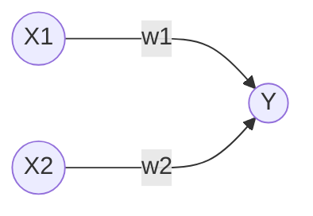

# 目录  
1.感知机  
2.神经网络  
3.神经网络的学习  
4.误差反向传播法  
5.与学习相关的技巧  
6.卷积神经网络  
7.深度学习  


# 1.感知机  
**目录:**  
1.1 感知机概述  
1.2 感知机的实现  
1.3 感知机的局限性  
1.5 多层感知机  

## 1.1 感知机概述  
1.感知机是什么  
感知机<font color="#00FF00">接收多个输入信号,输出一个信号</font>,下图是接收两个输入信号的感知机的例子,x1和x2是输入信号,y是输出信号,w1和w2是权重,图中的⭕称为<font color="#FF00FF">神经元</font>,输入信号被送往神经元时,会被分别乘以固定的权重(w1x1、w2x2)  

神经元会计算传送过来的信号总和,只有当这个总和超过某个界限值时(<font color="#FF00FF">阈值</font>),才会输出1,这也称为神经元被激活,用符号θ表示  

2.感知机的运行公式  
上述感知机的运行原理可以用下述公式来表示,感知机的多个输入信号都有各自固有的权重,这些权重控制着各个信号的重要性的作用,即<font color="#00FF00">权重越大对应权重的信号的重要性就越高</font>  
$$Y = \begin{cases} 
0, & w_1 x_1 + w_2 x_2 \le \theta \\ 
1, & w_1 x_1 + w_2 x_2 > \theta 
\end{cases}$$

## 1.2 感知机的实现
**目录:**  
1.2.1 简单实现  
1.2.2 导入权重和偏移量  

### 1.2.1 简单实现  
1.函数代码  
```python
import numpy as np

def AND(x1, x2):
    x = np.array([x1, x2])
    w = np.array([0.5, 0.5])
    b = -0.7
    tmp = np.sum(w*x) + b
    if tmp <= 0:
        return 0
    else:
        return 1

if __name__ == '__main__':
    for xs in [(0, 0), (1, 0), (0, 1), (1, 1)]:
        y = AND(xs[0], xs[1])
        print(str(xs) + " -> " + str(y))

# 输出结果
# (0, 0) -> 0
# (1, 0) -> 0
# (0, 1) -> 0
# (1, 1) -> 1
```
*提示:上述代码用于实现<font color="#00FF00">与门</font>的逻辑*

2.代码解释  
在函数内初始化参数w1、w2、theta,当输入的加权和超过阈值时返回1否则返回0

### 1.2.2 导入权重和偏移量  
1.修改公式  
将[[DeepLearing#11-感知机概述]]的公式变换,将其中的θ换成-b,于是就可以用下述公式来表示感知机的行为,*注意下面的公式进行了移相操作,把-b移到左边了*  
此公式中b称为偏移量,w1和w2称为权重,感知机会计算输入信号和权重的乘积,然后加上偏移量,如果值
$$Y = \begin{cases} 
0, & b + w_1 x_1 + w_2 x_2 \le 0 \\ 
1, & b + w_1 x_1 + w_2 x_2 > 0 
\end{cases}$$

2.代码示例  
```python
import numpy as np

def NAND(x1, x2):
    x = np.array([x1, x2]) #输入
    w = np.array([-0.5, -0.5]) #权重
    b = 0.7 #偏移量
    tmp = np.sum(w*x) + b
    if tmp <= 0:
        return 0
    else:
        return 1

if __name__ == '__main__':
    for xs in [(0, 0), (1, 0), (0, 1), (1, 1)]:
        y = NAND(xs[0], xs[1])
        print(str(xs) + " -> " + str(y))

# 输出结果
# (0, 0) -> 0
# (1, 0) -> 0
# (0, 1) -> 0
# (1, 1) -> 1
```
上述乘法运算,当两个数组的元素个数相同时,各个元素分别相乘即[0,1] * [0.5,0.5] = [0,0.5]  
np.sum(w*x)的意思是计算相乘后的各个元素的总和,最后再把偏移量加到这个结果之上就是上述1的公式

3.参数解释  
权重和偏移量的作用是不一样的,具体来说w1和w2是<font color="#00FF00">控制输入信号重要性的参数</font>,而<font color="#00FF00">偏移量是调整神经元被激活的容易程度的参数</font>(输出信号为1的容易度的参数)  
*举例:比如b取-0.1,则只要输入信号的加权总和超过0.1时,神经元就会被激活,但如果b为-20,则输入信号的加权总和必须超过20时,神经元才会被激活*  

4.或门的实现  
```python
import numpy as np

def OR(x1, x2):
    x = np.array([x1, x2])
    w = np.array([0.5, 0.5]) #仅权重和偏移量与AND算法不同
    b = -0.2
    tmp = np.sum(w*x) + b
    if tmp <= 0:
        return 0
    else:
        return 1

if __name__ == '__main__':
    for xs in [(0, 0), (1, 0), (0, 1), (1, 1)]:
        y = OR(xs[0], xs[1])
        print(str(xs) + " -> " + str(y))
```
*提示:与门、与非门、或门是具有相同构造的感知机,区别只在于权重参数的值*  

## 1.3 感知机的局限性  
**目录:**  
1.3.1 异或门  
1.3.2 线性和非线性  

### 1.3.1 异或门  
1.概述  
实际上用上述的感知机是无法实现异或门的,用感知机可以实现与门、或门却无法实现异或门  

2.或门公式和参数  
当权重参数(b,w1,w2)=(-0.5,1.0,1.0)时,可以满足或门的逻辑,此时感知机可以用下面公式表示,该公式表示的感知机会生成由直线-0.5+x1+x2=0分割开的两个空间,其中一个空间输出1,另一个空间输出0,公式对应的图也在下面,图中灰色区域是感知机输出0的区域  
$$Y = \begin{cases} 
0, & -0.5 + x_1 + x_2 \le 0 \\ 
1, & -0.5 + x_1 + x_2 > 0 
\end{cases}$$

  

*提示:图中只有当x1和x2在(0,0)时输出0,其余的三种情况都是输出1,如果想用感知机实现或门就需要用一条直线将图中的⭕和🔺分开,⭕代表0,🔺代表1*  

3.为什么感知机无法实现异或门  
看下图,要想用感知机实现异或门,就需要用一条直线作出分割图中⭕和🔺,但事实上无法用一条直线将⭕和🔺分开,所以感知机无法实现异或门  
  

### 1.3.2 线性和非线性  
  
上图中的⭕和🔺无法用一条直线分开,但如果将"直线"的限制去除,就可以实现了,如下图所示  
  
<font color="#00FF00">感知机的局限于在于它只能表示由一条直线分割的空间</font>,而上图这种弯曲的曲线是无法用感知机表示的  
所以由曲线分割而成的空间称为<font color="#FFC800">非线性空间</font>,由直线分割而成的空间称为<font color="#FFC800">线性空间</font>

## 1.5 多层感知机  
**目录:**  
1.5.1 已有门电路的组合  
1.5.2 异或门的实现  

### 1.5.1 已有门电路的组合  
1.概述  
实际上在[[DeepLearing#13-感知机的局限性]]所提到的感知机的局限性,是单层感知机无法表示异或门  
但感知机可以相互组合,于是乎就可以通过组合感知机实现异或门(也即通过已有的或门、与门、与非门的组合来实现异或门),如下图所示  
  

### 1.5.2 异或门的实现  
1.Python代码实现异或门  
*提示:使用之前定义的AND函数、NAND函数、OR函数就可以实现*  
```python
from and_gate import AND
from or_gate import OR
from nand_gate import NAND


def XOR(x1, x2):
    s1 = NAND(x1, x2)
    s2 = OR(x1, x2)
    y = AND(s1, s2)
    return y

if __name__ == '__main__':
    for xs in [(0, 0), (1, 0), (0, 1), (1, 1)]:
        y = XOR(xs[0], xs[1])
        print(str(xs) + " -> " + str(y))
```

2.感知机表示  
现在使用感知机来表示异或门,如下图所示异或门是一种<font color="#00FF00">多层结构的神经网络</font>,此处将最左边的第一列称为第0层、中间的第一列称为第1层、最右边的第一列称为第2层  
与门、或门是单层感知机,异或门是2层感知机,叠加了多层的感知机也称为<font color="#00FF00">多层感知机</font>  
  
*提示:这里称为2层感知机而不是三层的原因是,实质上拥有权重的层只有第0层和第1层,所以称为2层感知机*  
在上述的2层感知机中,先在第0层和第1层的神经元之间信号的传送和接收,然后在第1层和第2层之间进行信号的传送和接收  
<font color="#00FF00">即通过叠加层感知机能进行更加灵活的表示</font>  

# 2.神经网络  
**目录:**  
2.1 从感知机到神经网络  
2.2 激活函数  
2.3 多维数组的运算  
2.4 3层神经网络的实现  
2.5 输出层的设计  
2.6 手写数字识别  

## 2.1 从感知机到神经网络  
**目录:**  
2.1.1 神经网络的例子  
2.1.2 感知机复习  
2.1.3 激活函数  


### 2.1.1 神经网络的例子  
1.感知机的问题  
在介绍神经网络之前,先简单说明感知机存在的问题,对于感知机而言,即便是复杂的函数也可以通过感知机的叠加来实现它,但问题在于,设置感知机权重的工作(即确定合适的、能符合预期输入与输出的权重)还得依靠人工进行,在之前的章节中就是结合与门、或门的真值表人工决定了合适的权重  
<font color="#00FF00">神经网络</font>的出现就是为了解决刚才的问题,神经网络的重要性质就是它可以<font color="#00FF00">自动地从数据中学习到合适的权重参数</font>  

2.神经网络概述  
  
以上图来表示神经网络,最左边的一列称为<font color="#FFC800">输入层</font>,最右边的一列称为<font color="#FFC800">输出层</font>,中间的一列称为<font color="#FFC800">中间层</font>,中间层有时也称为<font color="#FFC800">隐藏层</font>  
隐藏层的意思是,相较于输入层和输出层而言,隐藏层的神经元是不可见的,本笔记依次把输入层到输出层称为第0层、第1层、第2层  
*提示:本笔记会把图中的神经网络称为2层网络,因为其本质只有2层的神经元有权重,有些地方会把上图的网络称为三层网络*  

### 2.1.2 感知机复习  
1.感知机  
$$Y = \begin{cases} 
0, & b + w_1 x_1 + w_2 x_2 \le 0 \\ 
1, & b + w_1 x_1 + w_2 x_2 > 0 
\end{cases}$$
以之前提到的上述感知机公式为例,我们可以画出其对应的网络结构,但现在也要把偏移量b一并画在图中,这个感知机将x1、x2、1三个信号作为神经元的输入,将其各自的权重相乘并相加后得到结果,由于偏移量b的值一直是1,所以为了区分别的神经元,将其整个涂成灰色  
  
*提示:所以偏移量b也可以算是权重,只不过它反映神经元被激活的容易程度*

2.改写公式  
将上述感知机公式简化,用一个函数来表示这种分情况的动作(超过0则输出1,否则输出0),引入新函数h(x)  
$$Y = h(b + w_1x_1 + w_2x_2)$$
$$h(x) = \begin{cases} 
0, & x \le 0 \\ 
1, & x > 0 
\end{cases}$$

式1中,输入信号的总和会被函数h(x)转换,转换后的值就是y的值  
式2中,h(x)函数,在输入超过0时输出0,否则返回1(该函数只输出0或1)

### 2.1.3 激活函数  
1.h(x)函数  
上述的h(x)函数会将输入信号的总和转为输出信号,这种函数一般称为<font color="#00FF00">激活函数</font>,激活函数的作用在于决定如何来激活输入信号的总和  

2.改写公式  
如果将Y=h(x)进一步改写,先计算输入信号的加权总和,然后用激活函数转换这一总和,此时可将该式子分解为下述的两个公式  
式1计算加权输入信号和偏移量的总和记为a,式2用h()函数将a转换为输出y  
$$a = b + w_1x_1 + w_2x_2$$  
$$y = h(a)$$  

3.激活函数的计算过程  
下图表示了上述改写后公式的样貌,图中的⭕明确显示了激活函数的计算过程,即信号的加权总和为节点a,然后节点a被激活函数h(x)转换为节点y  
  

## 2.2 激活函数  
**目录:** 
2.2.1 sigmoid函数  
2.2.2 阶跃函数的实现  
2.2.3 阶跃函数的图形  
2.2.4 sigmoid函数的实现  

### 2.2.1 sigmoid函数  
1.概述  
$$h(x) = \begin{cases} 
0, & x \le 0 \\ 
1, & x > 0 
\end{cases}$$
上述激活函数以阈值为界,一旦输入超过阈值,就切换输出,这样的函数称为<font color="#FFC800">阶跃函数</font>,因此可以说感知机使用阶跃函数作为激活函数,那么当感知机使用别的函数作为激活函数时,此时就进入了神经网络激活函数,可以说感知机和神经网络的主要区别就是<font color="#00FF00">激活函数</font>  
本节的sigmoid函数就是要介绍的第一个神经网络激活函数  

2.sigmoid函数  
sigmoid函数表达式如下,所谓函数就是单值对应(一个输入一个输出),比如向sigmoid函数执行,h(1)=0.731、h(2)=0.880  
$$h(x) = \frac{1}{1 + e^{-x}}$$  


### 2.2.2 阶跃函数的实现  
1.阶跃函数的简单代码实现  
$$h(x) = \begin{cases} 
0, & x \le 0 \\ 
1, & x > 0 
\end{cases}$$

```python
def step_function(x):
    if x > 0:
        return 1
    else:
        return 0
```
上述阶跃函数可以被上述代码简单地实现,但是该函数的输入参数只能接受实数(浮点数),但它不允许参数取NumPy数组,所以将其修改为支持NumPy数组的实现  
```python
import numpy as np

def step_function(x):
    y = x > 0
    return y.astype(np.int)
```
*解释:x>0会返回一个布尔数组并保存在y中,显示在数组x中有多少元素的值大于0,y是一个布尔数组,但是目前要求输出的值为0或1分别表示False和True,所以再用astype转换其类型为0/1*  
*模拟:例如x = np.array([-1.0,1.0,2.0])最后输出的结果为array([0,1,1])*  

### 2.2.3 阶跃函数的图形  
1.图像代码
用图来表示[[DeepLearing#222-阶跃函数的实现]]的阶跃函数,代码如下  
```python
import numpy as np
import matplotlib.pylab as plt


def sigmoid(x):
    return 1 / (1 + np.exp(-x))    


def step_function(x):
    return np.array(x > 0, dtype=int)

# 在-5.0到5.0之间以0.1为单位,生成NumPy数组
x = np.arange(-5.0, 5.0, 0.1)
# step_function以该数组为参数,对数组的各个元素执行阶跃函数运算,并以数组形式返回运算结果,对数组x、y进行绘图
y2 = step_function(x)

plt.plot(x, y2, 'k--')
plt.ylim(-0.1, 1.1) #指定图中绘制的y轴的范围
plt.savefig("sig_step_compare.png")
```

2.图像结果  
  
阶跃函数以0为界限,输出从0切换到1(或者反过来),<font color="#00FF00">它的值呈阶梯式变化,所以称为阶跃函数</font>  


