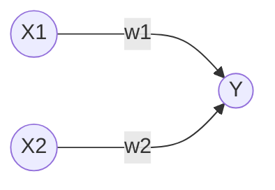
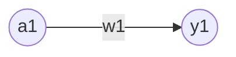

# 目录  
1.感知机  
2.神经网络  
3.神经网络的学习  
4.误差反向传播法  
5.与学习相关的技巧  
6.卷积神经网络  
7.深度学习  


# 1.感知机  
**目录:**  
1.1 感知机概述  
1.2 感知机的实现  
1.3 感知机的局限性  
1.5 多层感知机  

## 1.1 感知机概述  
1.感知机是什么  
感知机<font color="#00FF00">接收多个输入信号,输出一个信号</font>,下图是接收两个输入信号的感知机的例子,x1和x2是输入信号,y是输出信号,w1和w2是权重,图中的⭕称为<font color="#FF00FF">神经元</font>,输入信号被送往神经元时,会被分别乘以固定的权重(w1x1、w2x2)  

神经元会计算传送过来的信号总和,只有当这个总和超过某个界限值时(<font color="#FF00FF">阈值</font>),才会输出1,这也称为神经元被激活,用符号θ表示  

2.感知机的运行公式  
上述感知机的运行原理可以用下述公式来表示,感知机的多个输入信号都有各自固有的权重,这些权重控制着各个信号的重要性的作用,即<font color="#00FF00">权重越大对应权重的信号的重要性就越高</font>  
$$Y = \begin{cases} 
0, & w_1 x_1 + w_2 x_2 \le \theta \\ 
1, & w_1 x_1 + w_2 x_2 > \theta 
\end{cases}$$

## 1.2 感知机的实现
**目录:**  
1.2.1 简单实现  
1.2.2 导入权重和偏移量  

### 1.2.1 简单实现  
1.函数代码  
```python
import numpy as np

def AND(x1, x2):
    x = np.array([x1, x2])
    w = np.array([0.5, 0.5])
    b = -0.7
    tmp = np.sum(w*x) + b
    if tmp <= 0:
        return 0
    else:
        return 1

if __name__ == '__main__':
    for xs in [(0, 0), (1, 0), (0, 1), (1, 1)]:
        y = AND(xs[0], xs[1])
        print(str(xs) + " -> " + str(y))

# 输出结果
# (0, 0) -> 0
# (1, 0) -> 0
# (0, 1) -> 0
# (1, 1) -> 1
```
*提示:上述代码用于实现<font color="#00FF00">与门</font>的逻辑*

2.代码解释  
在函数内初始化参数w1、w2、theta,当输入的加权和超过阈值时返回1否则返回0

### 1.2.2 导入权重和偏移量  
1.修改公式  
将[[DeepLearing#11-感知机概述]]的公式变换,将其中的θ换成-b,于是就可以用下述公式来表示感知机的行为,*注意下面的公式进行了移相操作,把-b移到左边了*  
此公式中b称为偏移量,w1和w2称为权重,感知机会计算输入信号和权重的乘积,然后加上偏移量,如果值
$$Y = \begin{cases} 
0, & b + w_1 x_1 + w_2 x_2 \le 0 \\ 
1, & b + w_1 x_1 + w_2 x_2 > 0 
\end{cases}$$

2.代码示例  
```python
import numpy as np

def NAND(x1, x2):
    x = np.array([x1, x2]) #输入
    w = np.array([-0.5, -0.5]) #权重
    b = 0.7 #偏移量
    tmp = np.sum(w*x) + b
    if tmp <= 0:
        return 0
    else:
        return 1

if __name__ == '__main__':
    for xs in [(0, 0), (1, 0), (0, 1), (1, 1)]:
        y = NAND(xs[0], xs[1])
        print(str(xs) + " -> " + str(y))

# 输出结果
# (0, 0) -> 0
# (1, 0) -> 0
# (0, 1) -> 0
# (1, 1) -> 1
```
上述乘法运算,当两个数组的元素个数相同时,各个元素分别相乘即[0,1] * [0.5,0.5] = [0,0.5]  
np.sum(w*x)的意思是计算相乘后的各个元素的总和,最后再把偏移量加到这个结果之上就是上述1的公式

3.参数解释  
权重和偏移量的作用是不一样的,具体来说w1和w2是<font color="#00FF00">控制输入信号重要性的参数</font>,而<font color="#00FF00">偏移量是调整神经元被激活的容易程度的参数</font>(输出信号为1的容易度的参数)  
*举例:比如b取-0.1,则只要输入信号的加权总和超过0.1时,神经元就会被激活,但如果b为-20,则输入信号的加权总和必须超过20时,神经元才会被激活*  

4.或门的实现  
```python
import numpy as np

def OR(x1, x2):
    x = np.array([x1, x2])
    w = np.array([0.5, 0.5]) #仅权重和偏移量与AND算法不同
    b = -0.2
    tmp = np.sum(w*x) + b
    if tmp <= 0:
        return 0
    else:
        return 1

if __name__ == '__main__':
    for xs in [(0, 0), (1, 0), (0, 1), (1, 1)]:
        y = OR(xs[0], xs[1])
        print(str(xs) + " -> " + str(y))
```
*提示:与门、与非门、或门是具有相同构造的感知机,区别只在于权重参数的值*  

## 1.3 感知机的局限性  
**目录:**  
1.3.1 异或门  
1.3.2 线性和非线性  

### 1.3.1 异或门  
1.概述  
实际上用上述的感知机是无法实现异或门的,用感知机可以实现与门、或门却无法实现异或门  

2.或门公式和参数  
当权重参数(b,w1,w2)=(-0.5,1.0,1.0)时,可以满足或门的逻辑,此时感知机可以用下面公式表示,该公式表示的感知机会生成由直线-0.5+x1+x2=0分割开的两个空间,其中一个空间输出1,另一个空间输出0,公式对应的图也在下面,图中灰色区域是感知机输出0的区域  
$$Y = \begin{cases} 
0, & -0.5 + x_1 + x_2 \le 0 \\ 
1, & -0.5 + x_1 + x_2 > 0 
\end{cases}$$

  

*提示:图中只有当x1和x2在(0,0)时输出0,其余的三种情况都是输出1,如果想用感知机实现或门就需要用一条直线将图中的⭕和🔺分开,⭕代表0,🔺代表1*  

3.为什么感知机无法实现异或门  
看下图,要想用感知机实现异或门,就需要用一条直线作出分割图中⭕和🔺,但事实上无法用一条直线将⭕和🔺分开,所以感知机无法实现异或门  
  

### 1.3.2 线性和非线性  
  
上图中的⭕和🔺无法用一条直线分开,但如果将"直线"的限制去除,就可以实现了,如下图所示  
  
<font color="#00FF00">感知机的局限于在于它只能表示由一条直线分割的空间</font>,而上图这种弯曲的曲线是无法用感知机表示的  
所以由曲线分割而成的空间称为<font color="#FFC800">非线性空间</font>,由直线分割而成的空间称为<font color="#FFC800">线性空间</font>

## 1.5 多层感知机  
**目录:**  
1.5.1 已有门电路的组合  
1.5.2 异或门的实现  

### 1.5.1 已有门电路的组合  
1.概述  
实际上在[[DeepLearing#13-感知机的局限性]]所提到的感知机的局限性,是单层感知机无法表示异或门  
但感知机可以相互组合,于是乎就可以通过组合感知机实现异或门(也即通过已有的或门、与门、与非门的组合来实现异或门),如下图所示  
  

### 1.5.2 异或门的实现  
1.Python代码实现异或门  
*提示:使用之前定义的AND函数、NAND函数、OR函数就可以实现*  
```python
from and_gate import AND
from or_gate import OR
from nand_gate import NAND


def XOR(x1, x2):
    s1 = NAND(x1, x2)
    s2 = OR(x1, x2)
    y = AND(s1, s2)
    return y

if __name__ == '__main__':
    for xs in [(0, 0), (1, 0), (0, 1), (1, 1)]:
        y = XOR(xs[0], xs[1])
        print(str(xs) + " -> " + str(y))
```

2.感知机表示  
现在使用感知机来表示异或门,如下图所示异或门是一种<font color="#00FF00">多层结构的神经网络</font>,此处将最左边的第一列称为第0层、中间的第一列称为第1层、最右边的第一列称为第2层  
与门、或门是单层感知机,异或门是2层感知机,叠加了多层的感知机也称为<font color="#00FF00">多层感知机</font>  
  
*提示:这里称为2层感知机而不是三层的原因是,实质上拥有权重的层只有第0层和第1层,所以称为2层感知机*  
在上述的2层感知机中,先在第0层和第1层的神经元之间信号的传送和接收,然后在第1层和第2层之间进行信号的传送和接收  
<font color="#00FF00">即通过叠加层感知机能进行更加灵活的表示</font>  

# 2.神经网络  
**目录:**  
2.1 从感知机到神经网络  
2.2 激活函数  
2.3 多维数组的运算  
2.4 3层神经网络的实现(前向)  
2.5 输出层的设计  
2.6 手写数字识别  

## 2.1 从感知机到神经网络  
**目录:**  
2.1.1 神经网络的例子  
2.1.2 感知机复习  
2.1.3 激活函数  


### 2.1.1 神经网络的例子  
1.感知机的问题  
在介绍神经网络之前,先简单说明感知机存在的问题,对于感知机而言,即便是复杂的函数也可以通过感知机的叠加来实现它,但问题在于,设置感知机权重的工作(即确定合适的、能符合预期输入与输出的权重)还得依靠人工进行,在之前的章节中就是结合与门、或门的真值表人工决定了合适的权重  
<font color="#00FF00">神经网络</font>的出现就是为了解决刚才的问题,神经网络的重要性质就是它可以<font color="#00FF00">自动地从数据中学习到合适的权重参数</font>  

2.神经网络概述  
  
以上图来表示神经网络,最左边的一列称为<font color="#FFC800">输入层</font>,最右边的一列称为<font color="#FFC800">输出层</font>,中间的一列称为<font color="#FFC800">中间层</font>,中间层有时也称为<font color="#FFC800">隐藏层</font>  
隐藏层的意思是,相较于输入层和输出层而言,隐藏层的神经元是不可见的,本笔记依次把输入层到输出层称为第0层、第1层、第2层  
*提示:本笔记会把图中的神经网络称为2层网络,因为其本质只有2层的神经元有权重,有些地方会把上图的网络称为三层网络*  

### 2.1.2 感知机复习  
1.感知机  
$$Y = \begin{cases} 
0, & b + w_1 x_1 + w_2 x_2 \le 0 \\ 
1, & b + w_1 x_1 + w_2 x_2 > 0 
\end{cases}$$
以之前提到的上述感知机公式为例,我们可以画出其对应的网络结构,但现在也要把偏移量b一并画在图中,这个感知机将x1、x2、1三个信号作为神经元的输入,将其各自的权重相乘并相加后得到结果,由于偏移量b的值一直是1,所以为了区分别的神经元,将其整个涂成灰色  
  
*提示:所以偏移量b也可以算是权重,只不过它反映神经元被激活的容易程度*

2.改写公式  
将上述感知机公式简化,用一个函数来表示这种分情况的动作(超过0则输出1,否则输出0),引入新函数h(x)  
$$Y = h(b + w_1x_1 + w_2x_2)$$
$$h(x) = \begin{cases} 
0, & x \le 0 \\ 
1, & x > 0 
\end{cases}$$

式1中,输入信号的总和会被函数h(x)转换,转换后的值就是y的值  
式2中,h(x)函数,在输入超过0时输出0,否则返回1(该函数只输出0或1)

### 2.1.3 激活函数  
1.h(x)函数  
上述的h(x)函数会将输入信号的总和转为输出信号,这种函数一般称为<font color="#00FF00">激活函数</font>,激活函数的作用在于决定如何来激活输入信号的总和  

2.改写公式  
如果将Y=h(x)进一步改写,先计算输入信号的加权总和,然后用激活函数转换这一总和,此时可将该式子分解为下述的两个公式  
式1计算加权输入信号和偏移量的总和记为a,式2用h()函数将a转换为输出y  
$$a = b + w_1x_1 + w_2x_2$$  
$$y = h(a)$$  

3.激活函数的计算过程  
下图表示了上述改写后公式的样貌,图中的⭕明确显示了激活函数的计算过程,即信号的加权总和为节点a,然后节点a被激活函数h(x)转换为节点y  
  

## 2.2 激活函数  
**目录:** 
2.2.1 sigmoid函数  
2.2.2 阶跃函数的实现  
2.2.3 阶跃函数的图形  
2.2.4 sigmoid函数的实现  
2.2.5 阶跃函数和sigmoid函数  
2.2.6 非线性函数  
2.2.7 ReLU函数  

### 2.2.1 sigmoid函数  
1.概述  
$$h(x) = \begin{cases} 
0, & x \le 0 \\ 
1, & x > 0 
\end{cases}$$
上述激活函数以阈值为界,一旦输入超过阈值,就切换输出,这样的函数称为<font color="#FFC800">阶跃函数</font>,因此可以说感知机使用阶跃函数作为激活函数,那么当感知机使用别的函数作为激活函数时,此时就进入了神经网络激活函数,可以说感知机和神经网络的主要区别就是<font color="#00FF00">激活函数</font>  
本节的sigmoid函数就是要介绍的第一个神经网络激活函数  

2.sigmoid函数  
sigmoid函数表达式如下,所谓函数就是单值对应(一个输入一个输出),比如向sigmoid函数执行,h(1)=0.731、h(2)=0.880  
$$h(x) = \frac{1}{1 + e^{-x}}$$  


### 2.2.2 阶跃函数的实现  
1.阶跃函数的简单代码实现  
$$h(x) = \begin{cases} 
0, & x \le 0 \\ 
1, & x > 0 
\end{cases}$$

```python
def step_function(x):
    if x > 0:
        return 1
    else:
        return 0
```
上述阶跃函数可以被上述代码简单地实现,但是该函数的输入参数只能接受实数(浮点数),但它不允许参数取NumPy数组,所以将其修改为支持NumPy数组的实现  
```python
import numpy as np

def step_function(x):
    y = x > 0
    return y.astype(np.int)
```
*解释:x>0会返回一个布尔数组并保存在y中,显示在数组x中有多少元素的值大于0,y是一个布尔数组,但是目前要求输出的值为0或1分别表示False和True,所以再用astype转换其类型为0/1*  
*模拟:例如x = np.array([-1.0,1.0,2.0])最后输出的结果为array([0,1,1])*  

### 2.2.3 阶跃函数的图形  
1.图像代码
用图来表示[[DeepLearing#222-阶跃函数的实现]]的阶跃函数,代码如下  
```python
import numpy as np
import matplotlib.pylab as plt


def sigmoid(x):
    return 1 / (1 + np.exp(-x))    


def step_function(x):
    return np.array(x > 0, dtype=int)

# 在-5.0到5.0之间以0.1为单位,生成NumPy数组
x = np.arange(-5.0, 5.0, 0.1)
# step_function以该数组为参数,对数组的各个元素执行阶跃函数运算,并以数组形式返回运算结果,对数组x、y进行绘图
y2 = step_function(x)

plt.plot(x, y2, 'k--')
plt.ylim(-0.1, 1.1) #指定图中绘制的y轴的范围
plt.savefig("sig_step_compare.png")
```

2.图像结果  
  
阶跃函数以0为界限,输出从0切换到1(或者反过来),<font color="#00FF00">它的值呈阶梯式变化,所以称为阶跃函数</font>  

### 2.2.4 sigmoid函数的实现  
1.Python实现代码  
$$h(x) = \frac{1}{1 + e^{-x}}$$  
```python
def sigmoid(x):
    return 1 / (1 + np.exp(-x))    
```

2.广播
上述函数也可用于NumPy数组的计算,它的结果如下  
```python
x = np.array[(-1.0,1.0,2.0)]; # 定义数组
sigmoid(x)
# 输出结果为[(0.26894142,0.73105858,0.88079708)]
```
之所以sigmoid函数能够支持NumPy数组,原因就在于NumPy的广播功能[[../Python/Python#6543-广播]],如果在标量(一个具体的数值)和NumPy数组之间进行运算,<font color="#00FF00">则标量会和数组的各个元素进行计算</font>  

### 2.2.5 阶跃函数和sigmoid函数  
1.函数代码
```python
import numpy as np
import matplotlib.pylab as plt

def sigmoid(x):
    return 1 / (1 + np.exp(-x))    


def step_function(x):
    return np.array(x > 0, dtype=int)

x = np.arange(-5.0, 5.0, 0.1)
# 主要区别就在这里,y1是sigmoid函数的图像
y1 = sigmoid(x)
# y2是阶跃函数的图像
y2 = step_function(x)

# plot函数需要的参数是NumPy数组
plt.plot(x, y1)
plt.plot(x, y2, 'k--')
plt.ylim(-0.1, 1.1)
plt.savefig("sig_step_compare.png")
```
*提示:本代码和之前阶跃函数那边的代码类似,就是加了一个sigmoid函数的图像*

2.阶跃函数和sigmoid函数区别 
   
(1) sigmoid函数是一条平滑的曲线,输出随着输入发生连续性变化,而阶跃函数以0为界,输出发生急剧性变化  
(2) 阶跃函数只能返回0和1,但是sigmoid可以返回一些列实数(0.26894142,0.73105858,0.88079708),即感知机中神经元之间流动的是二元信号,而神经网络中流动的是连续的实数信号  

3.阶跃函数和sigmoid函数共同点  
(1) 虽然两个函数在平滑性上有差异,但是如果从宏观视角看,两者的结构均为<font color="#00FF00">输入小时,输出接近0,随着输入增大,输出向1靠近</font>,换句话说,当输入信号为重要信号时,阶跃函数和sigmoid函数都会输出较大的值,当输入信号不重要时,两者都输出较小的值  
(2) 不管输入信号的大小,两者的输出信号均在0到1之间  

### 2.2.6 非线性函数  
1.非线性函数  
阶跃函数和sigmoid函数都是<font color="#00FF00">非线性函数</font>,所谓非线性函数对应的是线性函数,若函数的输出值是输入值的常数倍数就称为线性函数,所以线性函数就是一条笔直的直线,反之就是非线性函数  

2.神经网络必须使用非线性函数  
激活函数不能使用线性函数,因为使用线性函数的话,<font color="#00FF00">加深神经网络的层数就没有意义了</font>  
比如把$h(x)=cx$作为激活函数,把$y(x)=h(h(h(x)))$的运算对应三层神经网络,这个运算会进行$y(x)=c * c * c * x$的乘法运算,但是同样的处理可以用$y(x)=ax$其中$a=c^3$这一次乘法运算来表示,所以使用线性函数的时候,就无法发挥多层网络带来的优势,因此要想发挥叠加层所带来的优势,<font color="#00FF00">激活函数必须使用非线性函数</font>  


### 2.2.7 ReLU函数  
1.函数表达式
ReLU函数在输入大于0时,直接输出该值,在输入小于等于0时,输出0;函数表达式如下  
$$h(x) = \begin{cases} 
x \space (x > 0) \\ 
0 \space (x \le 0) \\ 
\end{cases}$$

2.ReLU函数的实现  
```python
def relu(x):
    # 选择输入中较大的那个值进行输出
    return np.maximum(0, x)
```
  

## 2.3 多维数组的运算  
1.矩阵与神经网络  
其实用神经网络可以表示出矩阵乘法运算,如下图所示,该神经元省略了偏移量和激活函数,只有权重,例如这里的输入参数取[1,2],最终计算出的神经元就是[5,11,17]和矩阵乘法规则一模一样  
  

## 2.4 3层神经网络的实现(前向)  
**目录:**  
2.4.1 概述  
2.4.2 符号确认  
2.4.3 各层间信号传递的实现  
2.4.4 代码实现小结  

### 2.4.1 概述  
本节进行神经网络的实现,以下图的三层神经网络为对象,实现从输入到输出的(前向)处理,使用NumPy数组就可以用很少的代码完成神经网络的前向处理  
  

### 2.4.2 符号确认  
1.神经元  
  

2.解释  
上图只突出显示了从输入层神经元$x_2$到后一层的神经元$a_1^{(1)}$  
权重$w_{12}^{(1)}$和神经元$a_1^{(1)}$右上角的(1),表示权重和神经元的层号(注意这里不是2,从左往右依次是第0层、第1层)  
然后权重右下角的两个数字,指的是后一层的神经元和前一层的神经元的索引号,比如这里的12,表示前一层的第2个神经元x2和后一层的第1个神经元$a_1^{(1)}$的权重  

### 2.4.3 各层间信号传递的实现  
1.神经网络  
*提示:本节将以下述的神经网络为示例,另外图中的实心节点为偏移神经元"1",所以它右下角的索引号只有一个,表示前一层的神经元只有一个*  
  

2.输入层到第一层的信号传递  
根据[[DeepLearing#213-激活函数]]的相同计算方法,现在表示出$a_1^{(1)}$,它的计算方式为$a_1^{(1)}=w_{11}^{(1)}x_1 + w_{12}^{(1)}x_2 + b_{1}^{(1)}$  
如果使用矩阵运算的话,可以将第一层的加权和表示为$A^{(1)} = XW^{(1)} + B^{(1)}$,其中$A^{(1)}$、$X$、$B^{(1)}$、$W^{(1)}$如下所示  
$A^{(1)} = (a_1^{(1)} \quad a_2^{(1)} \quad a_3^{(1)})$,$X = (x_1 \quad x_2)$,$B^{(1)} = (b_1^{(1)} \quad b_2^{(1)} \quad b_3^{(1)})$,$W^{(1)} = \begin{pmatrix} w_{11}^{(1)} & w_{21}^{(1)} &w_{31}^{(1)} \\ w_{12}^{(1)} & w_{22}^{(1)} & w_{32}^{(1)} \end{pmatrix}$ 

接着使用NumPy数组来实现上述的式子,这里将输入信号、权重、偏移量设置为任意值  
```python
X = np.array([1.0, 0.5])
W1 = np.array([[0.1, 0.3, 0.5], [0.2, 0.4, 0.6]])
B1 = np.array([0.1, 0.2, 0.3])
print(W1.shape) # (2, 3)
print(X.shape) # (2,)
print(B1.shape) # (3,)
A1 = np.dot(X, W1) + B1
```
  
该公式的计算过程,用上图表示,隐藏层的加权和(加权信号和偏移量的总和)用$a$表示,被激活函数转换后的信号用$z$表示,图中的$h()$表示激活函数,这里的激活函数使用的sigmoid,用Python代码实现第一层的输出  
```python
Z1 = sigmoid(A1)
print(A1) # [0.3, 0.7, 1.1]
print(Z1) # [0.57444252, 0.66818777, 0.75026011]
```

3.实现第1层到第2层信号的传递  
```python
W2 = np.array([[0.1, 0.4], [0.2, 0.5], [0.3, 0.6]])
B2 = np.array([0.1, 0.2])
print(Z1.shape) # (3,)
print(W2.shape) # (3, 2)
print(B2.shape) # (2,)
A2 = np.dot(Z1,W2) + B2
Z2 = sigmoid(A2)
```
*提示:除了第一层的输出(Z1)变成第二层的输入之外,这里的实现和刚才的代码完全相同*  

4.实现第2层到第3层信号的传递  
```python
def identity_function(x):
 return x
W3 = np.array([[0.1,0.3],[0.2,0.4]])
B3 = np.array([0.1,0.2])

A3 = np.dot(Z2,W3) + B3
Y = identity_function(A3)
```
这里定义的identity_function函数(也成为恒等函数),将其作为输出层的激活函数,输出层的激活函数会稍微不同  
*提示:输出层的激活函数要根据具体问题来确定,一般回归问题可以使用恒等函数,二元分类问题可以使用sigmoid函数,多元分类问题可以使用softmax函数*  


### 2.4.4 代码实现小结  
3层神经网络的实现原理已经理解了,现在把之前的代码规整一下,代码中的权重记作W1  
```python
def init_network():
    network = {}
    network['W1'] = np.array([[0.1, 0.3, 0.5], [0.2, 0.4, 0.6]])
    network['b1'] = np.array([0.1, 0.2, 0.3])
    network['W2'] = np.array([[0.1, 0.4], [0.2, 0.5], [0.3, 0.6]])
    network['b2'] = np.array([0.1, 0.2])
    network['W3'] = np.array([[0.1, 0.3], [0.2, 0.4]])
    network['b3'] = np.array([0.1, 0.2])

    return network
def forward(network, x):
    W1, W2, W3 = network['W1'], network['W2'], network['W3']
    b1, b2, b3 = network['b1'], network['b2'], network['b3']
    a1 = np.dot(x, W1) + b1
    z1 = sigmoid(a1)
    a2 = np.dot(z1, W2) + b2
    z2 = sigmoid(a2)
    a3 = np.dot(z2, W3) + b3
    y = identity_function(a3)

    return y
network = init_network()
x = np.array([1.0, 0.5])
y = forward(network, x)
print(y) # [ 0.31682708 0.69627909]
```
这里定义了init_network和forward函数,init_network函数进行权重和偏移量的初始化并将其保存在字典network中,network保存了每一层所需的参数(权重和偏移量),forward函数中则封装了将输入信号转换为输出信号的处理过程  
<font color="#00FF00">forward(前向)表示的是从输入到输出方向的传递处理</font>,后续进行神经网络训练时会介绍后向处理  

## 2.5 输出层的设计  
**目录:**  
2.5.1 分类问题和回归问题  
2.5.2 恒等函数和softmax函数  
2.5.3 softmax函数优化  
2.5.4 softmax函数的特征  
2.5.5 输出层的神经元数量  


### 2.5.1 分类问题和回归问题  
神经网络可以用于<font color="#00FF00">分类问题和回归问题</font>,一般而言回归问题用恒等函数,分类问题用softmax函数  
机器学习的问题大致分为分类问题和回归问题  
(1) 分类问题是数据属于哪一个类别的问题,比如区分图像是男人还是女人的问题  
(2) 回归问题是根据某个输入预测一个数值的问题(连续的数值),比如根据一个图像猜测这个人体重的问题  
*提示:本节讲的函数都只是服务于输出层的函数,和中间层不相关*  

### 2.5.2 恒等函数和softmax函数  
1.恒等函数  
恒等函数会将输入按原样输出,对于输入的信息,不加以任何改动地直接输出,因此在输出层使用恒等函数时,输入信号会原封不动地被输出  


2.softmax函数  
分类问题中的softmax函数可用如下公式表示,假设输出层共有n个神经元,计算第k个神经元的输出yk,softmax函数的分子是输入信号ak的指数函数,分母是所有输入信号的指数函数的和  
$$yk = \frac{e^{a_k}}{\sum_{i=1}^{n} e^{a_i}}$$

下图可以表示softmax函数,softmax函数的输出通过箭头与所有输入信号相连,这是因为从上述式子可以看出,输出层的各个神经元都受到所有输入信号的影响  
  

3.Python代码实现  
```python
>>> a = np.array([0.3, 2.9, 4.0])
>>>
>>> exp_a = np.exp(a) # 指数函数
>>> print(exp_a)
[ 1.34985881 18.17414537 54.59815003]
>>>
>>> sum_exp_a = np.sum(exp_a) # 指数函数的和
>>> print(sum_exp_a)
74.1221542102
>>>
>>> y = exp_a / sum_exp_a
>>> print(y)
[ 0.01821127 0.24519181 0.73659691]
```
上述代码使用Python解释器来实现,这个Python实现完全是按照上节2.softmax函数的公式来的,下面把它定义为softmax函数  
```python
def softmax(a):
    exp_a = np.exp(a)
    sum_exp_a = np.sum(exp_a)
    y = exp_a / sum_exp_a
    
    return y
```

### 2.5.3 softmax函数优化  
1.数值溢出
上述的softmax函数虽然正确地描述公式,但会存在溢出缺陷,因为softmax函数的实现要进行指数函数的运算,但此时指数函数值会变得非常大,比如$e^10$值会超过20000,而$e^100$会有超过40个0的超大数值  

2.公式优化  
于是上述的经典公式可以按如下方法优化  
$$yk = \frac{e^{a_k}}{\sum_{i=1}^{n} e^{a_i}} = \frac{Ce^{a_k}}{C\sum_{i=1}^{n} e^{a_i}} \\ = \frac{e^{(a_k + logC)}}{\sum_{i=1}^{n} e^{(a_i + logC)}} \\ = \frac{e^{(a_k + C')}}{\sum_{i=1}^{n} e^{(a_i + C')}}$$  
首先在分子和分母都乘任意常数C,然后将C移动到指数函数中,记为$logC$,最后把$logC$替换为$C'$  
上述式子说明,在进行softmax的指数函数运算时,加上或减去某个常数并不会改变运算结果,这里的$C'$可以使用任何值,一般会使用输入信号中的最大值  

3.例子  
```python
>>> a = np.array([1010, 1000, 990])
>>> np.exp(a) / np.sum(np.exp(a)) # softmax 函数的运算
array([ nan, nan, nan])
# 没有被正确计算
>>> c = np.max(a) # 1010
>>> a - c
array([ 0, -10, -20])
>>>
>>> np.exp(a - c) / np.sum(np.exp(a - c))
array([9.99954600e-01, 4.53978686e-05, 2.06106005e-09])
```
正如上述例子所示,通过<font color="#00FF00">减去输入信号的最大值</font>,原本是nan的计算结果现在被正确计算了,于是乎可以像下面这样实现softmax函数  
```python
def softmax(a):
    c = np.max(a)
    exp_a = np.exp(a - c) # 溢出对策
    sum_exp_a = np.sum(exp_a)
    y = exp_a / sum_exp_a
    return y
```

### 2.5.4 softmax函数的特征  
1.softmax函数测试  
```python
>>> a = np.array([0.3, 2.9, 4.0])
>>> y = softmax(a)
>>> print(y)
[ 0.01821127 0.24519181 0.73659691]
>>> np.sum(y)
1.0
```
softmax函数的输出总是0.0到1.0之间的实数,并且softmax函数的输出值的总和是1,<font color="#FF00FF">输出总和为1是softmax函数的一个重要性质</font>,正因为有了这个性质才可以把softmax函数的输出解释为"概率"  

2.解释  
上述的例子还可以解释为y[0]的概率是0.018(1.8%),y[1]的概率是0.245(24.5%),y[2]的概率是0.737(73.3%),从概率的结果来看,可以说"因为第2个元素的概率最高,所以答案是第2个类别",还可以说"有74%的概率是第2个类别,有25%的概率是第1个类别,有1%的概率是第0个类别",即使用softmax函数,可以使用概率的方法处理问题  
另外,即便使用了softmax函数各个元素之间的大小关系也不会改变,这是因为指数函数$e^x$是单调递增函数,即数组a和数组y之间的大小关系没有改变(即数组a的值越大的元素,对应的y中的值也就越大)  

3.输出层函数  
一般而言,神经网络只把输出值最大的神经元所对应的类别作为识别结果,即使使用softmax函数,输出值最大的神经元的位置也不会改变,因此神经元在进行分类时,输出层的softmax函数可以省略,在实际问题中,由于指数函数的运算需要一定的计算机运算量,因此输出层的softmax函数一般会被省略  

4.学习和推理  
求解机器学习问题的步骤可以分为"学习"和"推理"两个阶段,在学习阶段进行模型的学习,在推理阶段用学到的模型对未知的数据进行推理(分类),推理阶段一般会省略输出层的softmax函数  


### 2.5.5 输出层的神经元数量  
输出层神经元数量需要根据待解决的问题来决定,对于分类问题输出层神经元数量一般设定为类别的数量,比如对于某个输入图像,预测图中数字是0-9中的哪一个的问题(10类别分类问题),可以将神经元设定为10个,类似下图  
  
在这个例子中,输出层的神经元从上到下依次对应数字0-9,图中输出层的神经元用不同的灰度表示,这个例子中神经元$y_2$颜色最深,输出的值最大,这表明这个神经网络预测的是$y_2$对应的类别,也就是2  

## 2.6 手写数字识别  
**目录:**  
2.6.1 MNIST数据集  
2.6.2 神经网络的推理处理  
2.6.3 批处理  


### 2.6.1 MNIST数据集  
1.概述  
MNIST数据集是知名数据集,在阅读图像或机器学习的论文时,MNIST数据集经常作为实验用的数据出现  
MNIST数据集由0到9的数字图像构成,如下图所示,训练图像有6万张,测试图像有1万张,这些图像可以用于学习和推理,MNIST数据集先用训练图像进行学习,再用学习到的模型度量能在多大程度上对测试图像进行正确分类  
  
MNIST的图像数据是28像素×28像素的灰度图像(1通道),各个像素的取值在0到255之间,每个图像数据都相应地标有7、2、1等标签  

2.文件结构  
现在的文件结构是,ch03含有mnist_show.py文件,但是该文件需要使用dataset文件夹中的mnist.py文件,所以为了在mnist_show.py文件中导入该文件,需要使用`sys.path.append(os.pardir)`代码,然后导入`dataset/mnist.py`中的`load_mnist`函数,调用该函数以读入MNIST数据集  

3.load_mnist函数  
load_mnist函数以(训练图像,训练标签),(测试图像,测试标签)的形式返回读入的MNIST数据,此外还可以像`load_mnist(normailize=True,flatten=True,one_hot_label=False)`设置三个参数  
第1个参数normalize设置是否将输入图像正规化为0.0～1.0的值,如果将该参数设置为 False,则输入图像的像素会保持原来的0～255  
第2个参数flatten设置是否展开输入图像(变成一维数组),如果将该参数设置为False,则输入图像为1×28×28的三维数组;若设置为True,则输入图像会保存为由784个元素构成的一维数组  
第3个参数one_hot_label设置是否将标签保存为one-hot表示(one-hot representation),one-hot表示是仅正确解标签为1,其余皆为0的数组,就像[0,0,1,0,0,0,0,0,0,0]这样(这是一种表示方式,数组一共10个元素,为1的是当前对应的正确解,其它的自然就为0),当one_hot_label为False时,只是像7、2这样简单保存正确解标签,当one_hot_label为True时,标签则保存为one-hot表示  
*提示:每一个图像它要对应一个标签,这个标签就是表明这个图像对应哪个数字,知识说one_hot_label这个参数的设置为影响这个<font color="#00FF00">标签的表示方式</font>*  

4.显示MNIST图像  
现在试着显示MNIST图像,同时确认一下数据,图像的显示使用PIL模块,执行下述代码后,训练图像的第一张就会显示出来  
这里需要注意的是,flatten=True时读入的图像是以一列(一维)NumPy数组的形式保存的,因此显示图像时,需要把它变为原来的28像素x28像素的形状,可以通过`reshapde()`方法的参数指定期望的形状,更改NumPy数组的形状,此外还需要把保存为NumPy数组的图像数据转换为PIL用的数据对象,这个转换处理由`Image.fromarray()`来完成  
```python
# coding: utf-8
import sys, os
sys.path.append(os.pardir)  # 为了导入父目录的文件而进行的设定
import numpy as np
from dataset.mnist import load_mnist
from PIL import Image


def img_show(img):
    pil_img = Image.fromarray(np.uint8(img))
    pil_img.show()

# (训练图像,训练标签),(测试图像,测试标签)
(x_train, t_train), (x_test, t_test) = load_mnist(flatten=True, normalize=False)

img = x_train[0]
label = t_train[0]
print(label)  # 5

print(img.shape)  # (784,)
img = img.reshape(28, 28)  # 把图像的形状变为原来的尺寸
print(img.shape)  # (28, 28)

img_show(img)
```
最终的显示效果如下  


### 2.6.2 神经网络的推理处理  
*提示:这里看不懂一定要回到[[DeepLearing#243-各层间信号传递的实现]]*  
1.神经元个数  
本节实现对MNIST数据集的神经网络<font color="#FF00FF">推理</font>处理,神经网络的输入层有784个神经元,输出层有10个神经元  
输入层的784个神经元对应图片的28*28=784个像素点,所以计算的时候实际上是把每个像素点的灰度值(0-255)传给神经元网络,输出层的10个神经元自然指代的就是0-9这10个数字  
此外神经网络有两个隐藏层,第一个隐藏层有50个神经元,第二个隐藏层有100个神经元,这个50和100可以设置为任何值

2.三个函数  
下面定义`get_data()`、`init_network()`、`predict()`三个函数  
```python
# 获取数据集,这里只返回测试集和测试集对应的标签
def get_data():
    (x_train, t_train), (x_test, t_test) = load_mnist(normalize=True, flatten=True, one_hot_label=False)
    return x_test, t_test

def init_network():
    # 读取神经网络的权重参数
    with open("sample_weight.pkl", 'rb') as f:
        network = pickle.load(f)
    return network

# 神经网络计算过程
def predict(network, x):
    W1, W2, W3 = network['W1'], network['W2'], network['W3']
    b1, b2, b3 = network['b1'], network['b2'], network['b3']

    a1 = np.dot(x, W1) + b1
    z1 = sigmoid(a1)
    a2 = np.dot(z1, W2) + b2
    z2 = sigmoid(a2)
    a3 = np.dot(z2, W3) + b3
    y = softmax(a3)

    return y
```
`init_network`函数会读取保存在`sample_weight.pkl`文件中学习到的权重参数(假设之前的学习阶段已经完成,所以学习到的参数被保存下来,在推理阶段直接使用这些参数即可)这个文件以字典变量的形式保存了权重和偏移量  
剩余的两个函数和前面介绍的代码实现基本相同,现在使用这三个函数来实现神经网络的推理处理并评价它的识别精度  

3.神经网络识别精度  
```python
x, t = get_data()
network = init_network()
accuracy_cnt = 0
for i in range(len(x)):
    y = predict(network, x[i])
    p= np.argmax(y) # 获取概率最高的元素的索引
    if p == t[i]:
        accuracy_cnt += 1

# 输出正确回答的概率
print("Accuracy:" + str(float(accuracy_cnt) / len(x)))
```
首先调用`get_data`获取MNIST数据集,再调用`init_network`生成神经网络,用`predict`进行分类,`predict`函数以NumPy数组的形式输出各个标签对应的概率,比如输出[0.1,0.3,0.2,...,0.04]的数组,该数组表示"0"的概率为0.1,"1"的概率为0.3等等,通过`argmax`函数取出概率列表中最大值的索引,作为预测结果,最后比较神经网络预测的答案和正确解的标签(t数组)将回答正确的概率作为识别精度  
执行上述代码后会输出"Accuracy:0.9352",这表示有93.5%的数据被正确分类了  

4.正规化  
在这个例子中设置`load_mnist`函数的`normalize`参数为True,设置为True之后函数内部会进行转换,将图像的各个像素点值(灰度值)除以255,使得数据的值在0.0~1.0之间浮动,想这样把数据限定到某个范围内的处理称为<font color="#FF00FF">正规化</font>  
此外对神经网络输入数据进行某种既定的转换称为<font color="#FF00FF">预处理</font>(对应的还有<font color="#00FF00">后处理</font>),这里作为对输入图像的一种预处理,我们进行了正规化  
*补充:除了像上述这种使数据整体以0为中心分布,或者进行正规化,把数据的延展控制在一定范围内的,还有将数据整体的分布形状均匀化的方法,即数据的<font color="#00FF00">白化</font>*  

### 2.6.3 批处理  
1.神经网络的形状  
使用Python的解释器,查看刚才的神经网络各层的权重形状  
```python
>>> x, _ = get_data()
>>> network = init_network()
>>> W1, W2, W3 = network['W1'], network['W2'], network['W3']
>>>
# 测试集一共10000张图片,每个图片对应784个像素
>>> x.shape
(10000, 784)
# 每个图片对应784个像素
>>> x[0].shape
(784,)
# 输入784个神经元,第一层输出50个神经元
>>> W1.shape
(784, 50)
# 输入50个神经元,第二层输出100个神经元
>>> W2.shape
(50, 100)
# 输入100个神经元,输出层输出10个神经元(对应数字0-9)
>>> W3.shape
(100, 10)
```
用图表示上述形状如下所示,多维数组对应维度的元素个数确实的一致的,从下面图像整体来看,输入一个由784个元素构成的一维数组后,输出一个由10个元素的一维数组,这是只输入一张图像的处理流程  
  

2.输入多张图像  
现在考虑打包输入多张图像,比如用`predict`函数一次性打包100张图像,为此可以把x的形状改为100*784,将100张图像打包作为输入数据,用图表示如下  
  
如上图所示,输入数据的形状为100\*784,输出数据的形状为100\*10(看图中间相等取两边),这表示输入的100张图像被一次性输出了,数组x[0]和y[0]中保存了第0张图像和其推理结果,x[1]和y[1]保存的是第一张图像...  
这种打包的输入数据被称为<font color="#FF00FF">批</font>
*提示:批处理可以大幅缩短每张图片的处理时间,因为大多数都库都对大型数组运算进行了优化,总之批处理一次性计算大型数组要比分开逐步计算各个小型数组速度更快*  

3.批处理代码实现  
```python
x, t = get_data()
network = init_network()

batch_size = 100 # 批数量
accuracy_cnt = 0

# 步长为100从
for i in range(0, len(x), batch_size):
    # 每次从测试集中取100张图像,根据索引抽取
    x_batch = x[i:i+batch_size]
    # 得到对应的图像识别批处理结果
    y_batch = predict(network, x_batch)
    # 获取最大元素的索引值(批处理)
    p = np.argmax(y_batch, axis=1)
    # 比对并记录
    accuracy_cnt += np.sum(p == t[i:i+batch_size])

print("Accuracy:" + str(float(accuracy_cnt) / len(x)))
```

4.argmax()函数解释
上述argmax()函数的参数axis=1表明,在最终输出的100\*10的二维矩阵中,沿着第一维度方向找到值最大的元素索引值(第0维是按列方向,第1维是按行方向,也就是说如果是第1维就从一行上找出最大的元素的索引值,在100\*10的矩阵中一行正好10个元素)  
可以看下面这个例子  
```python
>>> x = np.array([[0.1, 0.8, 0.1], [0.3, 0.1, 0.6],
...
 [0.2, 0.5, 0.3], [0.8, 0.1, 0.1]])
>>> y = np.argmax(x, axis=1)
>>> print(y)
[1 2 1 0]
```

5.结果比较并统计  
最后比较以批为单位进行分类的结果和实际的答案,为此需要在NumPy数组之间使用`==`生成由True/False构成的布尔型数组,并计算True的个数  
```python
>>> y = np.array([1, 2, 1, 0])
>>> t = np.array([1, 2, 0, 0])
>>> print(y==t)
[True True False True]
>>> np.sum(y==t)
3
```

# 3.神经网络的学习  
**目录:**  
3.1 从数据中学习  

## 3.1 从数据中学习  
**目录:**  
3.1.1 概述  
3.1.2 数据驱动  

### 3.1.1 概述  
1.概述  
本章所说的<font color="#00FF00">学习</font>是指从训练数据中<font color="#FF00FF">自动获取最优权重参数的过程</font>,为了使神经网络能够学习,将导入<font color="#00FF00">损失函数这一指标,而学习的目的就是以该损失函数为基准,找出能使它的值达到最小的权重参数</font>  

2.感知机  
在之前的感知机学习中,对照真值表人工设定了参数的值,但那个时候的参数只有3个,而在实际的神经网络中,参数的数量成千上万,在深度学习中参数的数量甚至可以上亿(现在的大模型亿级已经是入门了),所以这些参数是不可能人工确定的  

3.线性可分问题  
对于线性可分问题,感知机是可以利用数据自动学习的,根据"感知机收敛定理",通过有限次数的学习,线性可分问题是可解的;但是,非线性可分问题则无法通过(自动)学习来解决  

### 3.1.2 数据驱动  
1.人类学习和机器学习的区别  
人类给出某个问题的解决办法时,一般会以自已的经验和直觉为线索,通过反复试验推动工作,而机器学习的方法则避免人为介入,<font color="#00FF00">尝试从收集到的数据中发现答案</font>,神经网络或深度学习则比以往的机器学习更能避免人为介入  
  
比如识别数字5的算法,如果让我们自已来设计一个能将5正确分类的程序,就会意外发现这是一个很难的任务,人类可以简单地识别出5,但是却很难描述出这背后的算法,此外如上图所示每个人都有不同的书写习惯,要发现其中的规律也是很难的一件事  

2.特征量  
为此可以考虑通过有效利用数据来解决这个问题,一种方案是,先从图像中提取<font color="#FF00FF">特征量</font>,再用机器学习技术学习这些特征量的模式
特征量<font color="#00FF00">是指可以从输入数据(输入图像)中准确地提取本质数据(重要的数据)的转换器</font>  
图像的特征量通常表示为向量的形式,在计算机视觉领域,常用的特征量包括SIFT、SURF和HOG等,使用这些特征量将图像数据转换为向量,然后对转换后的向量使用机器学习中的SVM、KNN等分类器进行学习  

机器学习的方法中,由机器从收集到的数据中找出规律性,与从零开始想出算法相比,这种方法可以更高效地解决问题,也能减轻人的负担,但是需要注意的是,将图像转换为向量时使用的<font color="#00FF00">特征量仍是由人设计的</font>,对于不同的问题,必须使用合适的特征量(必须设计专门的特征量),才能得到好的结果  
*比如,为了区分狗的脸部,人们需要考虑与用于识别5的特征量不同的其他特征量,也就是说,即使使用特征量和机器学习的方法,也需要针对不同的问题人工考虑合适的特征量*  

3.机器学习的方法  
现在已经介绍了两种针对机器学习任务的方法,可以用下图来表示,此外图中还展示了深度学习的方法,在第二个方法中(利用特征向量和机器学习的方法),特征向量仍是由人工设计,而在神经网络中,<font color="#00FF00">连图像中包含的重要特征量也都是由机器来学习的</font>


