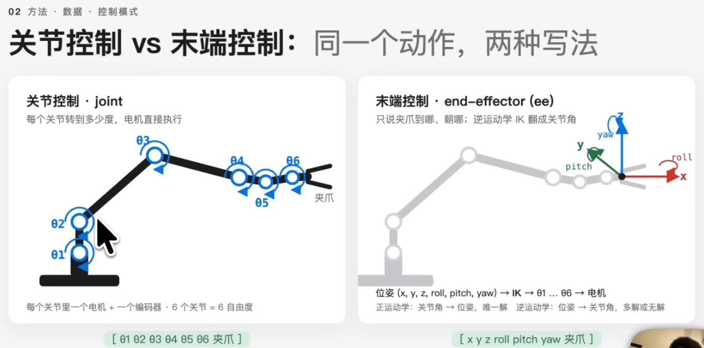

# 目录  
1.概述  

# 1.概述  
**目录:**  
1.1 VLA入门  
1.2 π0.5  
1.3 π0.6  
1.4 π0.7  
1.5 世界模型  

## 1.1 VLA入门  
1.什么是VLA  
VLA=Vision Language Action  
输入就是vision相机拍摄到的画面,Language就是输入给模型的指令(比如告诉机械臂把衬衫叠起来),action就是当前机器人每个关节的状态,将这三点作为机器人的输入  
输出就是该机器人的动作,这个动作是一串数字代表接下来机器人的每个关节应该运动到哪些角度  
完成该动作之后,相机再拍摄一帧重复上述循环,以此就可以使用VLA模型来控制整个机械臂  

2.机械臂上有什么  
本节例子以UR5e单臂机械臂为例,它有6个自由度即有6个能独立转动的关节,每个关节有电机和编码器,编码器可以读取当前传感器的位置,再将信息传送给后端大模型
|    名词     |            含义            |      数值形态       |
|:-----------:|:--------------------------:|:-------------------:|
|  自由度DoF  | 能独立转动的关节数,单臂6-7 |       6个角度       |
| 夹爪gripper |        末端两指开合        |    1个数,0-1之间    |
|  本体状态   |     关节编码器实际读数     |    qt,关节角向量    |
|    动作     |    发给控制器的目标位置    |     at,与qt同维     |
|  控制频率   |      每秒发多少条动作      | 50HZ,每20ms一个动作 |
|  固定相机   |       装在底座或支架       |                     |

3.模型每一步拿到什么  
首先拿到双臂的RGB图像,一共拿到三张(左右手腕各一个+最上面的相机一个),还需要拿到模型的本体状态,模型需要知道当前各个关节处于什么位置,一般是一个18维的向量,包含左臂和右臂各6个向量,左右夹爪各一个向量,加上底盘和躯干的4个向量  
一般就用这18维向量来代表当前机械臂的状态,如果使用单臂机械臂只有6维的情况下后续的12维补0就可以了,π里规定最长就是18维  

4.训练数据的格式  
比如一个叠衣服的过程需要用30秒,如果是50HZ的机械臂一共就是1500帧,每一帧需要有三样输入(图像、文本指令、当前的状态)

5.π0  
π0是一个模型,由Physical Intelligence公司发布(推荐看π0的论文),π0分析了当前VLA存在的三个问题①训练规模不够②架构不对(之前VLA的大模型还是LLM,输出非常慢最高只能到6HZ)③配方不对  
π0的一个训练样本就是一个时间步,一帧后接50个动作;π0自采了9.03亿个时间步、一共一万多个小时、7种构型、68类任务  
*解释:一般训练机器人的数据从何而来?来自人类的遥测数据,就是人类通过遥控器控制机械臂完成任务时产生的数据,动作就是人类命令,状态就是机器人的反馈*

6.π0架构  
Google开源的3B视觉语言模型伽马1->图像编码使用SigLIP是一个4亿参数的图像编码器->将三个图像混合文本一起送到伽马里面->最大的区别就是加了action expert,action expert只有3B的参数,它是一个扩散模型的扩散头,以前的范式更像LLM按TOKEN输出,而action expert是以flow matching为基础的以扩散模型为基础的,一次性完成50个动作  
所以action expert可以理解为以LLM为基础同时接入了一个扩散模型头,然后一次性输出50步动作的新架构  

7.π0训练配方  
之前的训练都是一步,而π0借鉴了LLM的训练方式,即先预训练再后训练  
预训练的时候就把刚才讲到的9.03亿个时间步全都喂给它,目的就是尽可能覆盖更多的任务、更多的场景、更多的机器人等,包括这些数据其实并不是很干净  
后训练的任务就是筛选出一部分高质量的数据,专门进行模型的微调,目的就是让做这个任务的时候更加流畅、更加一致  

## 1.2 π0.5  
1.π0的问题  
π0的所有测评和训练数据全身在相同的环境里做的,并没有验证泛化性,而且π0的动作都是原子动作(简单的动作)  
π0.5简单来说,就是给机器人一条指令,让机器人在一个完全没见过的家里或者环境里,就可以自动把房屋收拾干净,一次任务的时长也扩展到了10-15分钟  

2.π0-FAST  
将机器人的动作生成回到离散化(即按TOKEN方式输出),因为action expert以flow matching的生成方式其实是有一定问题的,比如训练速度会很慢、指令更随性并不太好  
π0-FAST还是按照TOKEN的方式去输出,但是它希望比以前生成地更快更好  
之前RT two和OpenVLA的方式是,它把动作变成token的方式,每有一个时间步,然后每一个维度把连续的数值变成256个桶,然后数值落在哪个桶就是哪个TOKEN  
假设一个关节从1秒内从0.1平滑地转到0.3,一秒50HZ则一秒就是50步,那么每一步就变0.004,也就是说每个TOKEN之间的数值变化太小了,有很多大量相邻的TOKEN其实是没有变化的  
所以FAST的解决思路,它换了一个TOKEN代表的东西,即做频率的切分,它对一整段的50步,首先做了一步DCT,把时域的50个数换成频率的50个系数,将动作按从低频到高频排列一下,步骤如下  
①归一化:把每个动作映射到-1到1之间,这样不同的机器人、不同量纲的动作可以在同一个尺度上
②DCT变化:即离散余弦变化,将时域变成频域
③量化:乘一步一个缩放系数伽马之后再取整,这样绝大多数高频取整以后就变成0了,整个系数矩阵就会变得比较稀疏
*附加:π还发现对于机器人运动而言,低频是更加重要的,而高频的抖动往往是一些机械噪声*
④展平:展成一整串整数,顺序就是低频在前、中低频在中间、高频在最后
⑤BPE:即语言模型分词用的byte pair encoding,因为这些数字有大量的0、和反复出现的组合等,BPE就可以把它们合并成词表里的token,规定词表大小为1024  

整个流程只有2个超参数,即伽马和词表  

**结果和代价**  
如果把动作头换成自回归+fast,那么20HZ的收桌子和50HZ的叠短袖这两个任务,用原来的分桶法训练出来的策略成功率接近0,而fast训练出的成功率大概65%-85%,而且只需要更少的显卡  
代价就是π0-FAST的推理更慢,因为它依旧是按TOKEN输出

3.π0.5  
*提示:如今π0和π0-FAST的优缺点已经很明显了,π0的action expert的flow方式,推理很快一步可以出50个动作且动作更加细致,但训练特别慢且指令跟随度不好,π0-FAST训练快、听指令、推理速度慢*  
π0.5的创新就是把两者结合,预训练大规模数据的时候使用离散的FAST模式,后训练的时候再接flow expert用少量数据精调  

3.1 数据来源  
π0的训练数据只有一类,即动作的遥测数据;而π0.5的训练数据类型上增加到了5类,这五类能一起训练是因为他们被写成了同一种序列格式(也称TOKEN化)  
(1)MM-使用移动机器人在真实家庭里做家务的数据,这种数据比较贵所以只占2.4%
(2)ME-单臂/双臂的固定机械臂,在更多的家庭里采集数据,代价就是能做的事情会少一些
(3)CE-实验室里的跨本体数据,类似π0的遥测数据但扩展了OXE等
(4)HL-高层标注,给前三种数据的多阶段任务都细粒度标注了子任务文本
(5)WD-网页数据,包含了大量的图片描述、视觉问答、物体检测,用的是公开数据集,数据集没有机器人的动作,主要用于提升预训练的泛化性
(6)VI-用语言遥操,在已经训练好的底层策略控制机器人,人不碰遥操的手柄,只是根据场景实时下达子任务,这批数据占MM高层样本的11%  

3.2 π0.5架构  
一共分为两个阶段,预训练和后训练  
(1)预训练有28万步,这一阶段的所有输出都是token,不管是文本还是动作全部用token,动作也使用π0-FAST的方式离散地变成token来预测;这里的训练就是普通的VLM  
(2)后训练有8万步,这个时候会把action expert随机初始化接上来

4.π0.5总结  
(1)数据上,相较于π0新增了5类更加细粒度的标注,是的机器人可以识别更多的陌生物体,进步一提升模型的泛化性  
(2)架构上,模型本身没有变化还是使用的伽马、action expert等模型,但是它的输入与输出方式变了  
首先输出包含文本,也增加了离散状态的输出类似π0-FAST  
(3)训练范式上,同样也是预训练和后训练  
但是在预训练的时候不加action expert,只是按TOKEN的方式进行训练,这样预训练的速度更快、更随性更好  
在后训练的时候使用高质量数据再去反推aciotn expert,从而保证输出的时候输出的速度更快且更加精确  

## 1.3 π0.6  
1.π0.6能做什么  
论文的结果是,一台机器人连续13个小时不间断地做浓缩咖啡,去一个从未见过的家里折叠从未见过的衣服,可以进入工厂,相较于π0.5失败率减少了一半,而通过强化学习就可以让其有自主恢复能力  

2.π0.5的问题  
由于π0和π0.5都是模仿学习,所以注定它的上限顶多和人一样,无法超越操作员,所以就需要把原来模仿学习的范式转换到强化学习的范式  

3.RECAP  
π0.6主推的方法就是RECAP,分成三步循环,用循环的方式训练  
(1)采集数据:把当前的策略部署到真机上跑任务,给每一个片段标记成功或失败  
(2)使用这些数据训练价值函数,需要自已训练出相应的价值函数给机器人做决策  
(3)使用价值函数来训练主要的策略函数VLA

3.1 步骤1奖励的定义  
* 是最后一步且成功则奖励rt=0
* 是最后一步且失败则奖励rt=-Cfail(一个很大的负数)
* 其余的每一步rt=-1

*解释:假设让机器人做一杯咖啡,一杯成功的咖啡可能需要120s,有120\*50HZ=6000个步骤,那么这次任务的回报就是-6000,另外一杯咖啡90s就失败了,在离结束还剩500步的时候如果还没有-Cfail它的回报就是-500,比成功的那杯起点要高得多,那么价值函数就分不清是快要成功还是快要报废了,所以假设-C取很大的数为-10W,那么这杯失败的咖啡的价值就是-10W-500,那么这条失败的片段奖励就会很低*  

3.2 步骤2价值函数怎么训练  
其本质就是一个倒计时器,训练数据就是把成功的录像倒着数帧  
比如一条32秒的折叠衣服的视频50HZ一共1600帧,第0帧的时候还剩下1600帧,所以标签就是-1600到第800帧的时候还剩下800帧,则标签就是-800
*就像训练导航,把过去每一单倒着记,每个路口标上"到送达实际还需要多少分钟",看多了就会看着路口猜ETA*  

3.3 步骤3的优势  
在第二步得到很好的价值之后,第三步是如何给单独一秒的动作打分(如何计算它的advantage)  
从第T步往前看N步,比如N=50往前看50步即1秒,于是优势=这50步实际拿到的奖励之和+五十步之后的那一帧的价值-当前这一帧的价值
*例子:假设在当前这一秒前价值函数表示还需要84秒(此时当前这里这一帧的价值就是-84,注意是倒着看的),过了这1秒相当于时钟走了1秒,那么这50步的奖励之和就是-1秒,然后当前的价值函数表示过了这1秒之后还需要80秒就可以完成,所以这一步就是五十步之后那一帧的价值就是-80,所以这个例子的advantage就是-1-80+84=3,也就是说在这1秒里机器人比价值函数预期地多推进了3秒,做的比平均好所以这一步就是优势步advantage*  

3.4 步骤3的二值化
在算出上述的优势之后,论文做了一个二值化;定义一个阈值,如果大于这个阈值才算是positive(积极的)否则就是negative(消极的)  
在预训练阶段只有达到示范数据的前30%才算positive,而在微调阶段放宽达到前40%才算positive  

3.5 步骤4一条训练样本长什么样  
现在已经有了每一帧的优势,该怎么让这个策略变好  
现在和之前的区别主要是,将上一步算出的优势advantage作为标签TOKEN输入到图像里,所以标签作为输入的一部分,而同一个episode相邻几帧的标签可能是不一样的,比如在1000帧的时候优势可能还是+3,但是到了1500帧的时候可能做错了这个时候就变成negative了  
所有的标签都会在训练数据里加入到训练数据的TOKEN里面,显示地进行训练,由于机器人的数据非常贵,所以π0.6会将好数据和坏数据都使用(传统会直接丢弃坏数据),只是给它输入的时候加上不同的标签,仅在输入时加上不同的标签,如果是好的就标注advantage positive如果是坏的也加入训练只是给它标注negative标签  
这样模型就见过优势帧和劣势帧分别是什么,有利于模型进行错误反馈  

## 1.4 π0.7  
1.介绍  
π0.7基本代表了当前VLA的最强模型  
(1) π0.7可以做到开箱即用完成一些复杂的灵巧任务,π0.6虽然也可以做到这些,但是π0.6需要在某项任务上微调RL模型,做一个专家型的模型,而π0.7是通用模型
(2) π0.7可以做到指令的泛化,比如实时根据输入的指令完成动作任务,所以它的指令跟随性更好  
(3) 实现跨机器人本体,比如一个双臂机器人在使用π0.7模型后可以在0样本的情况下完成任务,而且实际效果和专家遥操员第一次操作机器人的效果相当  
(4) 组合式泛化能力,用没见过的方式把已有的技能组合起来,简单说就是一个从未经历过的任务可以通过海量的训练数据,机器人可以把原子指令组合起来,从而实现这个任务

2.MEM  
MEM多尺度具身记忆,他解决的问题就是给VLA加上记忆,之前在π0.5或π0.6没有记忆,它的输入只是当前这一帧的画面,比如让它煮三碗面,就无法做到之前已经做过一碗的任务,所以就不利于模型在现实生活中的泛化  
MEM将VLA的记忆分为短期记忆和长期记忆  
短期记忆是稠密的、最近几秒的图像,用来处理遮挡、移动、换一种抓取方法,这种短期记忆需要大量的图像  
长期记忆是语义的,比如这碗面已经放过盐了,这种信息量可能只有几个bit,但是却需要维持几十分钟,这种长期记忆把所有的历史帧都塞进上下文并不现实,所以MEM的做法是分为两级  

短期记忆放在底层,用一个改造的视觉编码器把最近几秒的画面压缩进当前帧的表示,长期记忆放在高层,高层的策略包含每一步输出的下一个子任务和输出一段更新过的语言摘要(比如已经放过盐了等类似的指令)  

3.π0.7解决的问题  
大语言模型有一种组合泛化的能力,即大语言模型不仅是记住了训练数据而且还能把没见过的能力用新的方式组合起来,也就是所谓的涌现  
VLA目前为止还不具备涌现,即当前的VLA模型不但做不了新任务,甚至连训练过的任务可能还需要再做一次专属的微调才能够流畅执行,为了让其出现涌现,现在采取LLM的训练方式,用更多的数据、不同机器人的数据、不同的策略、失败数据一起训练模型  
但由于数据质量、做法不同等问题,如果直接混合在一起做训练的话,模型很可能学习到不同模式的平均值,所以就需要对数据做更细粒度的标注  

4.π0.7的数据构成  
* 机器人数据
  * 示范数据,来自实验室、仿真家庭、真实家庭,包含静态、移动、单臂、双臂等多平台的数据
  * 自主数据也就是模型自已跑出的大量的策略评价时留下的数据,包含很多的失败数据、人类中途接管的数据
* 非机器人数据
  * 人类的第一视角视频
  * 网页上的数据,比如属性预测、视觉问答

π0.7的训练数据与之前不同的点在于,其使用了大量的次优的机器人数据,也就是把π0.6在强化学习阶段训练的数据加入进来,相当于让π0.7蒸馏π0.6时期强化学习的专家数据,且次优数据让每个任务的状态更加多样,让它的鲁棒性更强  

4.1 一条数据的构成  
* 当前相机观测的数据
* 子图,子图是世界模型的输出,相当于预测机器人执行完任务之后的场景(这一帧完成之后世界应该长成什么样子)
* 子任务的指令,也就是把任务切成一个个片段,每段再有人工写一句非常详细的标注
* 元数据标注,这个数据的目的就是让低质量数据发挥作用,因为π0.7有很多失败的数据,为了能够更好的利用数据,就得告诉模型当前这条数据的质量到底如何
  * 整体速度,一个片段一共用了多少时间步
  * 整体的质量,从1-5由人工打分
  * 有没有失误
  * 控制模式,关节控制还是末端控制,之所以标注出来就是因为数据多了,两种混着学不得劲

4.2 关节控制  
关节控制和末端控制都是表示机器人接下来该怎么动,只不过表现形式不同  

关节控制中例如左边的这条机械臂,一共有6个自由度即有6个能够独立转动的关节,每个关节有一个电机和编码器,在关节控制模式下模型的输出动作就是这6个各自该转动多少度,也就是途中下面的6个数字,最多加一个夹爪的开合动作  

4.3 末端控制  
末端控制中模型的输出是这个夹爪应该运动到空间中的哪个位置,并且是朝着哪个方向即它只控制机械臂的末端,并不关注机械臂的关节是如何运动的,它的动作就是xyz坐标+roll、pitch、yaw表示朝向  

5.1 训练  
训练部分和之前差不多,也是flow matching、TOKEN输出等,但它会在训练的时候随机把上下文的某个成分去掉,原因有两点 
(1) 这样做保证了灵活性,因为每一样数据都随机丢过在测试的时候假如某个模态没有了它也能正常地完成
(2) 数据添加了世界模型的目标子图之后,模型的训练速度快了很多,原因是因为有了未来的画面,模型预测动作这件事就退化成了逆动力学,即根据画面反推出关节角,此时模型就会偷懒只去学世界模型的动作,就会退化到了纯世界模型,所以在训练的时候,数据只有25%带目标子图、30%的文本随机删掉、元数据会整体丢弃15%、其它3个分量会再随机丢弃5%、控制模式不变

## 1.5 世界模型  
**目录:**  
1.5.1 

